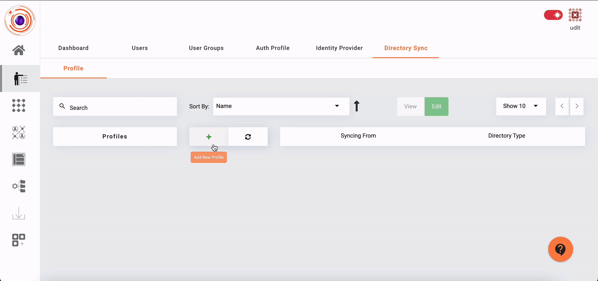

## Importing Users from Azure AD

InstaSafe ZTNA allows users to be synced directly from Azure AD. 

**To sync users from Azure AD to InstaSafe ZTNA the admins need to login to AzureAD via the console**

1. Log in as an admin in InstaSafe ZTNA and go to Directory Sync Profile under Identity management. 

2. Click on the 'Add New Profile' (+) button and select Azure AD .

3. Log into Azure via an admin account

4. Set Default Password for all users.

5. Click on Sync button to import users.

The steps to import users from an Azure Active Directory is illustrated in the video below.

  
 

