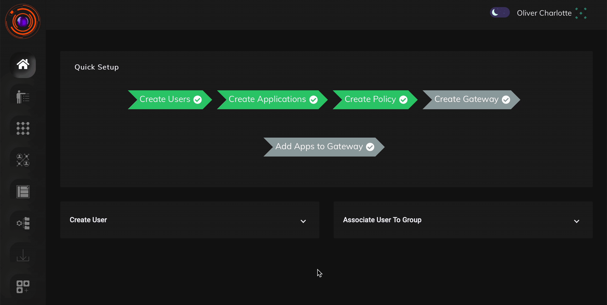

VPN Profile serves as a starting point in  VPN Gateway configuration.This is used for  allocating network for VPN infrastructure.
The admin can configure a range of private IP so as to avoid any conflict with existing network ranges.

* There can be only one VPN profile per company. 

* The admin must ensure that IP group defined in VPN profile must be different from IP used in Intranet.

* Reserve IPs are sets of IP’s kept separate for  Gateways only.First X Ips are reserved and Allocated to user status from after the reserved IP end.

* Static IP is allocated from the network series created by Admin .Each  IP is associated with a User and particular device.

```
**P.S InstaSafe ZTNA VPN component only works on NAT and hence the gateway needs to be installed in DMZ.**
```

## Steps to Configure VPN profile 

The steps given below demonstrate how  VPN profile can be configured.   

1. Login as Admin

2. Go to Configuration.

3. Admin can enter a subnet and IP addresses will be allocated  .Subnet will be  in CIDR notation

This can also be seen in the video given below.


