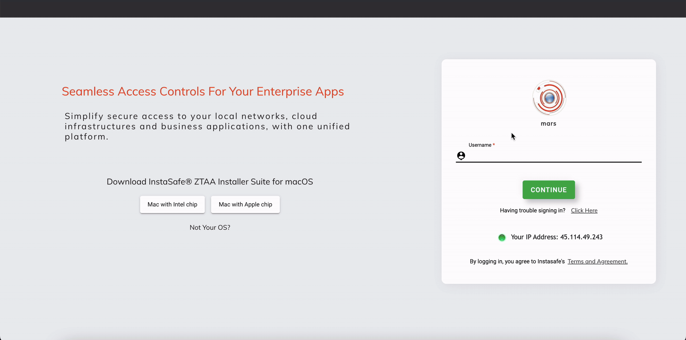

## Configuring as a Service Provider with SAML

InstaSafe ZTNA can act as both, an Identity provider as well as a service provider i.e., be integrated with other identity provider such as Azure AD. This article shows how InstaSafe ZTNA can be configured to be used as an service provider for Azure AD i.e. how can a user log into InstaSafe ZTNA with Azure AD as a SSO.

## Logging into InstaSafe ZTNA via Azure sso

| **Basic SAML Configuration setting** | **SP Initiated** | **IdP-Initiated** | **Description** | 
| ------ | ------ |------ | ------ |
| **Identifier (Entity ID)** | Required for some apps | Required for some apps | This field will Uniquely identify InstaSafe ZTNA application. Azure AD sends the identifier to the application as the Audience parameter of the SAML token. The application is expected to validate it. This value also appears as the **Entity ID** in InstaSafe ZTNA provided by the application.| 
| **ACS URL (Reply URL/Redirection URL)** | Required | Required | ACS or Assertion Consumer Service URL specifies where the application expects to receive the SAML token.| 
| **Sign-on URL** | Required | Need not be specified | When a user opens this URL, the service provider redirects to Azure AD to authenticate and sign on the user. Azure AD uses the URL to start the application from Microsoft 365 or Azure AD My Apps. When blank, Azure AD does an IdP-initiated sign-on when a user launches the application from Microsoft 365, Azure AD My Apps, or the Azure AD SSO URL.|

Azure AD can be configured as a SSO for InstaSafe ZTNA by following the given Steps. 

### Configurations in Azure AD

1. Add InstaSafe ZTNA as an enterprise application Application.

1. Select Create your own Application and enter InstaSafe ZTNA and go to Manage and Properties.Save the access URL

1. Enable Users for Sign in. Select users to add from **Users and Group** option.

1. Go to Single sign on .Go to SAML configuration and execute the following configurations 

1. Select **Basic SAML.** 

1. Define Entity ID. The value can be any string. Here a sample url is used as value.  

1. The reply (ACS) URL to be copied from the console and pasted here. \* 

1. The URL for InstaSafe ZTNA application login page has to be added **Sign-on URL**  field.

1. Next Go to ** User Attributes and Claim.**

Please ensure that the value of required claim is set to email (user.mail).

Else change the source attribute. 

1. Next go to **SAML signing certificate.**

1. Visit the link provided in **App federation metadata** URL. Obtain the entity ID from the first line of the page. The same will be required during configuring.

1. Download the certificate(base64). Open in notepad. This data will be required to be pasted into the console\*\*#\*\*.

### Configuration Steps in InstaSafe ZTNA

1. Go to **Auth Profile** under Identity section of the **console.**

1. Select **User** for adding profile for individual user or **Group** for adding profile for a group.

1. Click on add new profile and add the User/group for which you want to create Auth profile.
2. Select SAML as the primary Authentication mode. Fill the required  data 

**Service Provider Side configurations**

1. Redirection URL is to be copied and pasted in ACS(Reply) URL field in Basic SAML configuration as mentioned above.
2. The SP entity ID can be any string; however, it has to match the corresponding field in IDP portal. In case of Azure AD, the field is not required.
3. The value for **“Requested Authentication Context Comparison”** has to be changed to “**Exact”** from the drop down.
4. The certificate can be any encryption certificate generated by keygen/Putty or the content of the certificate downloaded above can be pasted.

**Identity Provider Side Configuration**

1. Enter the IDP entity ID. This will be the value obtained from the **App federation metadata** URL\*\*\*\*\*.
2. The IDP login id will be obtained from the Azure AD console i.e., the **Login URL** provided in the Setup application section of console.

1. The validating signature will contain the content of certificate downloaded above\*\*#\*\*.
2. Once the above field are set, Click on next. Set up 2FA if required.
3. Click next and **submit** once configuration is completed.

### Verification

1. Once setup is complete, open the InstaSafe ZTNA URL and enter the username for the user for whom the IDP is set. Click on SAML login.

1. The Portal will be redirected to Microsoft login.

1. On Successful verification of SSO credentials the user will be successfully logged in.

**Please note** It is advisable to keep username same as email so as to minimise chances of error during configuration.

The method to set up InstaSafe ZTNA as a service provider with Azure Ad can also be seen in the video given below.

