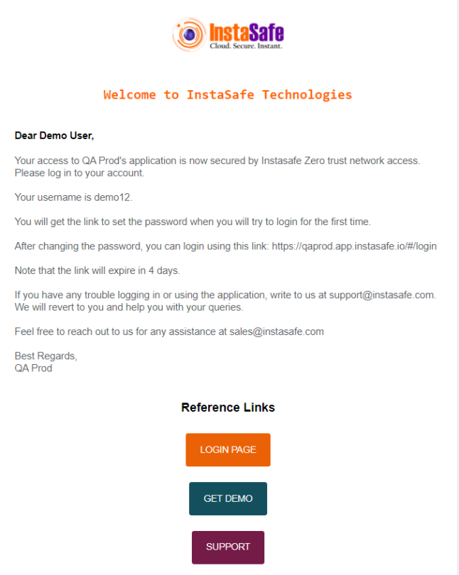
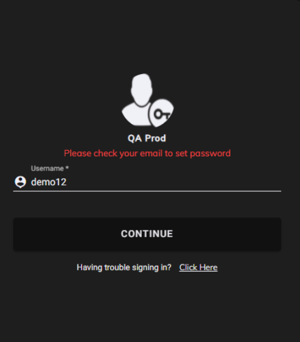
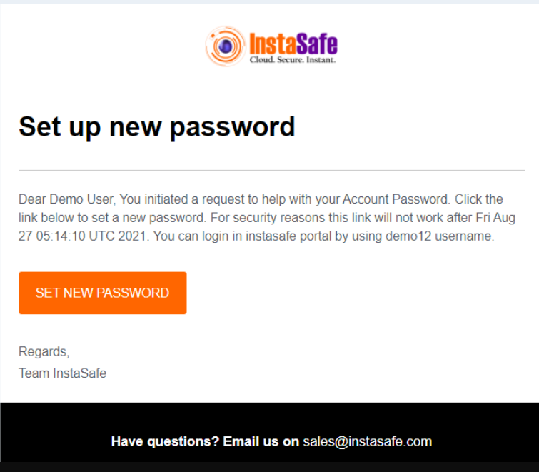
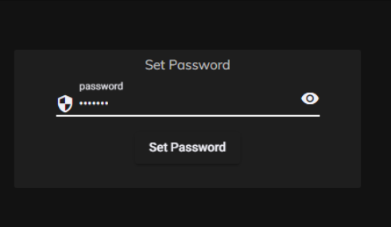
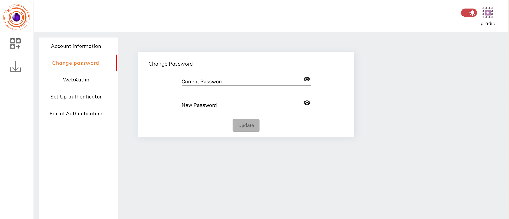

Once the profile for an user is created by the admin, the user has to set the password himself. The folowing steps will help the user set up a profile password.

1. On Provisioning an user will receive a mail providing him with details of user name and URl for login. 

2. The User can visit the **login page** and enter the ** user-name** mentioned in the mail.

3. When the user is logging for the first time  password a mail for setting the password will be sent to his mail.

 

4. The user can set a new password using the link.

5. For subsequent login the user can directly login using the User Name and password set.

**Change Password**

Users can change their password once they login into the the console or agent.

Steps to change the password:

1. User needs to clicks on the Profile icon in the top right corner of the the console or agent.
2. User needs to click on the 'My Profile' option.
3. User needs to click on the 'Change Password' option in the left menu bar if they have logged into the the console. If the user has logged into the agent then the option to be selected is "Password".
4. User needs to give their current password and new password.
5. After providing the above details, user needs to click on the 'Update' button.
6. User session will be invalidated and user will be logged out of either the the console or agent respectively from wherever they have tried to update their password.
7. User needs to relogin to the the console or agent with the new password.

**User Enrollment & Provisioning**

The InstaSafe MFA service simplifies the onboarding process for administrators by providing flexible options to enroll and provision users securely. Admins can trigger enrollment flows directly from the management console, ensuring quick user activation while maintaining a strong security posture.

**Supported Enrollment Methods:**

**Email-Based Enrollment** – A secure enrollment link is sent to the user’s registered email address, guiding them through step-by-step activation of the InstaSafe Authenticator or other supported methods.

**SMS-Based Enrollment** – A one-time link is delivered via SMS to the user’s verified mobile number, enabling frictionless enrollment and device binding.
