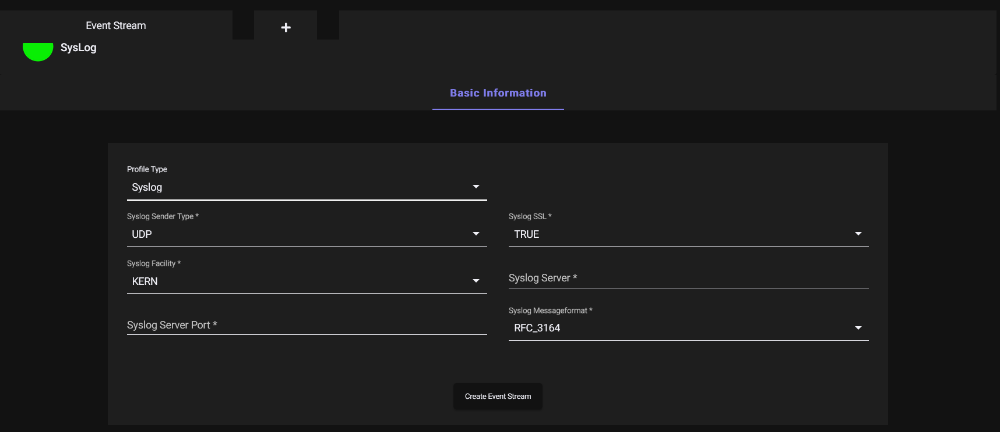
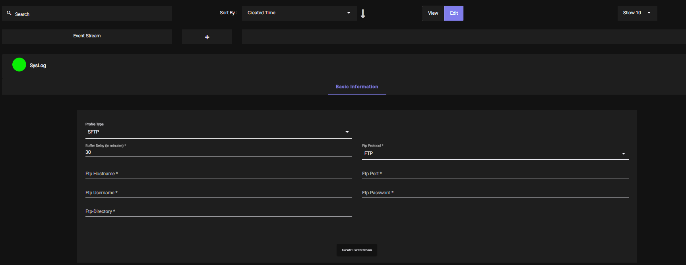

ZTAA supports integration with external SIEM products. This feature is exclusively used for streaming/sharing system events to customer for their SIEM integration/Analysis.

Event streaming is for sending system events to an external system. Email alerts to
administrators are configured separately, on risk profiles, and reports can be emailed on a
schedule through report subscriptions - both are covered in
[Email Alerts and Scheduled Reports](email-alerts.md).

## Creating Event Stream Profile

The administrator can configure how they should receive ZTAA system events in their infrastructure from **Event Stream Profile**  tab in configuration section of the dashboard.

1. The admin can fill the details of the configuraton in the UI.  

2. Event can be streamed in two format i.e. Syslog and FTP/SFTP.

**For Configuration in Syslog format.**

```
 Syslog Server Type- UDP/TCP
 Syslog SSL Enabled- True/False
 Syslog Facility (KERN/USER/MAIL/DEAMON/AUTH/SYSLOG/LPR/NEWS/CRON/
 UUCP/AUTHPRIV/FTP/NTP/AUDIT/ALERT/CLOCK). 
 This data can be obtained from syslog server documentation.
 Syslog Server (ip/dns name)
 Syslog Server Port
 Syslog Message Format (RFC_3164/RFC_5424/RFC_5425)

```



**For Configuration in FTP/SFTP format**

```
Buffer Delay (how many minutes system events needs to buffered in ESS client and uploaded to FTP/FTPS/SFTP server)
FTP Hostname
FTP Port
FTP Username
FTP Password
FTP Directory
Protocol (FTP/FTPS/SFTP)
```


3. Once the given data is configured click on **Create Event Stream Button** and the Event stream profile will be created.
