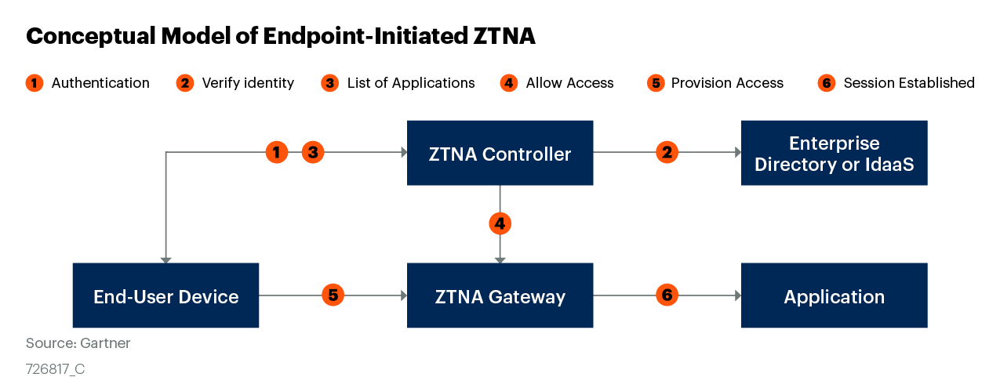
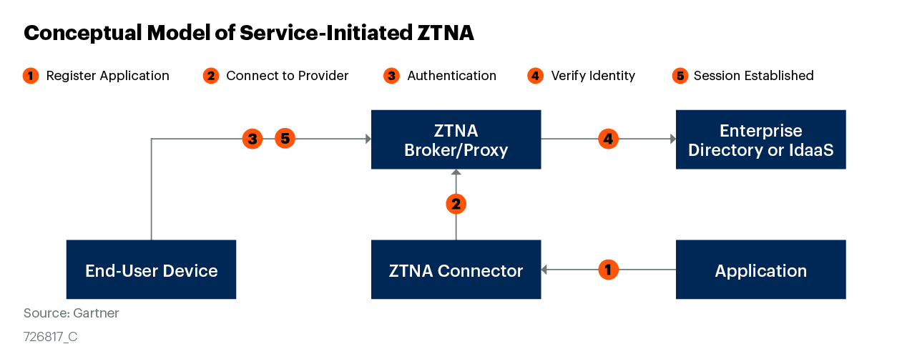

Zero Trust Models
-----------------

Keeping in mind about the above principles of Zero Trust, Companies have orchestrated Zero Trust into their IT infrastructure primarly in two different ways.

### Client Initiated Zero Trust Access

This model uses the Software Defined Perimeter as proposed by the Cloud Security Alliance as its inspiration. This model includes the use of an “Agent” which resides on the client’s machines and connects the client to the required resource after performing necessary security checks and validations defined by the company operating the Zero Trust Network. Such a model can be used to access company resources in private networks and cloud hosted services securely from anywhere in the world. Examples of client-initiated solutions are InstaSafe’s Zero Trust Application Access (InstaSafe ZTNA) and Zero Trust Network Access (ZTNA). 

### Service Initiated Zero Trust Access

This model implements Zero Trust using a reverse proxy architecture. It is based on Google’s Zero Trust Implementation called BeyondCorp. It uses the browser to validate the user and establish a tunnel between the client and server eliminating the need for an agent to be installed and maintained on enterprise devices. However, The access is limited to cloud hosted services as it only supports protocols like HTTP/HTTPs due to its reliance on the browser and has limited support for other protocols. Examples of client-initiated solutions are Google’s BeyondCorp InstaSafe’s Agentless Gateway 
