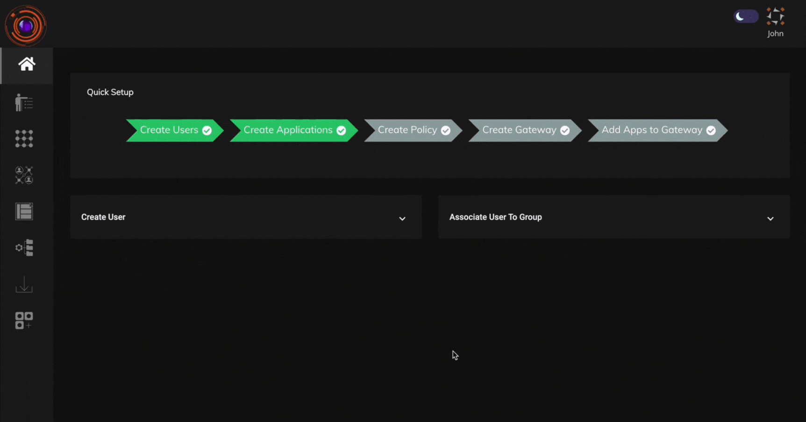

When an application is accessed over InstaSafe ZTNA, traffic is routed via the InstaSafe Gateways. Users in the intranet when they try to access the applications over InstaSafe ZTNA then their traffic is routed via the internet and then through the InstaSafe Gateways, when it could be routed locally. 

This resulted in an use case wherein users should be able to access the applications directly when in the intranet instead of their traffic getting routed through the InstaSafe ZTNA gateways.It would save internet bandwidth and reduce an unnecessary hop.

To implement this use case, there are two configurations which needs to be done:

1. Create an Intranet Profile in the Configuration section and assign the intranet IP range to the Intranet Profile.

2. Enable the "Direct Access" toggle in the respective application.

### Creating an Intranet Profile

1. To create an Intranet Profile, go to Configuration section of the console and click on Intranet Profile.

2. Click on the "+" icon to create a new Intranet Profile. Give a name for the profile and select an IP address dataset which specifies the IP range of the intranet.

### For WEB Application:

### For Direct Access 
When 'Direct Access' is enabled and if the user’s clientIP is in the range, which is found under Intranet Profile, then agent won't be creating a tunnel, so the traffic will be systems default.

When 'Direct Access' is `enabled` and if user’s clientIP is not in the range, which is found under Intranet Profile, then agent will establish tunnel for the application.

### For Force Tunnel 
When 'Force Tunnel' is enabled and if the user’s clientIP is in the range, which is found under Intranet Profile, then agent will establish tunnel for the application, but stunnels config's endpoint will be using gateways privateIP instead of publicIP.

When 'Force Tunnel' is enabled and if user’s clientIP is not in range, which is found under Intranet Profile, then agent will establish tunnel with gateways publicIP as usual (Old flow)

### For Network Application:

### For Direct Access
When 'Direct Access' is enabled and if the user's clientIP is in the range, which is found under Intranet Profile, then the agent will not add those applications IPs under AllowedIPs of wireguard configuration.

When 'Direct Access' is enabled and if the user's clientIP is not in the range, which is found under Intranet Profile, then the agent will establish the tunnel with gateways publicIP.

### For Force Tunnel
When 'Force Tunnel' is enabled and if the user’s clientIP is in the range, which is found under Intranet Profile, then the agent will use gateway’s privateIP as endpoint under wireguard configuration. 
Note: Even if one application has forceTunnel enabled then all the applications under that gateway will go through privateIP, direct application will be ignored.

When 'Force Tunnel' is enabled and if the user’s clientIP is not in the range, which is found under Intranet Profile, then the agent will estable the tunnel with gateway’s publicIP.

