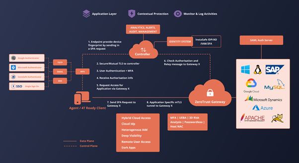
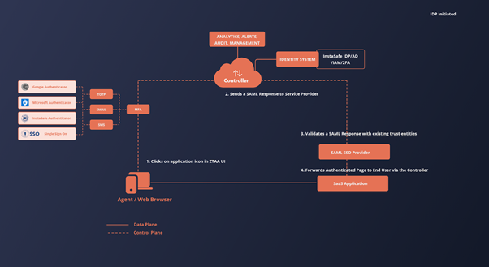
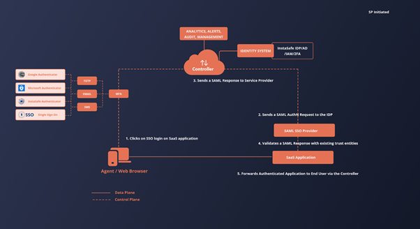

Architecture
------------

## Zero Trust Application Access - Share the Application in DMZ

### Overview

The architecture is based on the Client-Gateway model as detailed in the CSA architecture guide for SDP .

### Components
The primary components of the InstaSafe ZTNA include the Client,  Controller,  Gateway and the IT resources of the organisation. 

Clients are devices that are in the hands of users who wish to access resources that are secured by  ZTA. Laptops, Desktops, Mobile phones are examples of such clients. However, the ZTA Agent has to be installed on these devices to be able to communicate and interact with the Zero Trust Network . The client is configured to drop all connections to the SDP in the case that any of  InstaSafe ZTNA’s access policies are violated or the standards are not met. 
Note: Client less access the resources can be powered by a browser based access, but with less scope and lesser secure posture validations

Controllers are the decision making components in InstaSafe ZTNA . They are connected to Identity providers  to gather information about the users trying to access the network. It has a inbuilt IdP for user and group management. the Controller also supports Active directory, Azure AD and SAML Assertions for application and network access. The client sends vital information about the user’s device to the controller which helps the controller in granting entitlements i.e the level of access to the clients. In the context of the CSA SDP model, this component is the Policy Decision Point (PDP).

Gateways are the components which enforce the policies and entitlements set by the controllers. They verify the client's entitlements to grant them access to the resources only in the client’s context. In the context of the CSA SDP or NIZT ZT model, this component is the Policy Enforcement Point (PEP)

Resources are the infrastructure that are secured by ZTA.

<<<<<<< HEAD
=======

>>>>>>> f5b164a35554e56ec5892896123737aa654c818f

The client connects to the desired resource as graphically depicted in the above figure.

The client sends a Single Packet Authentication (SPA) packet containing its device and user fingerprint to the controller. The controller will validate that SPA packet. On successful validation, a dynamic port rule is opened such that the client’s ip can connect to the controller but no response is sent to the client.
The client then connects to the controller via a secure control channel separate from the data channel used to transmit application data. 
The client provides the controller with data about the device’s various security measures as defined in the controller’s trust policy. The controller uses an identity provider to authenticate the user’s credentials. Additionally, Multi-Factor-Authentication is also used to verify the user’s authenticity.
Based on the information gathered on the user and user’s device, the controller issues a dynamic entitlement token which is cryptographically signed by itself to the client. The entitlement is dynamic because the user is not guaranteed the same entitlements on each access if the client or the device does not meet certain policy rules. The entitlement is granted based on the data collected from the sources at the time of access, therefore is subject to change. Controller communicates with the ZTA Gateway about the user permission via Message Queue ( Amazon SQS or InstaSafe Message Queues).

After receiving the entitlement in the form of a certificate, the client then connects to the gateway by using another SPA mechanism and provides its certificate to access a particular resource. The gateway verifies whether the certificate was issued by the controller. The gateway then uses the entitlement to determine whether the requested resources are within the client’s context by communicating with the controller.
 
On successful validation of the client’s access request, a mTLS tunnel is established to the gateway. The data flows from the application server to the gateway on the local network and then is relayed to the client by the gateway through the TLS tunnel. The gateway dynamically creates access rules for the client to use the resources based on the messaged via the message queues.This is the first part of the process where the user is allowed into InstaSafe ZTNA’s network to access critical resources. The gateway logs and monitors all the traffic flowing in and out of the network. 

## Zero Trust Application Access - Third Party Applications through SAML

### Overview

The architecture is based on the interaction between a SAML Service Provider and SAML Identity Provider with the additional layers of security that come with using the Zero Trust Platform.

### Components
The primary components of the SAML based ZTNA access include a Client, a Controller, a Gateway and the resources. 

Clients are devices that are in the hands of users who wish to access resources which are secured by  InstaSafe ZTNA. Laptops, Desktops, Mobile phones are examples of such clients. An agent or the web browser can be used to access applications of this type

Controllers are the decision making components in InstaSafe ZTNA . They are connected to Identity providers to gather information about the users trying to access the network. The client sends vital information about the user’s device to the controller which helps the controller in granting entitlements i.e the level of access to the clients. The controller also houses an Identity Provider which can be used for logging into SaaS applications that support Single Sign On.

SaaS Application  is the third-party hosted application secured by the InstaSafe ZTNA architecture. It logs the user into the application after receiving an Identity assertion from the Identity Provider

SAML Service Provider (SP)  is a part of the SaaS application delivery  which sends an SAML AuthNRequest to the Identity Provider to authenticate a user.

It receives and validates the SAML Response sent by the Identity Provider. On successful validation, it redirects the user to the authenticated SaaS application.

SAML Identity Provider (IdP) is a component of Zero Trust Platform which provides authentication identities of users within the system to third party applications to enable Single Sign On into those applications.

### Authentication Flows

SAML Single Sign On (SAML SSO) has two authentication flows which allow developers to use the flow more suitable to their business requirements.

#### IdP Initiated ( Identity Provider Initiated)

This flow is initiated by the identity provider. Once the SP is preconfigured with all the data necessary to establish trust between the SP and IdP, the IdP sends a SAML Response to the SP with the authentication assertions of a users and the SP validates the response and forwards and authenticated application to the user on successful validation of the response.

In InstaSafe ZTNA, this flow is useful when providing the one-click interface to the user to access the third party applications. The flow inside InstaSafe ZTNA is as follows
User logins into the  the platform using the agent / web browser (user agent) and navigates to the Application Access screen. The user clicks on any of the third party applications.
Since the user is already authenticated by the the platform, the IdP sends a SAML Response to the Service Provider providing the assertions about the user to validate the user’s identity.
The Service Provider receives and validates the SAML Response sent by the IdP via the user agent.
On successful validation of the SAML Response, the Service Provider returns an authenticated session of the application to the user agent for the user to consume.

The visualization of the above flow can be seen in the following figure

#### SP Initiated ( Service Provider Initiated)

This flow is initiated by the Service Provider.  The SP is preconfigured with all the data necessary to establish trust between the SP and IdP. The Service Provider sends a AuthNRequest to the IdP requesting for identity assertions. The IdP sends a SAML Response to the SP with the authentication assertions of the users and the SP validates the response and forwards an authenticated application session to the user on successful validation of the response.

In InstaSafe ZTNA, this flow is useful when users try to log into a third party application by clicking on the login with the SSO option provided by the application. The flow is as follows.

The user is logged into the the platform. The user tries to login into a third party application using the SSO feature.
The application sends an AuthNRequest to the IdP requesting for assertions about the user’s identity.
Since the user is already authenticated by the the platform, the IdP sends a SAML Response to the Service Provider providing the assertions about the user to validate the user’s identity.
The Service Provider receives and validates the SAML Assertion sent by the IdP via the user agent.
On successful validation of the SAML Response, the Service Provider returns an authenticated session of the application to the user agent for the user to consume.

The visualization of the above flow can be seen in the following figure

