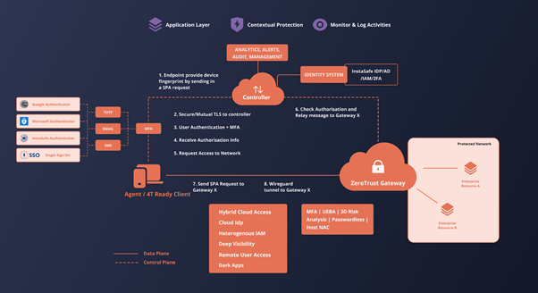

Zero Trust Network Access
-------------------------

### Overview
The architecture follows the Zero Trust ideology like InstaSafe ZTNA but unlike InstaSafe ZTNA, connects users to corporate networks or IP. The access can be leveraged for a set of IPs or can be bound to a IP and port.

### Components
The primary components of the ZTNA include a Client, a Controller, a Gateway and resources. 

Clients are devices that are in the hands of users who wish to access resources which are secured by  ZTNA. Laptops, Desktops, Mobile phones are examples of such clients. However, the InstaSafe Agent has to be installed on these devices to be able to communicate and interact with the Zero Trust Network . The client is configured to drop all connections to the SDP in the case that any of  ZTNA’s access policies are violated or the standards are not met. 

Controllers are the decision making components in ZTA . They are connected to Identity providers  to gather information about the users trying to access the network. It has a inbuilt IdP for user and group management. the Controller also supports Active directory, Azure AD and SAML Assertions for application and network access. The client sends vital information about the user’s device to the controller which helps the controller in granting entitlements i.e the level of access to the clients. In the context of the CSA SDP model, this component is the Policy Decision Point (PDP).

Gateways are the components which enforce the policies and entitlements set by the controllers. They verify the client's entitlements to grant them access to the resources only in the client’s context. In the context of the CSA SDP model, this component is the Policy Enforcement Point (PEP)

Resources are customer infrastructure elements that are secured by ZTNA.

                                           

The client connects to the corporate network as graphically depicted in the above figure

The client sends a Single Packet Authentication (SPA) packet containing its device and user fingerprint to the controller. The controller will validate that SPA packet. On successful validation, a dynamic port rule is opened such that the client’s ip can connect to the controller but no response is sent to the client.
The client then connects to the controller via a secure control channel separate from the data channel used to transmit application data. 
The client provides the controller with data about the device’s various security measures as defined in the controller’s trust policy. The controller uses an identity provider to authenticate the user’s credentials. Additionally, Multi-Factor-Authentication is also used to verify the user’s authenticity.

Based on the information gathered on the user and user’s device, the controller issues a dynamic entitlement token which is cryptographically signed by itself to the client. The entitlement is dynamic because the user is not guaranteed the same entitlements on each access if the client or the device does not meet certain policy rules. The entitlement is granted based on the data collected from the sources at the time of access, therefore is subject to change.
 After receiving the entitlement in the form of a certificate, the client then connects to the gateway by using another SPA mechanism and provides its certificate to access a particular resource. The gateway verifies whether the certificate was issued by the controller. The gateway then uses the entitlement to determine whether the requested resources are within the client’s context by communicating with the controller.
 
On successful validation of the client’s access request, a wireguard tunnel is established from the client to the gateway. The data flows from the applications to the gateway on the local network and then is relayed to the client by the gateway through the Wireguard tunnel. The gateway dynamically creates access rules for the client to use the resources. The wg0 interface created by the wireguard tunnel can be extensively configured by the means of iptables access rules to achieve microsegmentation of the network  and allow access to machines on the network on a need-to-know basis . The gateway logs and monitors all the traffic flowing in and out of the network.
