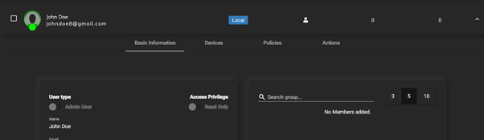
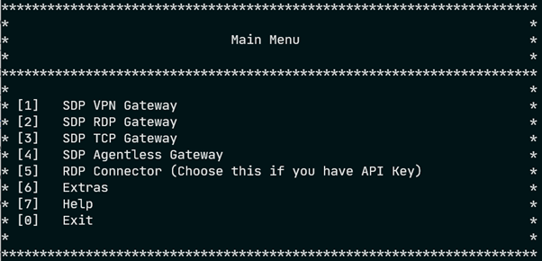
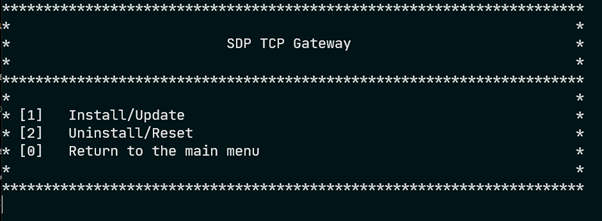
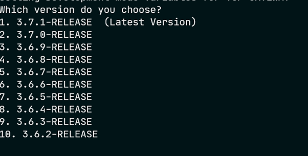
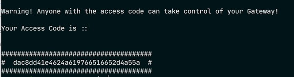

Installation Guide
------------------

### Zero Trust Application Access - With Applications in the DMZ

This guide details how to quickly set up a working InstaSafe ZTNA environment. The control access has to be configured at the controller level, where as the application has to be onboarded via the gateway.

### Controller Configurations

The following steps have to be performed by an admin user on the portal <companyname>.app.instasafe.io.

#### Create Users

To create users, Navigate to the Users tab under Identity Management.
 Click on the ‘+’ icon to add a new user. Details like the role of the user, contact details have to be provided on this screen. On successful addition of the user, you will be given a notification in green. 
You can verify the addition by refreshing the users page.

	
#### Create Applications

To add applications, navigate to the Applications tab under Perimeter Management.
Click on the ‘+’ icon to add a new application.Click on the application type required. Give the application an appropriate name and give its connection details like IP address (local) and Port. On successful addition of the application, you will be given a notification in green. 

	
#### Create Policies

To add policies, Navigate to Access Policies in menu bar on the left side
Click on the ‘+’ icon to add a new access policy. Give the policy an appropriate name and description and click on Next.
	
Click on the Add User button to add a user/users to the policy.
	
After adding user/users, Click on Next. 
	
This panel lets you add applications to the policy. This essentially means that all the users added to this policy will be able to access the applications that are added to this policy. Click on Add Application and add applications to the policy. And Click on next.

This panel allows the admin to configure specific rules and rulesets (a boolean combination of rules) that have to be met before being able to access the applications covered under this policy. Click on Next.

This panel allows you to configure OTP/Captcha access to the application in addition to the MFA during the initial login. Click on Next

This panel has the submit button to add this policy to the controller.On successful addition of the policy, you will be given a notification in green. 

#### Create a Gateway

The gateway is the relay point between the user and the application and point of access to all the applications secured by the InstaSafe ZTNA. Therefore, the security configuration of the gateway has to be impenetrable.

As an admin, Navigate to the Downloads page in the portal. Here you find the command to install the gateway on a linux machine
Prerequisites of the linux machine
	
A Linux machine which is publicly accessible has to be earmarked for the installation of the gateway software. This machine should be able to access all the applications that are to be accessed through the InstaSafe ZTNA network locally.
	
The machine should allow all inbound and outbound TCP traffic on port 443 publicly. It is strongly recommended that no ports other than 22 and 443 are opened publicly.
A user in the linux system with sudo privileges.
	
Once the prerequisites are met, SSH into the linux machine using the SSH client and authentication mechanism of your choice. The installation script uses the curl command to download the installation script. Therefore, make sure that curl is installed on the system by runnin the following command,
	
 For Ubuntu and Debian systems
 
> sudo apt install curl

 For  RHEL, CentOS and Fedora distros
> yum install curl

Once installed, we can run the gateway installation script. Before running the script, prepend the command in downloads with the keyword ‘sudo’. 

> sudo /bin/bash -c "$(curl -fSsL https://storage.googleapis.com/4tr/start.sh) --devmode" 2>&1 | tee -a installationlogs.txt 

After some processing, you will be presented with the following menu

Enter 3 and press Enter. The following menu will appear

Enter 1 and press Enter. The installation process will begin.The next prompt will ask you to select the version of the gateway.
	
 Select the desired version by entering its corresponding number on the prompt and press Enter.
The installation process will start. It will download and install all the required packages. Once the installation is done, you will be presented with an access code as shown below.

Copy the access code here and head to the portal. Navigate to the Gateways tab under Perimeter Management. Click on the ‘+’ to add a gateway. Select the option Private Gateway and click on Next.
	
On this panel, paste the access code that was generated by the gateway installation script and click on Next.Finalize the installation by clicking on Authorize.
	
On successful addition of the gateway, you will be given a notification in green. The access code expires after a minute after it has been generated. Therefore, it is essential that the last few steps be performed quickly.If the access code expires, follow all the steps until again step 8 where you are presented with an Install,Unistall screen. Uninstall the gateway and follow the gateway installation guide again to generate a new access code.

	
#### Add Applications to the Gateway

Now that the gateway has been added, the last part of the portal configuration
is to add the applications to the gateway.

Navigate to the Gateways tab under Perimeter Management. Click on the gateway that has just been installed. The names of the gateways are the same as the hostname of the linux box they are hosted on.
	
On clicking the gateway, it expands to show more information and options. Here navigate to the Applications tab. Find View/Edit toggle on the topmost part of the screen and click to toggle between read and edit mode. 
	
Once in edit mode, Click on Add Applications, add the applications that are to be added to the gateway. Remember that the gateway can only access applications that are on the same VNC or network.
	
On successful addition of the application to the  gateway, you will be given a notification in green.

The InstaSafe ZTNA setup is complete. Users who were added in policies will be able access the applications through the agent. A guide for users to access applications can be found under the Getting Started section of this document.

### Zero Trust Application Access - SAML applications
This guide details the steps involved in adding SAML SSO supported third party applications into InstaSafe ZTNA. Since each Service Provider has different requirements to establish trust between the platform and itself, The process of adding the application will be detailed assuming that configuration has been done such that the Service Provider trusts the Instasafe IDP.

Navigate to the Identity Provider tab under Identity Management. Click on the ‘+’ to add a new service provider.
	
Select either the Office 365, Generic SP or the newly added one as your SP type.
	
On reaching the SAML Frontend , Click on Generate Certificate to generate the certificate and private key of the IDP.
	
Copy the certificate and private key and add them to the SP configuration and retrieve all the required information from the SP like ACS Url, Logout URL, SP Entity ID and add them into the IDP configuration on the portal.

Enable the access from the browser,desktop and mobile and click on next.
	
On the next panel, select the backend type as Local and click on Next and then submit the SP configuration.
	
To add applications, navigate to the Applications tab under Perimeter Management. Click on the ‘+’ icon to add a new application.Click on the application type required. Give the application an appropriate name and give its connection details like IP address and Port.On successful addition of the user, you will be given a notification in green. 
	
Navigate to the Identity Provider tab under Identity Management and navigate to the SP added in the previous steps. Go to edit mode by clicking on the view/edit toggle, Click on the ‘Add Application’ button to add the new application to the SP.
	
Now users should be able to access the application from the application access section of the portal, the agent or the 4T Ready Client

### Zero Trust Network Access

This guide details how to quickly set up a working ZTNA environment.
The following steps have to be performed by an admin user on the portal <companyname>.app.instasafe.io.

#### Create Users

To create users, Navigate to the Users tab under Identity Management. Click on the ‘+’ icon to add a new user. Details like the role of the user, contact details have to be provided on this screen. On successful addition of the user, you will be given a notification in green. You can verify the addition by refreshing the users page.

#### Create Applications

To add applications, navigate to the Applications tab under Perimeter Management. Click onthe ‘+’ icon to add a new application.Click on the application type required. Give the application an appropriate name and give its connection details like IP address (local) and Port.On successful addition of the application, you will be given a notification in green. 

#### Create Policies

To add policies, Navigate to Access Policies in menu bar on the left side
	
Click on the ‘+’ icon to add a new access policy. Give the policy an appropriate name and description and click on Next.
	
Click on the Add User button to add a user/users to the policy.
	
After adding user/users, Click on Next. 
	
This panel lets you add applications to the policy. This essentially means that all the users added to this policy will be able to access the applications that are added to this policy. Click on Add Application and add applications to the policy. And Click on next.
	
This panel allows the admin to configure specific rules and rulesets (a boolean combination of rules) that have to be met before being able to access the applications covered under this policy. Click on Next.
	
This panel allows you to configure OTP/Captcha access to the application in addition to the MFA during the initial login. Click on Next
	
This panel has the submit button to add this policy to the controller.On successful addition of the policy, you will be given a notification in green. 

#### Create a Gateway

The gateway is the relay point between the user and the application and point of access to all the applications secured by the InstaSafe ZTNA. Therefore, the security configuration of the gateway has to be impenetrable.

As an admin, Navigate to the Downloads page in the portal. Here you find the command to install the gateway on a linux machine
Prerequisites of the linux machine
	
A Linux machine which is publicly accessible has to be earmarked for the installation of the gateway software. 
	
This machine should be able to access all the applications that are to be accessed through the InstaSafe ZTNA network locally.
	
The machine should allow all inbound and outbound UDP traffic on port 443 publicly. It is strongly recommended that no ports other than 22 and 443 are opened publicly.
A user in the linux system with sudo privileges.
	
Once the prerequisites are met, SSH into the linux machine using the SSH client and authentication mechanism of your choice.
	
The installation script uses the curl command to download the installation script. Therefore, make sure that curl is installed on the system by runnin the following command

For Ubuntu and Debian systems

> sudo apt install curl

For  RHEL, CentOS and Fedora distros
> yum install curl

Once installed, we can run the gateway installation script. Before running the script, prepend the command in downloads with the keyword ‘sudo’. 

> sudo /bin/bash -c "$(curl -fSsL https://storage.googleapis.com/4tr/start.sh)" 2>&1 | tee -a installationlogs.txt 

After some processing, you will be presented with the following menu
	

	
Enter 3 and press Enter. The following menu will appear

	
Enter 1 and press Enter. The installation process will begin.The next prompt will ask you to select the version of the gateway.
	

	
Select the desired version by entering its corresponding number on the prompt and press Enter.
The installation process will start. It will download and install all the required packages. Once the installation is done, you will be presented with an access code as shown below.

Copy the access code here and head to the portal.
Navigate to the Gateways tab under Perimeter Management. Click on the ‘+’ to add a gateway. Select the option Private Gateway and click on Next.
	
On this panel, paste the access code that was generated by the gateway installation script and click on Next.
	
Finalize the installation by clicking on Authorize.On successful addition of the gateway, you will be given a notification in green.  The access code expires after a minute after it has been generated. Therefore, it is essential that the last few steps be performed quickly.

If the access code expires, follow all the steps until again step 8 where you are presented with an Install,Unistall screen. Uninstall the gateway and follow the gateway installation guide again to generate a new access code.

#### Add Applications to the Gateway

Now that the gateway has been added, the last part of the portal configuration is to add the applications to the gateway.
	
Navigate to the Gateways tab under Perimeter Management. Click on the gateway that has just been installed. The names of the gateways are the same as the hostname of the linux box they are hosted on.
	
On clicking the gateway, it expands to show more information and options. Here navigate to the Applications tab. Find View/Edit toggle on the topmost part of the screen and click to toggle between read and edit mode. 
	
Once in edit mode, Click on Add Applications, add the applications that are to be added to the gateway. Remember that the gateway can only access applications that are on the same VNC or network.
	
On successful addition of the application to the  gateway, you will be given a notification in green.

The ZTNA setup is complete. Users who were added in policies will be able access the applications through the agent.  A guide for users to access applications can be found under the Getting Started section of this document.
