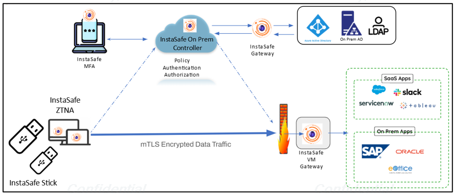
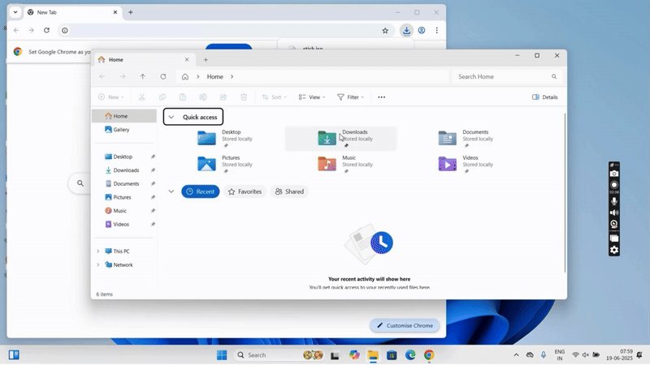
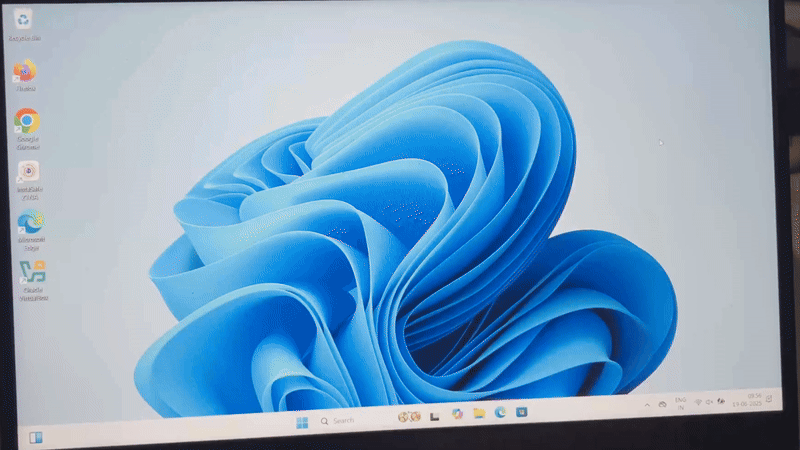

# InstaSafe Stick

InstaSafe USB provides the secure and controlled access to internal applications from external networks by administrators or power users, InstaSafe offers the InstaSafe Stick—a tamper-proof, encrypted, read-only Ubuntu-based bootable operating system deployed on a USB 3.0 drive. This hardened environment is designed to eliminate data leakage risks and enforce strict Zero Trust access policies.

**Key Security Mandate Compliance**

- **Isolated Boot Environment:** The solution mandates access through a separate bootable system using a preconfigured USB OS, disallowing access from any host operating system.
- **Data Encryption and Isolation:** All files created or accessed within the InstaSafe Stick environment are encrypted and cannot be opened or decrypted in any other OS or device.
- **Tamper-Proof and Read-Only:** The USB drive operates in a read-only mode, preventing unauthorized modifications, thereby ensuring integrity and non-repudiation.

**InstaSafe Stick: Technical Architecture**

- **Base OS:** Hardened Ubuntu (LTS version)
- **Deployment Medium:** USB 3.0 Drive (8 GB or higher)
- **Boot Mode:** Secure boot via BIOS/UEFI (user reboots and selects USB boot)
- **Network Access:**
    - Whitelisted application access only
    - No access to external/public internet
- **ZTNA Integration:** Secure tunnels for application-specific access
- **MFA Integration:** Integrated support for OTP/Push via InstaSafe Authenticator

**Use Case Scenarios**

- **Secure Third-Party Access:** Ideal for consultants, vendors, and remote employees who need limited and secure access to applications.
- **BYOD Environments:** Enables use of personal or non-compliant devices without risking corporate data exposure.
- **Disaster Recovery or Remote Admin Access:** Acts as a secure fallback environment for administrators during remote interventions.

**Creating a Bootable InstaSafe USB Stick**

This section provides a step-by-step technical guide for creating a bootable InstaSafe USB Stick used for secure access to enterprise applications via a hardened OS environment.

Prerequisites

- USB Drive (Minimum 8 GB recommended)
- InstaSafe ISO file (provided by InstaSafe)
- Rufus or similar bootable USB creation tool (e.g., Balena Etcher)
- Windows/Linux system with administrative privileges

Step 1: Download Required Files

- Download the InstaSafe OS ISO provided by InstaSafe.
- Download Rufus from https://rufus.ie.

Step 2: Plug in USB Drive

- Insert the USB drive into a working USB port on the system.
- Back up any important data on the USB as it will be completely formatted.

Step 3: Launch Rufus

- Open Rufus as an administrator.
- The USB drive should automatically be detected.

Step 4: Select ISO File and Settings

In Rufus:

- Device: Select the correct USB drive.
- Boot Selection: Click “Select” and browse to the InstaSafe ISO file.
- Partition Scheme: Select MBR (for BIOS/UEFI compatibility) OR
- GPT (for UEFI systems only) – confirm based on target machine.
- File System: Default to FAT32 (recommended).
- Volume Label: Name it InstaSafe Stick or similar.

Step 5: Start the Bootable USB Creation

- Click Start.
- Confirm the warning that the USB will be erased.
- Rufus will begin writing the ISO to the USB.
- Wait for the process to complete.
 
Step 6: Safely Eject USB Drive

- Once the status bar is green and says READY, click Close.
- Safely eject the USB stick from the system.

**User Workflow**

1.	Insert InstaSafe Stick into a USB 3.0 port.
2.	Reboot system and select USB as the boot device.
3.	Hardened Ubuntu OS launches with InstaSafe ZTA preconfigured.
4.	Authenticate via MFA and gain access to permitted applications.
5.	Operate in a secure, isolated environment; any accessed data is encrypted.
6.	Remove USB on session completion — no trace or leakage on host system.

**User Guide : Booting a System Using InstaSafe USB Stick**

The InstaSafe USB Stick is a secure bootable device that enables users to initiate a hardened OS environment for accessing secure enterprise applications through Zero Trust principles. Below is a step-by-step guide on how to boot the system using the InstaSafe Stick:

Step 1: Insert InstaSafe USB Stick

- Plug the InstaSafe USB Stick into a USB port of the laptop or desktop device.
- Ensure the device is powered off before inserting the USB stick for best results.

Step 2: Power On and Access Boot Menu

- Immediately press the relevant boot menu key (e.g., F12, F9, Esc, or Del) depending on your device's manufacturer.
- From the boot menu, navigate using arrow keys to select the USB drive listed under bootable devices.
- Or access the boot menu from Settings > System > Recovery > Advanced Startup

Step 3: Make sure these options are enabled

- Secure boot is turned off for best results.
- Boot from USB/Flash Drive is the first priority in boot order.

Step 4: Boot into InstaSafe OS

- Select the InstaSafe USB device and press Enter.
- The system will boot into the secure InstaSafe OS environment.
- This OS is typically Linux-based and contains pre-configured security controls and the InstaSafe Secure Access client.

Step 5: Authentication and Login

- Once the OS loads, the InstaSafe login interface will appear.
- Users are prompted to:
    - Authenticate using credentials (username/password).
    - Optionally verify Multi-Factor Authentication (OTP, mobile authenticator).

- After successful authentication, access is granted to the enterprise portal or permitted SaaS/on-prem applications.
 

Step 6: Secure Session Use

- Users can now securely access enterprise applications through the locked-down secure session.
- Internet access, clipboard use, file transfer, and printing can be restricted as per policy.
- Endpoint posture checks, DLP rules, and session recording may also be enforced depending on configuration.

Step 7: End Session and Power Down

- Once the session is complete, users can log out of the InstaSafe OS.
- Shut down the system normally.

**Benefits**

- **Enhanced Security Posture:** Isolated, hardened OS with no access to host system or public internet.
- **Compliance Ready:** Aligns with regulatory and data protection mandates.
- **Rapid Deployment:** Preconfigured, plug-and-play setup with no additional software installation.
- **Operational Efficiency:** Reduces the need for expensive endpoint hardening or dedicated laptops for external users.

