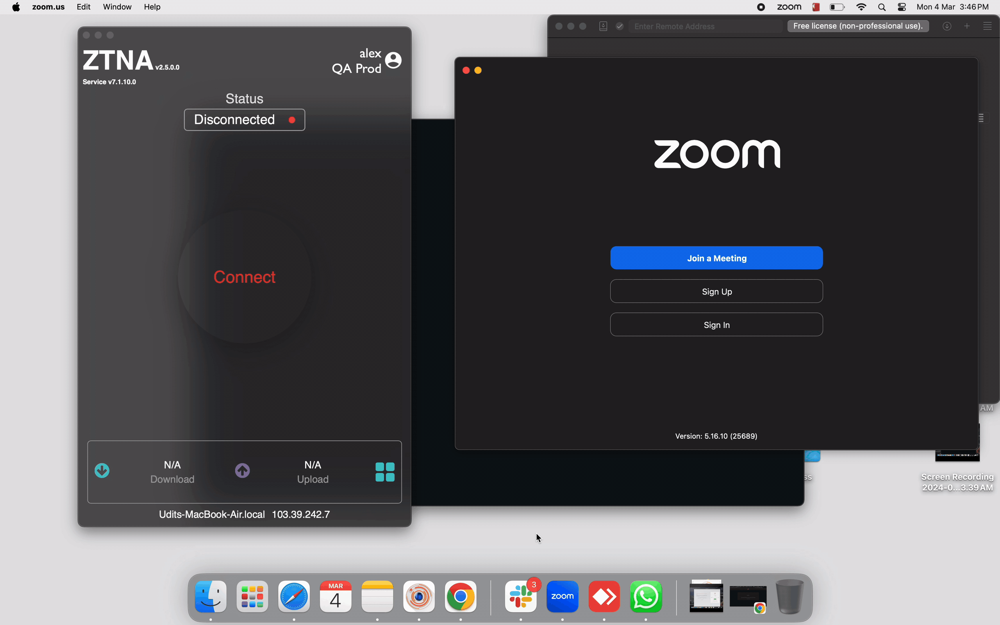

The App Filter endpoint control feature gives Admins the control to block end users from using specific applications in their devices. This feature can be applied over devices with either Windows, Linux or Darwin operating systems. Admins can choose whether to have this endpoint control applied when user connects to the ZTNA agent for VPN connectivity or have it applied when user boots his device.

To create and apply the App Filter endpoint control feature, Admins will have to perform the below steps:

 - create a dataset of type 'Application' to define the applications which needs to be blocked.

 - create a App Filter endpoint control policy with the defined dataset and selecting the operating systems in which it needs to be applied.
 
 - select the Users/User Groups to which the policy needs to be applied.

Please refer the below video on how to create a App Filter endpoint control policy.

Please refer the below video on how the App Filter endpoint control policy gets applied in the end user systems.

**Real-Time Keylogger Detection & Prevention**

InstaSafe Secure Access incorporates an intelligent Real-Time Keylogger Detection Engine as part of its anti-keylogging technology. This engine actively scans the user’s environment for behavioral patterns and system-level activities commonly associated with keylogger tools, thereby adding an additional layer of endpoint protection.

The solution continuously monitors and mitigates the following suspicious behaviors:

- Low-Level Keyboard Hooks:

Detects unauthorized attempts to register global keyboard hooks used to intercept keystrokes across all applications.

- DLL Injection Attempts:

Identifies processes trying to inject malicious Dynamic Link Libraries (DLLs) into legitimate applications to capture input data or manipulate behavior.

- High-Frequency Window Focus Polling:

Monitors applications frequently checking which window is currently active—a typical sign of spyware or keyloggers trying to track user activity.

If such behavior is detected, the system can trigger alerts, log the event, and optionally block or terminate the malicious process in real time. These activities are logged for audit purposes and can be integrated with Security Information and Event Management (SIEM) platforms for enterprise-wide visibility.

This comprehensive monitoring approach ensures keystroke integrity during authentication and secure session activities, providing robust protection against known and emerging keylogger threats.
