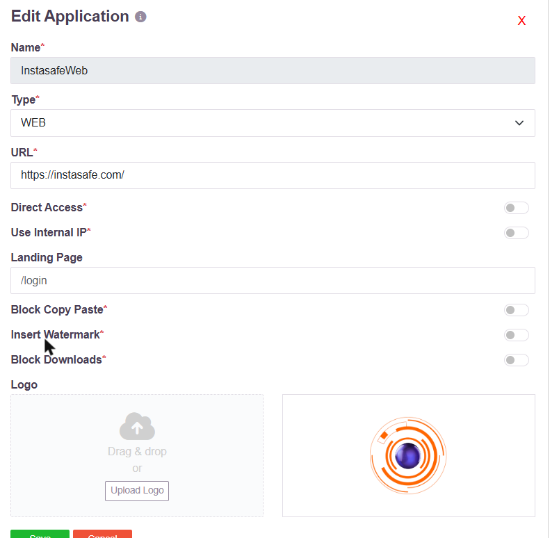
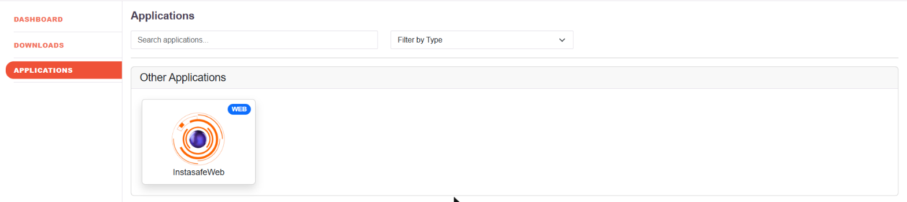

# Custom Application Icons

Every application published on the platform can carry its own icon. The icon is what the
user sees on their portal, so an internal application appears under its own identity -
eOffice as eOffice, Sparrow as Sparrow - rather than as a generic placeholder.

The icon is set per application, by the administrator, when the application is created or
at any time afterwards.

## Uploading an icon

1. Go to **Applications** and open the application, or click **Add** to create one.
2. Click **Edit** if you are changing an existing application.
3. Scroll to **Logo** at the bottom of the form.
4. Drag an image file onto the drop zone, or click **Upload Logo** and choose the file.
   The uploaded image is shown beside the drop zone so you can confirm it before saving.
5. Click **Save**.

The same form carries the rest of the application's definition - its **Type**, its **URL**,
the optional **Landing Page**, and the session controls **Block Copy Paste**,
**Insert Watermark** and **Block Downloads**.

## What the user sees

The icon appears on the application's tile in the end-user portal, under the application
name and beside a badge showing its type.

Users see only the applications their access policy entitles them to, so the portal is a
per-user set of tiles rather than a shared catalogue. See
[Role-Based Application Access Control](007-accesscontrol.md) and
[Clientless Access to Web Applications](clientless-web-access.md).

An application with no icon uploaded falls back to a generic icon for its type.
