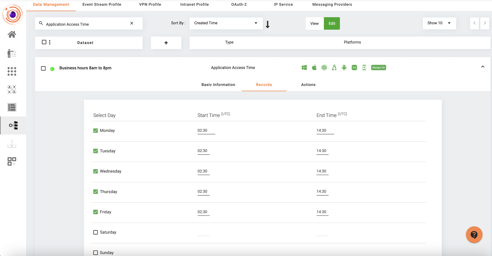
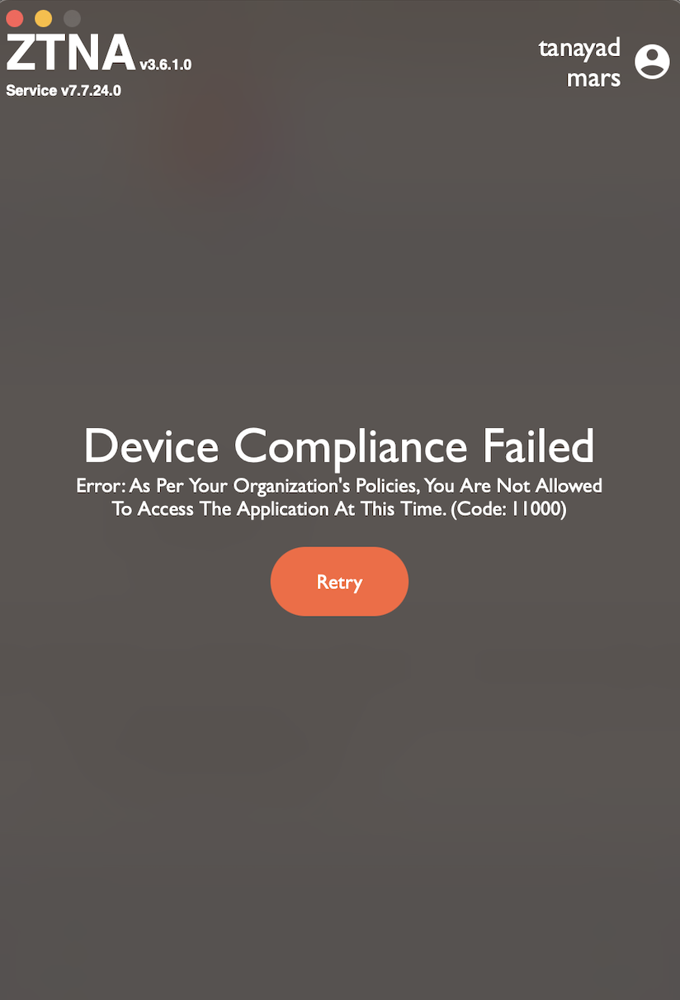

Contextual Access Control (CAC) based on application access time involves controlling access to applications based on specific time-related criteria. This approach adds an additional layer of security and flexibility to access policies, aligning access permissions with organizational needs and security requirements. Here’s how it can be implemented and its benefits:

**Implementation of Contextual Access Control based on Application Access Time**

*Time-Based Access Policies*: Organizations can define policies that restrict or allow access to applications based on the time of day, day of the week, or specific dates. For example:

- *Business Hours Access*: Allow access to critical business applications only during standard business hours (e.g., 9 AM to 5 PM).
- *After-Hours Restrictions*: Restrict access to sensitive or less frequently used applications during non-business hours or weekends.

**Benefits of Contextual Access Control based on Application Access Time**

*Enhanced Security*: By restricting access to applications based on time, organizations reduce the attack surface during off-hours and weekends when security resources may be limited.

*Granular Control*: Time-based policies provide granular control over access permissions, allowing organizations to align access with operational requirements and reduce unnecessary exposure to sensitive data.

*Compliance Adherence*: Helps organizations meet regulatory requirements by enforcing access controls that limit access to sensitive applications and data only during authorized times.

**Steps to implement the Application Access Time policy in InstaSafe ZTNA**

1. Create a dataset of type "Application Access Time"
   - click on the "Configuration" tab on the left menu.
   - In the "Data Management" tab, click on the '+' icon.
   - From the 'Select Variable' dropdown, select 'Application Access Time'.
   - Provide a name for the dataset and click on the 'Add dataset' button.
   - Once the dataset is created, select the dataset and click on 'Edit'.
   - Browse to the 'Records' tab of the dataset.
   - Click on the check against the days of the week, the application accces needs to be granted.
   - Provide the 'Start Time' and 'End Time' between which the application access needs to be granted in UTC format. 

The below screenshot displays a sample configuration for the Application Access Time dataset.

2. Add the created "Application Access Time" dataset in the Device Compliance profile.
   - Browse to Perimeter Management -> Devices.
   - Click on the 'Device Compliance Profiles' tab.
   - Select the configured 'Device Compliance' profile or create a new one.
   - Click on 'Edit' and browse to the 'Rules' tab.
   - Click on the '+ Rule' button.
   - Select "Agent Access Time" from the dropdown.
   - From the "Agent Access Time" dropdown, select the "Application Access Time" dataset created in Step 1.
   - Click on the 'Update' button.

   When end users try to connect to the ZTNA agent outside of the day/time range defined in the "Application Access Time" dataset then they will be presented with the below message.

In conclusion, contextual access control based on application access time is a valuable component of a comprehensive security strategy. It helps organizations optimize resource protection, maintain compliance, and enhance overall cybersecurity posture by aligning access permissions with business needs and security policies.

## Seeing the last login

The other half of a time-based control is knowing when an account was last used. **Last Login
Time** is the time of the last successful login in the user portal or the agent, and it is
shown to administrators in two places: the **User Last Login Report**, which lists every user
and every gateway with the timestamp of their most recent successful login, and the **Event
Log**, which carries a separate event type for each kind of login and for each kind of
failure. See [Last Login, and Access by Day and Time](last-login-and-time.md).
