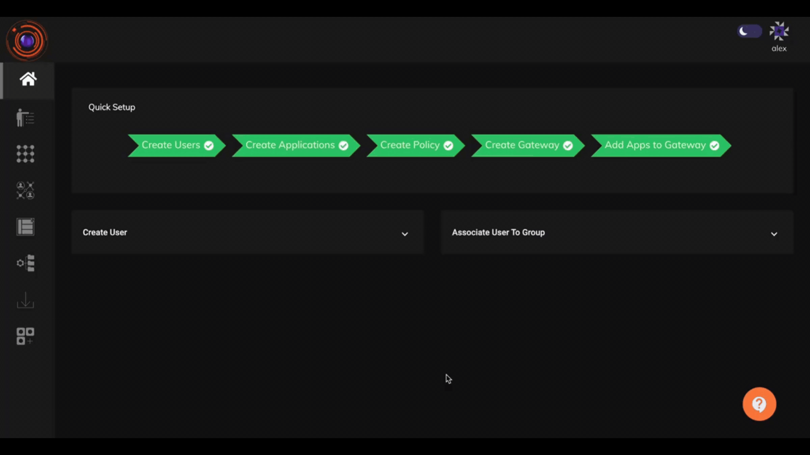

### Setting up the Authentication Profile

The authentication profile for the organization can be enabled under Auth profile tab in Identity management Section.  The admin can set a global auth profile which will enable different primary authentication methods as well secondary authentication for all users. Exclusion to Auth profiles can also  be created for individual user or user group.

The various method of primary Authentication available are

* Password: Logging into ZTAA directly via password.
* AD:  Logging into ZTAA via Active Directory credentials.
* SAML: Logging into ZTAA via organization's SSO.
* OIDC: Logging into ZTAA via organization's OIDC.

InstaSafe directory supports password policy and Account Lockout.

Password Policy parameters:

1. No of uppercase and Lowercase letters.
2. No of numericals.
3. No of special characters.
4. Special characters to be used in the password.
5. Password Legnth.
6. Last 3 Passwords match case.

Admins can define a password standard by clicking on the 'Set password standard' checkbox. 

The various method of Secondary Authentication availabe are

* OTP
* Captcha

### To configure Global Auth Profile 

1. Go to Auth Profiles tab under Identity Management.

2. Edit the Global Authentication profile.

3. Select the Primary mode of Authentication. In the Secondary Authentication enable OTP.

4. You may choose IP based filtering if you require else this can be skipped. This can be enabled later.

5. Select Configurations to configure the Session Timeout. The Session Timeout duration can vary from 60mins to 43200mins.

6. Set additional policies as per your organization's requirement. Click on Update once done.

The global Authentication Profile is now set.

The method to set up 2FA in ZTAA a can also be seen in the video given below.

## Adding Individual and Group level Exclusions

The Global auth profile is applicable on all users except for whom specific exclusions are provided. Exclusions can be configured for individuals as well as for user groups. Individual User exclusion takes precedence over Group exclusions which in turn precedes Global Auth Profile.

1. Under the Exclusion Tab select individual or Group based upon your requirements.

2. Add a new exclusion rule. Add User/User group to the rule. 

3. Select primary and secondary method of authentication.

4. Create additional rules as per your organization's requirement.

5. Click on Update once Done.

### Enabling Two Factor Authentication for Users that have Integrated InstaSafe Authenticator App

For users who have registered with the Instasafe Authenticator app, Two Factor Authentication will be automatically enabled for them even if it is not explicitly enabled for them in the Auth profile. This feature can be enabled for the specific tenant by the Admin.

InstaSafe supports Simple Authentication and Security Layer (SASL). Additionally InstaSafe ustilises Radius protocol to satisfy SASL DIGEST MD5.
