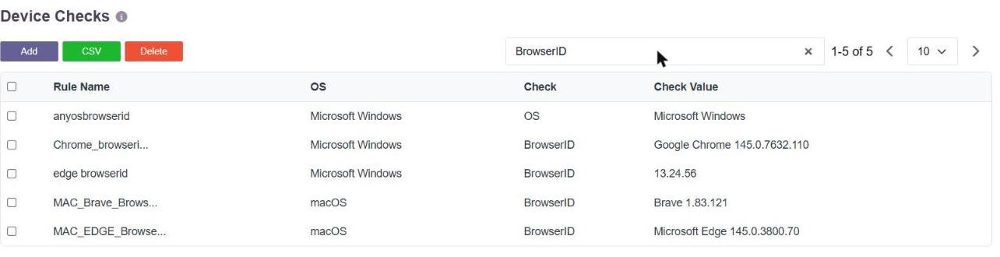
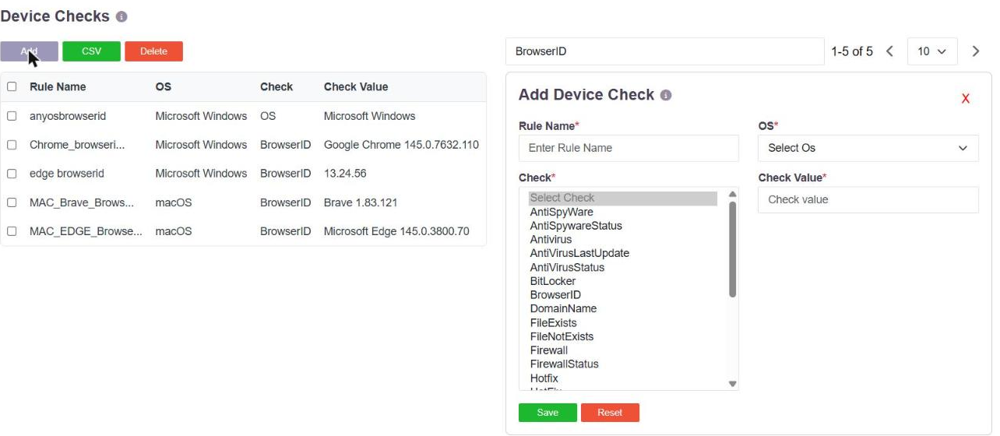
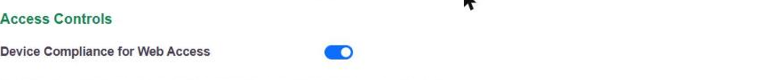
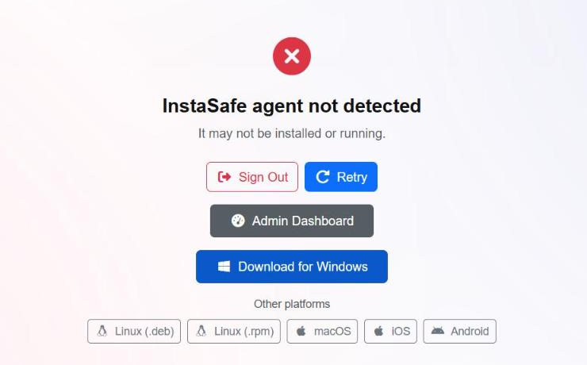
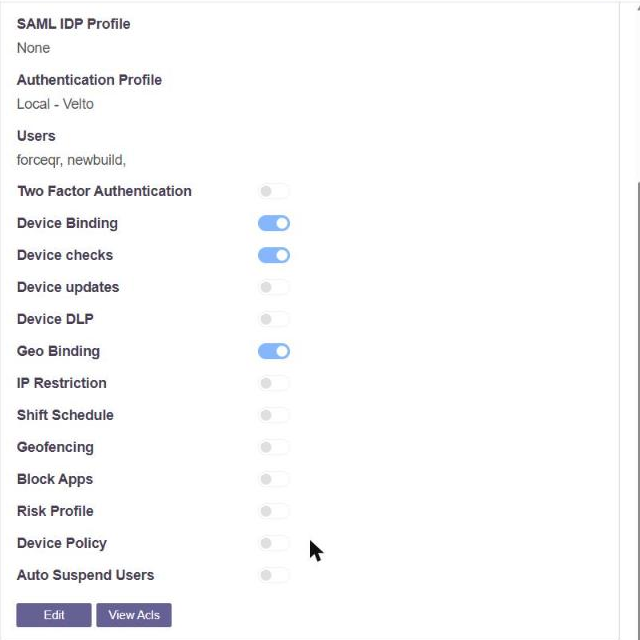

# Identifying the Browser and the Device

A device check is a named rule that states what the endpoint must look like. **BrowserID**
is one of the check types, so "which browser is this, and which version" is a condition the
platform evaluates before access is allowed - not an attribute that is merely recorded.

## The browser identity check

**Devices & Checks → Device Checks** holds the rules. A BrowserID rule carries the
operating system it applies to and the browser or browsers that satisfy it, by name and
version:

A single rule can list several acceptable browsers, separated by `|` - for example
`safari 26.4 | safari 18.5 | Microsoft Edge 145.0.3850.71 | Google Chrome 145.0.7732.117` -
so one rule can express "any of our approved browsers, at or above these builds".

Rules are created per operating system, so Windows, macOS, Linux, Android and iOS can each
carry their own browser requirement.

## The full set of checks

BrowserID sits alongside the rest of the endpoint checks. The complete list in the console:

| Group | Check types |
|---|---|
| Malware protection | `Antivirus`, `AntiVirusStatus`, `AntiVirusLastUpdate`, `SEPLastAVUpdate`, `AntiSpyWare`, `AntiSpywareStatus` |
| Host hardening | `Firewall`, `FirewallStatus`, `BitLocker` |
| Identity of the machine | `BrowserID`, `OS`, `OSName`, `OS Version`, `ServicePack`, `Hotfix`, `TenantId` |
| Management state | `InDomain`, `DomainName`, `mdm` |
| Files, processes, registry | `FileExists`, `FileNotExists`, `ProcessRunning`, `ProcessNotRunning`, `RegistryKeyExists` |

Each rule names the operating system it applies to; the list covers Microsoft Windows,
macOS, iOS, Android, ChromeOS and the Linux distributions.

## How the checks reach a browser session

Checks are performed on the endpoint by **InstaCheck**, which runs locally alongside the
browser. It is a small download and is not the full access agent.

Turn on **Device Compliance for Web Access** in **User Settings → Access Controls**:

With it enabled, a browser session is admitted only once the endpoint answers. If nothing
answers, the user is stopped at a device-status gate rather than reaching the applications,
and is offered the download for the platform they are on:

InstaCheck is published for Microsoft Windows, macOS and Linux as `.msi`, `.pkg`, `.deb`
and `.rpm`, with the mobile applications covering iOS and Android.

Because the checks are performed on the endpoint and not inferred from the browser, a
clientless session with InstaCheck running is subject to the same device checks as an
agent session - browser identity among them.

## Attaching the checks to users

Device checks are enabled per user group. In **Users & Groups → User Groups**, a group
carries **Device checks** as one of its actions, alongside **Device Binding**, **Geo
Binding**, **IP Restriction** and the rest:

Checks apply to the users in the groups where the action is enabled, so a strict browser
requirement can be placed on the group that reaches sensitive applications without
constraining everyone.

## What is recorded, and what happens on a mismatch

Every session records the browser, the platform, the public IP and the country, and those
are visible in the session and access logs - see
[Last Login, and Access by Day and Time](last-login-and-time.md).

Separately from the checks, **Browser Switch** and **Platform Switch** are available as risk
types, so a browser or operating system that differs from the one previously seen for that
user can raise an alert, deny the access, suspend the user or disconnect the session. See
[Email Alerts and Scheduled Reports](email-alerts.md).

A device check and a risk type answer different questions. The check asks whether the
endpoint is acceptable at all. The risk type asks whether it is the same one as last time.
