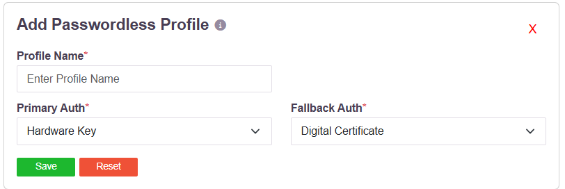

# Certificate-Based Authentication

A digital certificate can be used to authenticate a user, either on its own or alongside a
password. It is configured in two places, depending on what the certificate is doing.

## As a passwordless authentication method

A **Passwordless profile** sets what a user presents instead of a password, and what they
fall back to if that is unavailable:

| Setting | Options |
|---|---|
| **Primary Auth** | **Digital Certificate**, **Hardware Key**, **Kerberos** |
| **Fallback Auth** | **Digital Certificate**, **Hardware Key**, **Password** |

**Digital Certificate** and **Hardware Key** are different mechanisms and are offered
separately. A hardware key is a FIDO2 authenticator - a security key or a platform
authenticator - which proves possession through the WebAuthn protocol and holds no X.509
certificate. A digital certificate is an X.509 certificate presented by the client and
validated by the platform.

A profile can combine them: a certificate as the primary method with a hardware key as the
fallback, or the reverse.

## Alongside a directory

An Active Directory or OpenLDAP profile carries an **Authentication Type**:

| Option | What the user presents |
|---|---|
| **Certificate** | The certificate alone |
| **Password + Certs** | The directory password **and** the certificate |

**Password + Certs** makes the certificate a second factor on top of the directory
credential, rather than a replacement for it. See
[Directory Queries and the Login Identifier](directory-query.md).

## Where the certificate lives

The platform consumes a client certificate; it does not issue one. Certificates are issued
by the organisation's own certification authority and installed on the user's machine, where
the client presents them from the operating system's certificate store.

That store holds both software-resident certificates and certificates whose private key is
held on a hardware device, so either kind is presented to the platform the same way. Where
the key is on a hardware device, the device's own PIN or unlock gates its use, and the key
never leaves it.

## Related

For FIDO2 and WebAuthn as a second factor, including security keys and platform
authenticators, see [WebAuthn MFA](webauthn-fido2-mfa.md). For the full set of second
factors, see [Configure MFA](mfa-configure.md).
