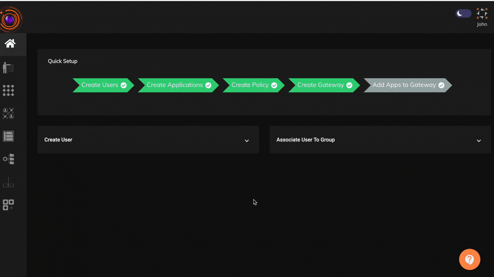
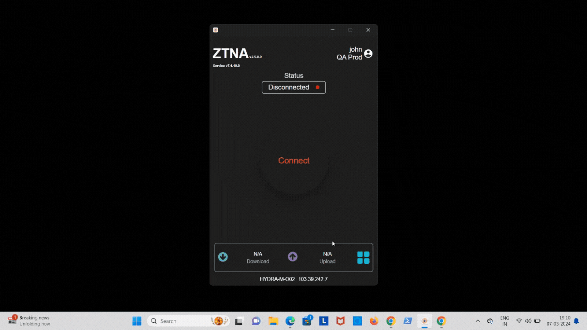

The Chrome endpoint control feature gives Admins the control to restrict end users from performing downloads, opening developer tools and taking prints from the Chrome browser in their devices. This feature can be applied over devices with either Windows or Linux operating systems. Admins can choose whether to have this endpoint control applied when user connects to the ZTNA agent for application access or have it applied when user boots his device.

To create and apply the Chrome endpoint control feature, Admins will have to perform the below steps:

 - Click on 'Access Policies' in the left menu and then click on the 'EndPoint Policies' tab.

 - Click on the '+' and then give a name for the policy.

 - select the 'Chrome' endpoint control policy by selecting from the different available control types. Mulitple control type records can be added in a single policy.
 
 - select the operating systems in which the Chrome controls needs to be applied.
 
 - select the Users/User Groups to which the policy needs to be applied.

 - select 'On Boot' if the policy needs to be applied on the start of the device or 'On Network Connection' if the endpoint control has to be applied when user connects to the ZTNA agent.

Please refer the below video on how to create a Chrome endpoint control policy.

Please refer the below video on how the Chrome endpoint control policy gets applied in the end user systems.

