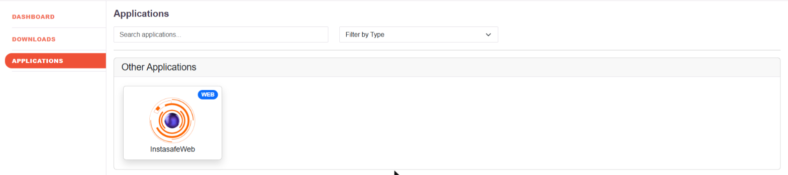
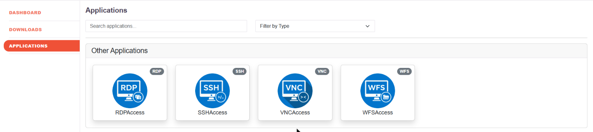

# Clientless Access to Web Applications

Users reach internal web applications from a standard browser. Nothing is installed on the
endpoint: the user signs in to the platform's portal, authenticates, and opens the
applications that policy has entitled them to. The application itself stays unpublished to
the internet and is reached through the secure gateway.

This is the access mode the platform offers alongside the agent. The agent adds deeper
endpoint posture checking; clientless access trades that for reaching the application from
any managed browser with nothing to deploy.

## What clientless access provides

| | |
|---|---|
| **No endpoint installation** | The user needs a browser, not an agent. |
| **Application types** | Web applications over HTTP and HTTPS, and RDP and SSH sessions rendered in the browser. See [Agentless Access](agentless.md). |
| **Authentication before access** | The user authenticates, including multi-factor, before any application is listed or opened. |
| **Per-application entitlement** | A user sees only the applications their access policy allows. See [Role-Based Application Access Control](007-accesscontrol.md). |
| **Session audit** | RDP and SSH sessions can be recorded for audit. See [Agentless Access](agentless.md) and [Audit Logs](017-auditlog.md). |

## What the user sees

After signing in, the user lands on a portal with three sections: **Dashboard**,
**Downloads** and **Applications**.

Each tile is an application the signed-in user is entitled to, carrying the application's
own icon and a badge naming its type. The same portal lists the other types side by side:

**Applications** lists everything the user is entitled to. It carries a search box and a
**Filter by Type** facet, so a user with a long list can narrow it to one kind of resource:

| Type | What it opens |
|---|---|
| **WEB** | An internal web application, in the browser |
| **RDP** | A Windows desktop session, rendered in the browser |
| **SSH** | A terminal session, rendered in the browser |
| **VNC** | A remote framebuffer session |
| **DB** | A database endpoint |
| **WFS** | A file share |

A user who has been entitled to nothing sees an empty list. Applications appear only after an
access policy grants them, which is what makes the portal per-user rather than a shared
catalogue.

**Dashboard** shows the user their own current and previous session, the devices registered
to them, which web and network applications they hold, and the applications they have opened
recently. It also carries the MFA, device binding, shift schedule and geo binding indicators,
so a user can see which controls apply to them.

## Publishing a web application for clientless access

1. **Create the application.** Define the internal web application on the platform — see
   [Create an Application](005-creatingapplication.md).
2. **Attach it to a gateway.** The gateway is what reaches the application inside the
   network — see [Create Gateway](006-creatinggateways.md) and
   [Add application to the gateway](006b-addapptogateway.md).
3. **Entitle it.** Write an access policy whose members are the user group that needs the
   application — see [Role-Based Application Access Control](007-accesscontrol.md).

Once those three are in place, the application appears to the entitled users when they sign
in to the portal, and to nobody else.

## What clientless access does not include

Browser-based access performs fewer endpoint posture validations than agent-based access.
Where a policy depends on device posture — device binding, device checks, the full set of
endpoint attributes — the agent is required. See
[Architecture](002-architecture.md) and [ZTNA Agent](ztna_app_access.md).
