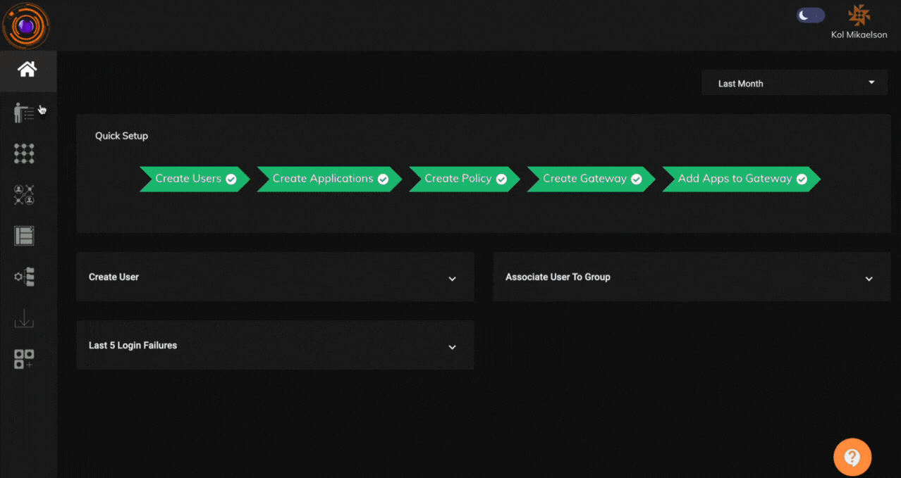

The Clipboard control feature gives Admins the control to block end users from performing copy-paste actions in their devices. This feature can be applied over devices with either Windows, Linux or Darwin operating systems. The Clipboard endpoint control will be applied when user connects to the ZTNA agent for application access.

To create and apply the Clipboard endpoint control feature, Admins will have to perform the below steps:

 - create a Clipboard endpoint control policy by selecting the operating systems in which it needs to be applied.
 
 - select the Users/User Groups to which the policy needs to be applied.

Please refer the below video on the steps to create a Clipboard endpoint control policy and how it gets applied in the user device on connecting to ZTNA.

InstaSafe Zero Trust Secure Access provides granular clipboard and screen control features to ensure data protection and prevent leakage from endpoints accessing sensitive applications. The system enables organizations to enforce strict policies on copy-paste operations, screen captures, and recording functionalities. Key capabilities include:

- Clipboard Copy Restriction (Browser to External Applications)
Prevents any copy operation performed within the secure browser session (e.g., WebVPN) from being transferred to other local applications, safeguarding sensitive information viewed via browser-based apps.

- Application-Specific Clipboard Blocking

Enables blocking of copy operations from selected applications to any external application, reducing the risk of unauthorized data movement from critical applications (e.g., ERP, CRM, internal portals).

- Global Clipboard Lockdown with Allowed Exceptions

Allows administrators to block copy-paste across all applications by default, while enabling granular exceptions for pre-approved applications where such operations are business-critical.

- System-Wide Print Screen Blocking

Disables print screen functionality across the endpoint system during secure sessions to prevent visual data capture of sensitive applications or content.

- Screen Recording Software Detection and Blocking

Detects and blocks the execution of known screen recording tools to prevent unauthorized video capture during sessions accessing secure enterprise resources.

- Snapshot Tool Restriction

Prevents launch and usage of third-party applications or utilities that can capture screenshots or snapshots from the user’s device while secure access is active.

- Selective Exceptions for Clipboard and Screen Sharing

Provides policy-based control to allow exceptions on a per-app basis, enabling copy-paste or screen sharing only for authorized applications based on business needs and compliance requirements.

