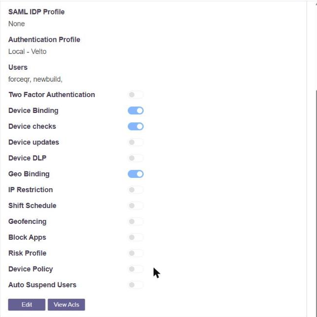
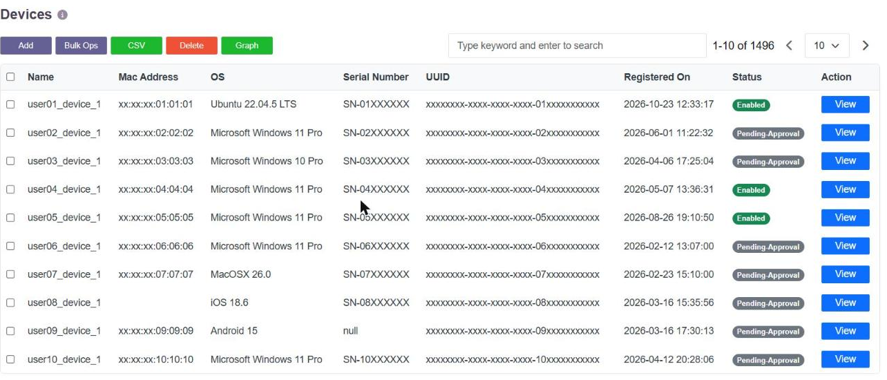
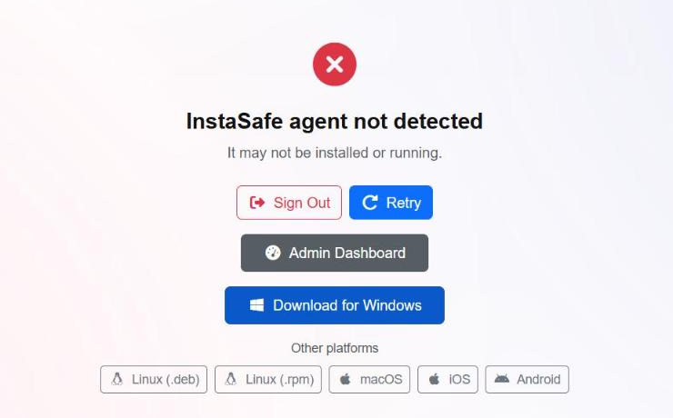

# Device Binding for Browser Users, and New-Device Alerts

Device binding ties a user to the devices they are allowed to use. A device the platform
has not seen before does not get in on the strength of a correct password - it is held, or
refused, or reported, depending on how the organisation has set it.

## Enabling binding

Binding is an action on a **user group**. In **Users & Groups → User Groups**, open a group
and the actions are listed:

**Device Binding** turns the control on for the users in that group. **Device checks** and
**Geo Binding** sit beside it, so an organisation can require a bound device, an acceptable
endpoint and a permitted location together, for the group that needs all three.

## The binding rules

Five rules are available, so the control can be as strict or as forgiving as the
organisation needs:

| Rule | Behaviour |
|---|---|
| Allow First Device | The first device the user signs in from is bound; it is the only one |
| New Devices will require Admin Approval | Every device waits for the administrator |
| Allow First Device. Subsequent Devices will require Admin Approval | The first is automatic, every later one waits |
| Allow First Device from Desktop & Mobile. Subsequent Devices will require Admin Approval | A desktop and a phone are automatic, every later one waits |
| New Devices will be Automatically Approved after *n* days | A device is admitted after a stated delay |

The steps to set the rule are in [Device Binding](devicebinding.md).

## The device register

**Devices & Checks → Devices** is the register. Every device that has presented itself is
listed with its operating system, hardware identifiers and the date it was first seen, and
carries a status:

**Pending-Approval** is a device that has arrived and is waiting. **Enabled** is a device
that is bound and may be used. The administrator approves, rejects or blocks from this
page, and can block a single device for a single user without touching the rest.

## Browser users

Binding is not limited to users running the access agent. Where **Device Compliance for Web
Access** is enabled, a browser session is identified on the endpoint by **InstaCheck**,
which runs locally alongside the browser and is a small download rather than the full
agent. A browser user whose endpoint does not answer is stopped at a device-status gate and
offered that download:

Because the endpoint answers for itself, a browser session presents a device the platform
can recognise and bind, in the same way an agent session does. See
[Identifying the Browser and the Device](browser-identity.md) for what is checked.

## Being told about a new device

The platform emails the administrator through **risk profiles**, which pair a set of events
with an action. The relevant event is **Device Bind Failure** - a user signing in from a
device that is not bound to them, which is what a new device is until it is approved.

1. Go to **User Settings → Risk Profiles** and click **Add**.
2. Name the profile.
3. In **Types**, select **Device Bind Failure**. **Device Check Failure** can be added in
   the same profile, so a non-compliant endpoint is reported as well.
4. Set **Action** to **Email Admin**.
5. Save.

The administrator then receives an email the moment a user presents a device that is not
theirs, and the device itself is waiting in the register for approval. The full set of risk
types and actions is in [Email Alerts and Scheduled Reports](email-alerts.md).

The same event is recorded in the event log, so the history is available whether or not the
email was configured - see [Last Login, and Access by Day and Time](last-login-and-time.md).
