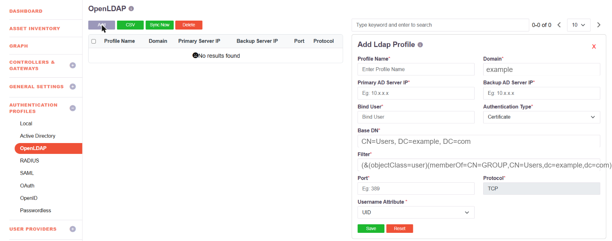

# Directory Authentication and the MFA Methods Available With It

The platform uses LDAP in two different ways. They are separate features with separate
capabilities, and it is worth being clear which is which before looking at multi-factor
authentication.

| | What it does | Where it is configured |
|---|---|---|
| **Directory integration** | Users are authenticated against the organisation's own Active Directory or OpenLDAP. The platform is a client of that directory. | Authentication Profiles → **Active Directory** or **OpenLDAP** |
| **LDAP identity provider** | Other systems authenticate their users against the platform over LDAP, as they would against a directory server. The platform is the directory. | Identity Management → Identity Provider → **LDAP** |

The second is described in [LDAP Authentication](ldap-authentication.md). The limits noted
there - TOTP as the second factor, and one profile per tenant - apply to **that** feature,
where the platform is answering LDAP binds from third-party clients. They are not the limits
that apply to users signing in against the organisation's own directory.

## Integrating a directory

An Active Directory or OpenLDAP profile points the platform at the directory:

| Field | What it takes |
|---|---|
| **Profile Name**, **Domain** | A name, and the directory domain |
| **Primary / Backup AD Server IP** | The directory servers, with a fallback |
| **Bind User** | The account used to bind. An ordinary account is sufficient |
| **Authentication Type** | Certificate, or Password + Certs |
| **Base DN** | Where the search starts, for example `CN=Users, DC=example, DC=com` |
| **Filter** | An LDAP filter limiting which users or groups are provisioned |
| **Port**, **Protocol** | 389 by default, over TCP |
| **Username Attribute** | The attribute users sign in with, such as UID |

More than one directory profile can exist. Users are imported and kept in step with the
directory - see [Import Users from AD/LDAP](008-importADusers.md).

## MFA for users authenticating against a directory

Directory authentication is a **primary** authentication method, and the second factor is
chosen independently of it. The primary methods are Password, **AD** and SAML; the secondary
methods available are:

| Second factor | |
|---|---|
| **Email OTP** | One-time code by email |
| **SMS OTP** | One-time code by SMS |
| **OTP via Phone Call** | One-time code read out on a call |
| **TOTP** | InstaSafe Authenticator, or any authenticator app |
| **HOTP** | Counter-based one-time code |
| **Push Notification** | Approve or deny on the InstaSafe Authenticator app |
| **WebAuthn (FIDO2 / Passkey)** | Security key or device authenticator |
| **Security Question & Answer** | |
| **QR Code** | |

So a user whose password is held in Active Directory can still be challenged with SMS OTP,
email OTP, push, TOTP or a FIDO2 key. See [Configure MFA](mfa-configure.md) for how the
global authentication profile and its per-user and per-group exceptions are set.

## Biometric and facial authentication

Biometrics are provided through **WebAuthn / FIDO2**, which the platform supports in three
forms - see [WebAuthn MFA](webauthn-fido2-mfa.md):

| Form | What the user presents |
|---|---|
| **Windows Hello** | The biometric built into their Windows device - fingerprint or face, depending on the hardware - or its PIN |
| **Security Key** | A hardware key such as a YubiKey, with its PIN |
| **Pass Key** | A passkey held on their phone, unlocked by that phone's own biometric |

The biometric is read and verified by the user's own device, and the device attests to the
platform. Fingerprint and facial recognition therefore work wherever the endpoint provides
them - a Windows device with a Hello-capable camera or fingerprint reader, or a phone with
Face ID or a fingerprint sensor.

There is no separate server-side face-matching service: no facial images are enrolled in or
held by the platform. This is the stronger arrangement for a government deployment, since no
biometric template ever leaves the user's device.
