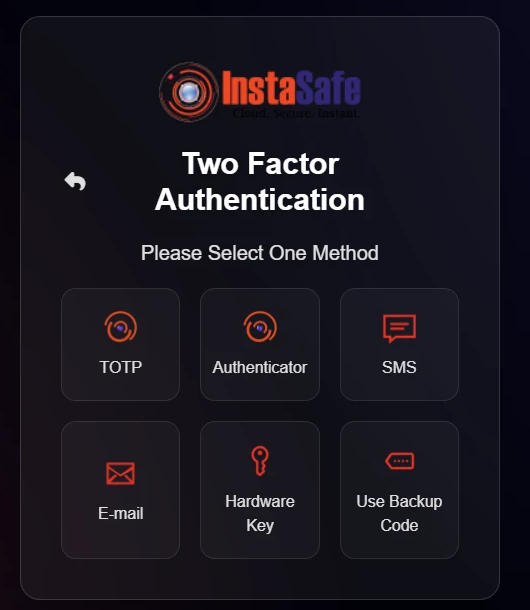
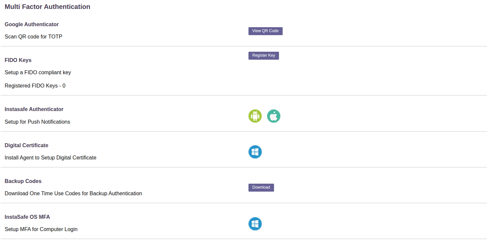

# Directory Authentication and the MFA Methods Available With It

The platform uses LDAP in two different ways. They are separate features with separate
capabilities, and it is worth being clear which is which before looking at multi-factor
authentication.

| | What it does | Where it is configured |
|---|---|---|
| **Directory integration** | Users are authenticated against the organisation's own Active Directory or OpenLDAP. The platform is a client of that directory. | Authentication Profiles → **Active Directory** or **OpenLDAP** |
| **LDAP identity provider** | Other systems authenticate their users against the platform over LDAP, as they would against a directory server. The platform is the directory. | Identity Management → Identity Provider → **LDAP** |

The second is described in [LDAP Authentication](ldap-authentication.md). The limits noted
there - TOTP as the second factor, and one profile per tenant - apply to **that** feature,
where the platform is answering LDAP binds from third-party clients. They are not the limits
that apply to users signing in against the organisation's own directory.

## Integrating a directory

An Active Directory or OpenLDAP profile points the platform at the directory:

| Field | What it takes |
|---|---|
| **Profile Name**, **Domain** | A name, and the directory domain |
| **Primary / Backup AD Server IP** | The directory servers, with a fallback |
| **Bind User** | The account used to bind. An ordinary account is sufficient |
| **Authentication Type** | Certificate, or Password + Certs |
| **Base DN** | Where the search starts, for example `CN=Users, DC=example, DC=com` |
| **Filter** | An LDAP filter limiting which users or groups are provisioned |
| **Port**, **Protocol** | 389 by default, over TCP |
| **Username Attribute** | The attribute users sign in with, such as UID |

More than one directory profile can exist. Users are imported and kept in step with the
directory - see [Import Users from AD/LDAP](008-importADusers.md).

## What the user is asked for

Directory authentication is a **primary** authentication method. The second factor is
configured separately from it, so a user whose password lives in Active Directory is
challenged from the same set as any other user.

Once the password has been accepted, the user chooses a method:

| On the prompt | What the user does |
|---|---|
| **TOTP** | Enters the current code from their authenticator app |
| **Authenticator** | Approves the sign-in on the InstaSafe Authenticator app |
| **SMS** | Enters a one-time code sent by text message |
| **E-mail** | Enters a one-time code sent by email |
| **Hardware Key** | Presents a FIDO2 security key |
| **Use Backup Code** | Enters a one-time code from the list issued in advance |

The methods offered are the ones the administrator has enabled and the user has enrolled.
Backup Code is a recovery route rather than a routine factor.

## Where the user enrols

Each user manages their own factors on the **Multi Factor Authentication** page of their
profile:

| On the page | Enrols |
|---|---|
| **Google Authenticator** | TOTP - the user scans a QR code with any authenticator app |
| **FIDO Keys** | A FIDO2 security key, with a count of the keys already registered |
| **Instasafe Authenticator** | Push notifications, through the Android or iOS app |
| **Digital Certificate** | A certificate on the user's machine, set up through the agent |
| **Backup Codes** | A downloadable list of single-use recovery codes |
| **InstaSafe OS MFA** | A second factor at Windows computer login, not only at application login |

The administrator can require MFA, see each user's enrolment state and reset it, but cannot
enrol on a user's behalf - the factor is registered on the user's own device.

See [Configure MFA](mfa-configure.md) for the global authentication profile and its per-user
and per-group exceptions.

## Biometric and facial authentication

Biometrics are provided through **WebAuthn / FIDO2**, which the platform supports in three
forms - see [WebAuthn MFA](webauthn-fido2-mfa.md):

| Form | What the user presents |
|---|---|
| **Windows Hello** | The biometric built into their Windows device - fingerprint or face, depending on the hardware - or its PIN |
| **Security Key** | A hardware key such as a YubiKey, with its PIN |
| **Pass Key** | A passkey held on their phone, unlocked by that phone's own biometric |

The biometric is read and verified by the user's own device, and the device attests to the
platform. Fingerprint and facial recognition therefore work wherever the endpoint provides
them - a Windows device with a Hello-capable camera or fingerprint reader, or a phone with
Face ID or a fingerprint sensor.

There is no separate server-side face-matching service: no facial images are enrolled in or
held by the platform. This is the stronger arrangement for a government deployment, since no
biometric template ever leaves the user's device.
