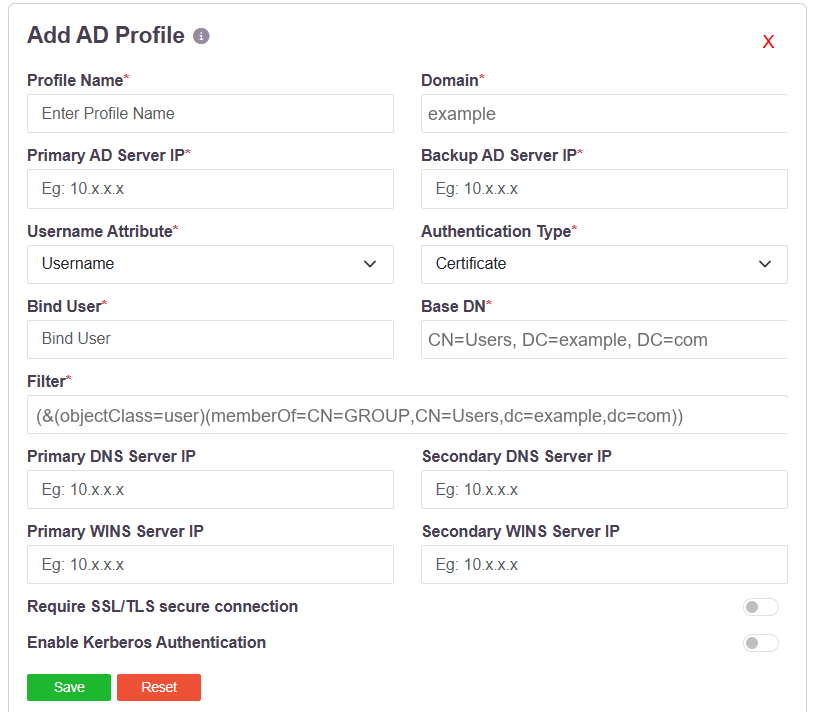

# Directory Queries and the Login Identifier

A directory profile does not simply point at a server. It carries the query used to find
users in that directory, and the attribute those users sign in with. Both are set by the
administrator, per profile.



## The query

| Field | What it does |
|---|---|
| **Base DN** | Where the search begins, for example `CN=Users, DC=example, DC=com`. It can be the domain, or a container inside it. |
| **Filter** | An LDAP search filter, written by the administrator, that decides which directory entries this profile covers. |

The filter is an ordinary LDAP filter expression, so it can be as narrow as required. The
form's own example restricts the profile to members of one group:

```
(&(objectClass=user)(memberOf=CN=GROUP,CN=Users,dc=example,dc=com))
```

Any valid filter works - object class, group membership, organisational unit, a custom
attribute, or a combination. Users the filter does not match are not provisioned by that
profile and are not validated against it.

## The login identifier

**Username Attribute** sets the directory attribute a user authenticates with.

| Profile type | Options |
|---|---|
| **Active Directory** | **Username** (the sAMAccountName) or **User Principal Name (UPN)** |
| **OpenLDAP** | **UID** |

## How the identifier is matched at sign-in

The portal asks for the identifier on its own, before anything else:


What the user types is matched against the **Username Attribute** of the profile that covers
them. Only once the identifier resolves to a user does the sign-in continue to the
authentication step configured for that user - a local password, a directory bind, or a
redirect to an identity provider. Nothing about the account is revealed before that.

This applies to clientless access and to the agent alike: both present the same identifier
step and resolve it the same way.

## More than one identifier for the same person

Several Active Directory and OpenLDAP profiles can exist side by side, each with its own
server pair, Base DN, filter and **Username Attribute**. A single directory can therefore be
covered by more than one profile, and the profiles need not name the same login attribute.

Where the directory holds more than one form of identifier for an account, that is how each
form is accepted. An Active Directory user whose sAMAccountName is `kmurphy` and whose UPN
is `kmurphy@example.com` is reached by a profile using **Username** in the first case and a
profile using **User Principal Name** in the second - one person, two identifiers they can
sign in with.

The same mechanism scopes identifiers by part of the organisation: a profile filtered to one
organisational unit can use UPN while a profile filtered to another uses sAMAccountName, so
different populations sign in in the form that suits them without a change to the directory.

## The rest of the profile

| Field | |
|---|---|
| **Primary / Backup AD Server IP** | The directory servers, with a fallback |
| **Bind User** | The account used to bind. An ordinary account is sufficient |
| **Authentication Type** | Certificate, or Password + Certs |
| **Primary / Secondary DNS and WINS Server IP** | Name resolution pushed to connected users |
| **Require SSL/TLS secure connection** | Binds to the directory over LDAPS |
| **Enable Kerberos Authentication** | Authenticates users with Kerberos rather than a simple bind |

Users found by the profile are imported and kept in step with the directory - see
[Import Users from AD/LDAP](008-importADusers.md). For the second factors available to
directory-authenticated users, see
[Directory Authentication and MFA](directory-mfa.md).
