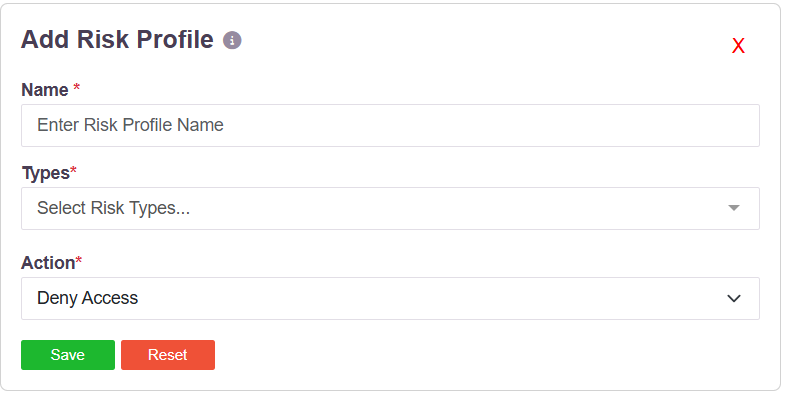
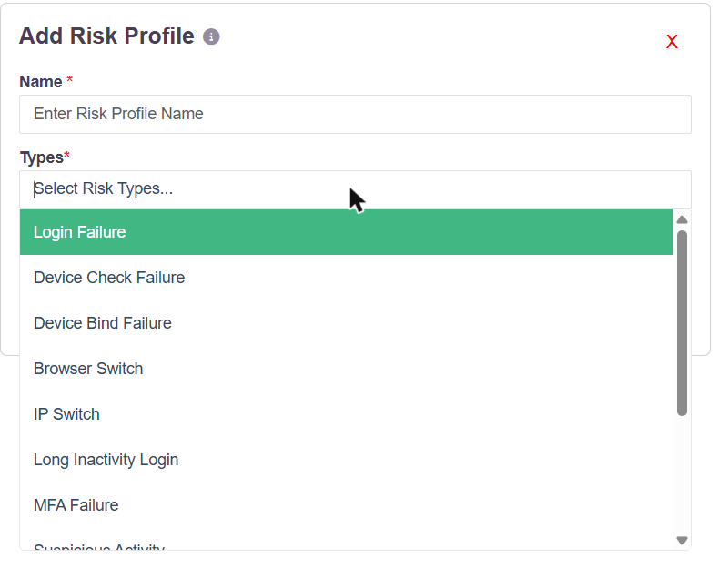
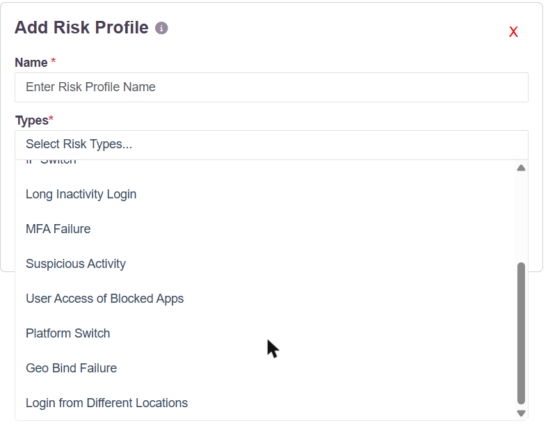
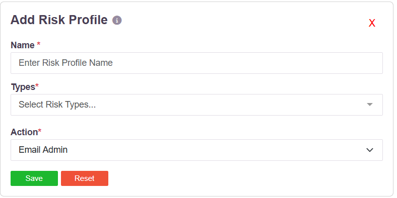
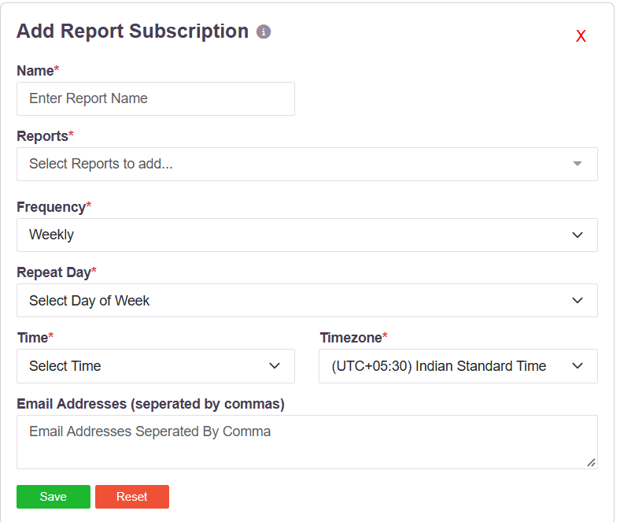
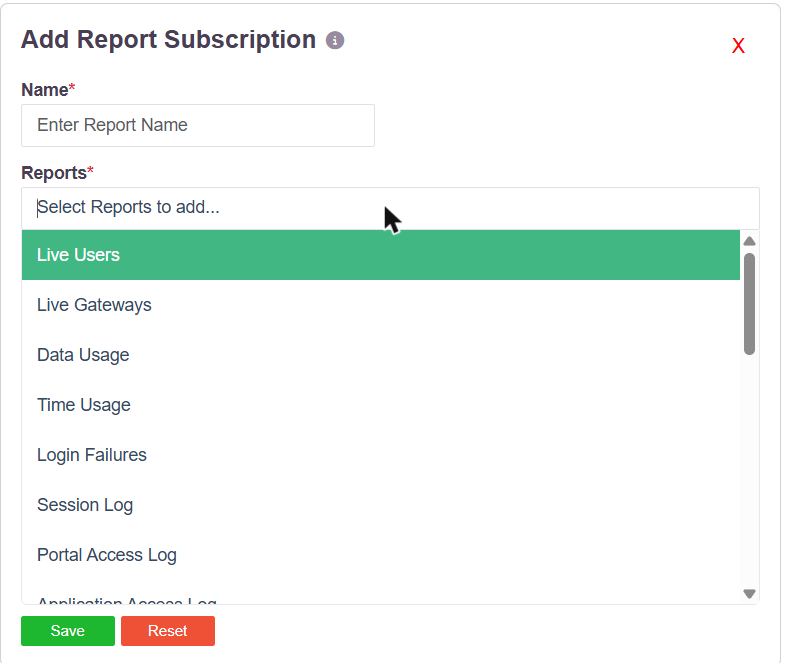
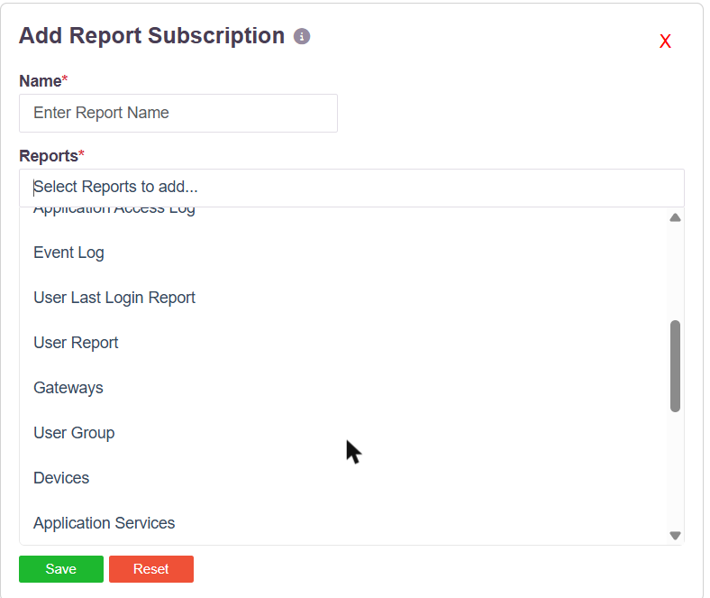

# Email Alerts and Scheduled Reports

The platform sends administrators email through two separate mechanisms, and it is worth
being precise about which does what.

| | Fires on | Configured in |
|---|---|---|
| **Risk profiles** | A security or user event, the moment it happens | User Settings → Risk Profiles |
| **Report subscriptions** | A schedule you choose, daily, weekly or monthly | Report Settings → Report Subscriptions |

Risk profiles are event-driven. Report subscriptions are time-driven. Together they cover
security events, user issues and operational reporting.

## Email alerts on security and user events

A risk profile pairs a set of **risk types** with a single **action**. When a user trips any
type in the profile, the action runs. Choosing **Email Admin** as the action turns the
profile into an email alert.

### The risk types

Twelve event types can be put in a profile:

| Type | Fires when |
|---|---|
| Login Failure | A sign-in attempt fails |
| MFA Failure | The second factor fails |
| Device Check Failure | The endpoint fails a configured device check |
| Device Bind Failure | The user signs in from a device that is not bound to them |
| Geo Bind Failure | The user signs in from outside their permitted geography |
| Login from Different Locations | The same account is used from more than one place |
| IP Switch | The source IP changes during or between sessions |
| Browser Switch | The browser differs from the one previously seen |
| Platform Switch | The operating system differs from the one previously seen |
| Long Inactivity Login | An account dormant for a long period is used again |
| Suspicious Activity | Activity the platform scores as anomalous |
| User Access of Blocked Apps | A user attempts an application that policy blocks |

A profile can carry one type or many. Several profiles can exist side by side, each with its
own types and its own action.

### The actions

| Action | Effect |
|---|---|
| **Email Admin** | Sends an email to the administrator. This is the alert. |
| Deny Access | Refuses the access attempt |
| Suspend User | Suspends the account |
| Disconnect User | Ends the user's active session |

### Creating one

1. Go to **User Settings → Risk Profiles** and click **Add**.
2. Enter a **Name** for the profile.
3. Open **Types** and select the events the profile should watch. More than one can be
   selected.
4. Set **Action** to **Email Admin**.
5. Click **Save**.

The profile is then assigned to users, groups or access policies, and the administrator is
emailed whenever a covered event occurs.

## Scheduled report delivery

Report subscriptions email reports on a timetable, to one or more addresses, without anyone
logging in to fetch them.

| Field | What it takes |
|---|---|
| **Name** | A name for the subscription |
| **Reports** | One or more reports to include |
| **Frequency** | Daily, weekly or monthly |
| **Repeat Day** | The day of the week the report goes out |
| **Time** and **Timezone** | When it is sent, in the timezone you choose |
| **Email Addresses** | Recipients, separated by commas |

### Reports that can be subscribed to

Live Users · Live Gateways · Data Usage · Time Usage · Login Failures · Session Log ·
Portal Access Log · Application Access Log · Event Log · User Last Login Report ·
User Report · Gateways · User Group · Devices · Application Services · Access Policies ·
Application Groups

**Live Users, Live Gateways, Data Usage, Time Usage and Gateways** are the consumption and
capacity reports. Subscribing to those delivers utilisation figures to administrators on a
schedule.

### Creating one

1. Go to **Report Settings → Report Subscriptions** and click **Add**.
2. Enter a **Name**.
3. Open **Reports** and select the reports to include.
4. Choose a **Frequency**, then the **Repeat Day**, **Time** and **Timezone**.
5. Enter the recipient **Email Addresses**, separated by commas.
6. Click **Save**.

## What is not in the product

There is no threshold alarm. Nothing sends an email because CPU, memory, bandwidth, session
count or licence consumption crossed a configured limit. Utilisation reaches administrators
as a report on a schedule, through a subscription, not as an event-driven alert.

Audit reports can also be downloaded or scheduled from the Exports section — see
[Audit Logs](017-auditlog.md). For streaming events to a SIEM, see
[Event Stream](018-eventstream.md).
