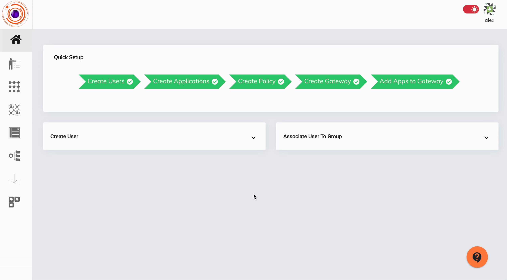
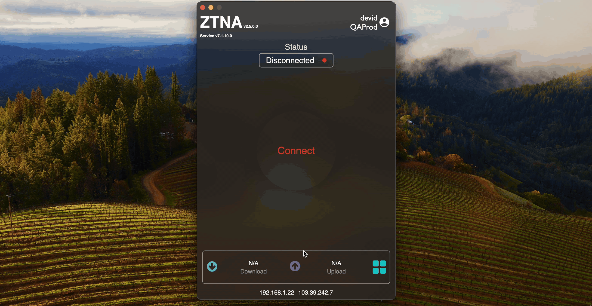

**Superseded.** This is the previous version of this page, kept for comparison. The current
page is [Account Lockout, Idle Timeout and Forced Logout](inactivity_timeout.md).

The Inactivity timeout feature gives Admins the control to have the ZTNA agent disconnected if users are not accessing network applications actively. The inactivity timeout can be configured by defining whether there is a certain amount of data transfer through the ZTNA agent in a specified time interval. If there is less data transfer than the configured value the ZTNA agent gets disconnected. This feature can be applied over devices with either Windows, Linux or Darwin operating systems. 

To create and apply the Inactivity timeout feature, Admins will have to perform the below steps:

 - Click on 'Access Policies' in the left menu and then click on the 'EndPoint Policies' tab.

 - Click on the '+' and then give a name for the policy.

 - select the 'Inactivity timeout' endpoint control policy.

 - give values for 'Enter interval in seconds' and 'Enter threshold in KB'. If the data transfer is less than the value set in 'Enter threshold in KB' within the duration set in 'Enter interval in seconds', the ZTNA agent will get disconnected due to inactivity.
 
 - select the operating system of the devices in which the inactivity timeout needs to be applied.
 
 - select the Users/User Groups to which the policy needs to be applied.

 - click on the 'Submit' button to save the policy.

Please refer the below video on how to create a inactivity timeout endpoint control policy.

Please refer the below video on how the inactivity timeout policy gets applied in the end user systems.

