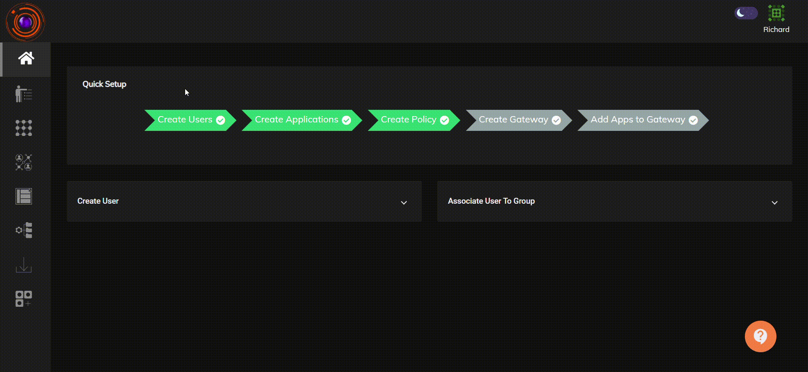
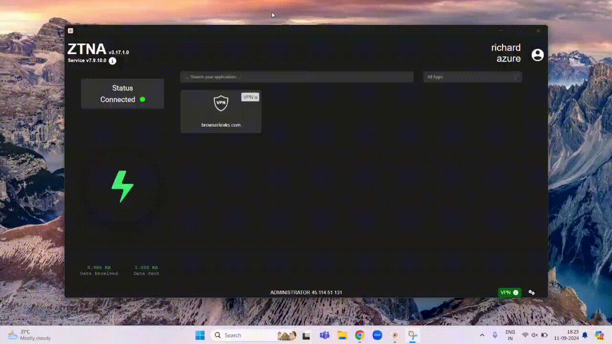

With unrestricted access to the internet at the workplace, it introduces a range of problems along with the many benefits. Unproductive or personal browsing by employees, the threat of downloading and infecting the enterprise network with viruses, malwares and bandwidth hogging are just a few of the numerous challenges.

The InstaSafe Zero Trust platform provides the  "Block Internet" endpoint control feature to mitigate security risks, enhance workforce productivity, and prevent unauthorized data access.

The "Block Internet" endpoint control feature gives Admins the control to block end users from accessing the internet on their devices. This feature can be applied over devices with Windows, Linux or Darwin operating systems. 

The InstaSafe Zero Trust platform provides the below two options to block internet access.

- **When VPN is Connected**: internet access will be blocked in the device when the user is connected to VPN provided by the InstaSafe ZTNA agent. Users will be able to access only those applications for which they have been granted access to through the secure gateways. 

- **When VPN is Not Connected**:  internet access will be blocked in the device when the user is not connected to VPN (InstaSafe ZTNA agent).

To create and apply the "Block Internet" endpoint control feature, Admins will have to perform the below steps:

- create a "Block Internet" endpoint control policy by selecting the operating systems in which it needs to be applied.

- select the Users/User Groups to which the policy needs to be applied.

- select from the options of “When VPN is Connected” or “When VPN is Not Connected” to block internet as per the organization requirement.  

Please refer to the below video on how to create a "Block Internet" endpoint control policy.

Please refer to  the below video on how the "Block Internet"  endpoint control policy gets applied in the end user devices with the “When VPN is Not Connected” option configured. 

As illustrated in the video, when a user is connected to the VPN which is provided by the  InstaSafe ZTNA agent, they will be able to access the applications to which they have been granted access to and also have internet access. Once a user disconnects from the VPN (InstaSafe ZTNA agent), they lose access to applications and internet access is also blocked.

