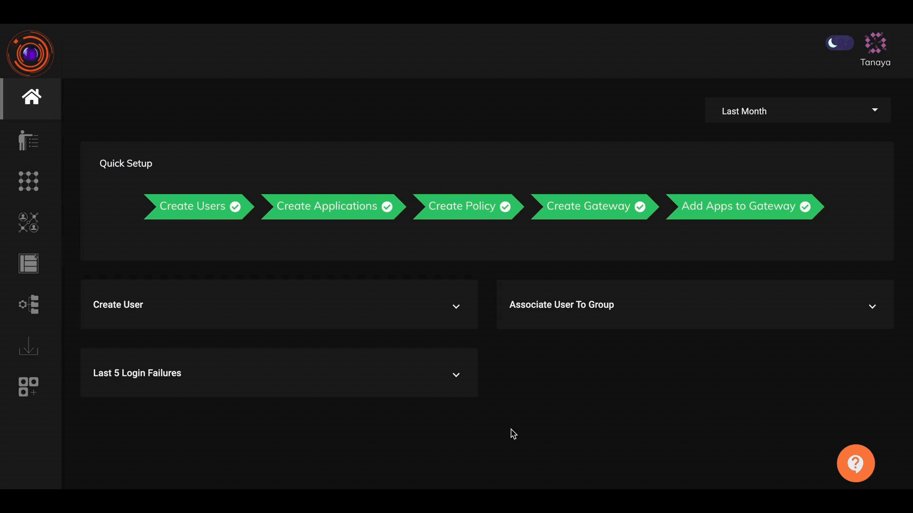

To leverage the expansive address space, enhanced security and efficient routing provided by IPv6 addresses, the the platform supports applications access with IPv6 & IPv4 addresses in a dual stack mode.

## Steps for configuring applications with IPv6 addresses

1. Create [network applications](https://docs.instasafe.io/Zero%20Trust%20Application%20Access/005-creatingapplication/) with their IPv6 addresses.
2. Define a IPv6 Pool Range in the [Global VPN Profile](https://docs.instasafe.io/Zero%20Trust%20Application%20Access/010-VPNProfileSetup/).
3. Upgrade the network gateway to version 7.0.0 or higher which supports applications with IPv4 & IPv6 addresses. Assign an IPv6 DNS to the gateway.
4. Publish the ZTNA service version 6.0.2.0 or higher which supports applications with IPv4 & IPv6 addresses in the [Agent Release](https://docs.instasafe.io/Zero%20Trust%20Application%20Access/005b-agentrelease/) section.

### Prerequisites

1. The network gateway instances should be dual stack supporting both IPv4 and IPv6 protocol.
2. The network gateway instances should have IPv6 application reachability.

Please refer the below video for configuring network applications with IPv6 addresses.

