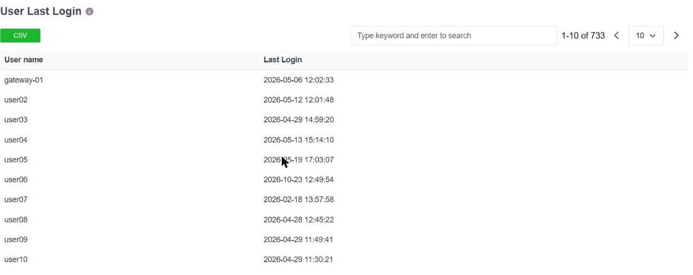
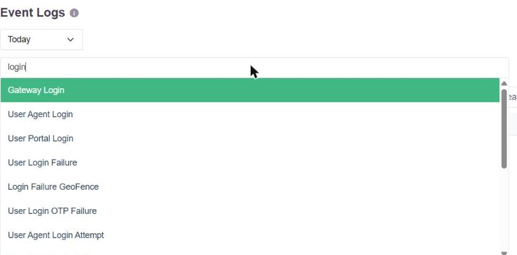
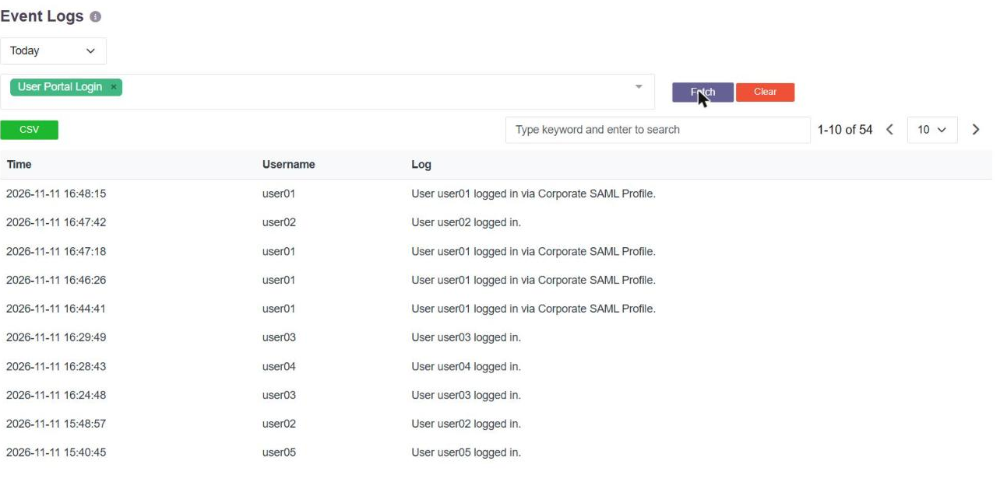

# Last Login, and Access by Day and Time

## What "last login" means

**Last Login Time** is the time of the last successful login performed in the **InstaSafe
User Portal** or the **InstaSafe Agent**. It is shown to administrators in two places: the
**User Last Login Report** and the **Event Logs**.

## User Last Login Report

**Logs & Reports → User Last Login** lists every user with the timestamp of their most
recent successful login, in `YYYY-MM-DD HH:MM:SS` format. Gateways are listed the same way,
with the time of their latest successful connection.

The list is searchable by keyword and paged. **CSV** exports the complete list - the
administrator receives an email with a download link, and the file carries the same two
columns. See [Reporting, Dashboards and Export](reporting-and-export.md).

The audit section also carries a **Never Logged In** view, which asks the same question the
other way round: accounts that exist and have never been used.

## Event Logs

**Logs & Reports → Event Log** holds the individual login events rather than a per-user
summary, so an administrator can see every login attempt and not only the latest one.

The event type selector carries a separate type for each kind of login, so the log can be
narrowed to exactly the one in question:

| Event type | What it records |
|---|---|
| **User Portal Login** | A successful sign-in to the InstaSafe User Portal |
| **User Agent Login** | A successful sign-in through the InstaSafe Agent |
| **Gateway Login** | A gateway's successful connection |
| **User Login Failure** | A failed sign-in |
| **User Login OTP Failure** | A sign-in that failed at the second factor |
| **Login Failure GeoFence** | A sign-in refused by the geolocation condition |
| **User Agent Login Attempt** | An agent sign-in attempt |

Selecting a type and clicking **Fetch** returns the matching events with their time, the
user, and the log line - including the authentication profile used, where the user signed in
through an external identity provider:

The date range above the filter sets the period, and **CSV** exports the result.

Because failed logins have their own event types, the same page answers both halves of the
question: when the account last signed in successfully, and whether anything else tried.

## To the user

The portal header shows the signed-in user the timestamp of their own previous portal
login, so a user who did not make that sign-in can see as much without going to an
administrator.

## Dormant accounts

**Long Inactivity Login** is available as a risk type, so an account that has not been used
for a long period and is then used again raises the risk profile's action rather than
passing unnoticed. The User Settings page separately carries **Inactive Users** actions -
Warning, Suspend and Delete.

## Restricting access by day and time

Access can be limited to particular days and hours as a contextual condition on the access
policy, rather than as a property of the account.

An **Application Access Time** dataset is created and populated with the days of the week
on which access is permitted, and a **Start Time** and **End Time** for those days. The
dataset is then attached to the policy, so the restriction applies to the users and
applications that policy covers.

Typical uses are allowing a business application only during working hours, and refusing
sensitive applications outside them or at weekends.

The full steps are in [Application Access Time](applicationaccesstime.md).
