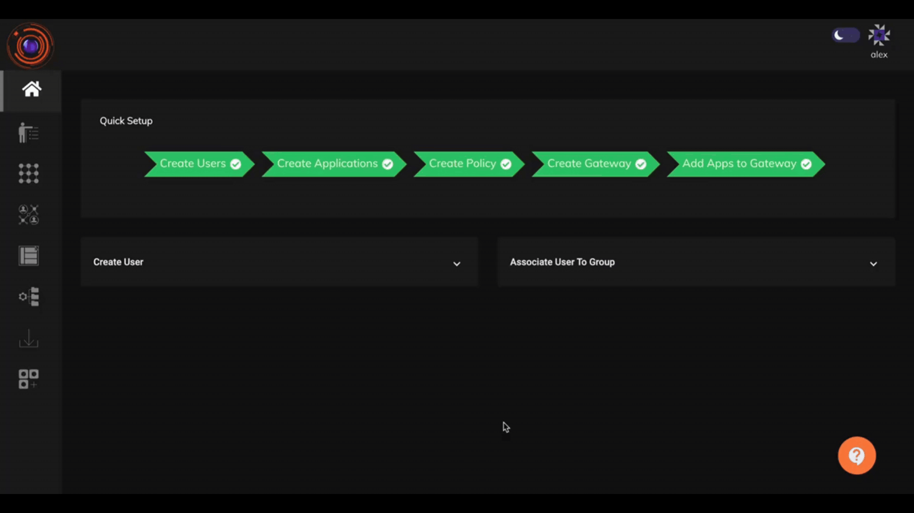

Multi-factor authentication (MFA) is a layered approach to securing physical and logical access where a system requires a user to present a combination of two or more different authenticators to verify a user’s identity for login. MFA increases security because even if one authenticator becomes compromised, unauthorized users will be unable to meet the second authentication requirement and will not be able to access the targeted physical space or computer system.

A typical MFA login would require the user to present some combination of the following:

• Something you know: like a password or Personal Identification Number (PIN).

• Something you have: like a smart card, mobile token, or hardware token.

• Something you are: some form of biometric factor (facial recognition, fingerprint, palm print or voice recognition).

## Enabling Multi-Factor Authentication in InstaSafe ZTNA

Two factor authentication can be enabled under Auth profile tab in Identity Management section of the InstaSafe ZTNA Admin console. The Admin can set a Global Auth Profile which will enable different primary authentication methods as well as secondary authentication for all users. Exclusion to Auth profiles can also  be created for individual user or user groups to customize the authentication profile as per the organisation requirements.

The various methods of available Primary Authentication are:

* Password: Logging into InstaSafe ZTNA directly via password.
* AD: Logging into InstaSafe ZTNA via Active Directory credentials.
* SAML: Logging into InstaSafe ZTNA via organization's identity provider.

The various methods of available Secondary Authentication are:

* Email OTP
* SMS OTP
* TOTP from [InstaSafe Authenticator app](https://docs.instasafe.com/Zero%20Trust%20Application%20Access/026authenticator/) or any other Authenticator app
* HOTP
* Push Notification from InstaSafe Authenticator app
* Security Question & Answer
* WebAuthn (FIDO2/Passkey)
* QR Code
* OTP via Phone Call

## Configure Global Authentication Profile 

1. Go to Auth Profiles tab under Identity Management.

2. Edit the Global Authentication profile.

3. Select the Primary mode of Authentication. In the Secondary Authentication enable OTP.

4. You may choose IP based filtering if you require else this can be skipped. This can be enabled later.

5. Set additional policies as per your organization's requirement. Click on Update once done.

The global Authentication Profile is now set.

The method to set up 2FA in InstaSafe ZTNA a can also be seen in the video given below.

## Adding Individual and Group level Exclusions

The Global auth profile is applicable on all users except for whom specific exclusions are provided. Exclusions can be configured for individuals as well as for user groups. Individual User exclusion takes precedence over Group exclusions which in turn precedes Global Auth Profile.

1. Under the Exclusion Tab select individual or Group based upon your requirements.

2. Add a new exclusion rule. Add User/User group to the rule. 

3. Select primary and secondary method of authentication.

4. Create additional rules as per your organization's requirement.

5. Click on Update once Done.

## Enabling Multi-Factor Authentication for Users that have Integrated InstaSafe Authenticator App

For users who have registered with the Instasafe Authenticator app, Two Factor Authentication will be automatically enabled for them even if it is not explicitly enabled for them in the Auth profile. This feature can be enabled for the specific tenant by the Admin.

**Transactional Authorization & Step-Up Verification**

The InstaSafe Zero Trust Platform strengthens security within active sessions by enabling transactional authorization for high-risk or sensitive actions. Rather than relying solely on initial login authentication, InstaSafe enforces policy-driven, real-time verification at the moment of action, ensuring that elevated operations are performed only by the legitimate, authorized user.

**Key Features:**

Policy-Driven Enforcement – Administrators can define granular policies to determine when additional verification is required (e.g., financial approvals, configuration changes, data exports).

Step-Up Authentication Methods – Supports a variety of modern verification options:

Re-authentication with primary credentials

TOTP (Time-based One-Time Password)

Push notifications via InstaSafe Authenticator

WebAuthn / FIDO2 biometric or hardware token validation

Number Challenge for phishing-resistant verification

Just-in-Time Consent/Signing – Requires explicit user confirmation before execution of critical actions, providing non-repudiation and auditability.

Seamless Integration – Works across web, mobile, and API-based transactions without disrupting standard user workflows.

## Second factors available to directory-authenticated users

A user whose password is held in Active Directory or OpenLDAP is challenged from the same set
of factors as any other user: TOTP from any authenticator application, push notification
through the InstaSafe Authenticator app, OTP over SMS, OTP over email, a FIDO2 hardware key,
or a backup code for recovery. Each user enrols their own factors on the Multi Factor
Authentication page of their profile, which additionally offers a digital certificate and a
second factor at Windows computer login.

Biometric, fingerprint and facial authentication are provided through WebAuthn / FIDO2 -
Windows Hello, a security key, or a passkey on the phone - where the biometric is read and
verified by the device itself and no biometric template is transmitted to or stored by the
platform.

See [Directory Authentication and the MFA Methods Available With It](directory-mfa.md).
