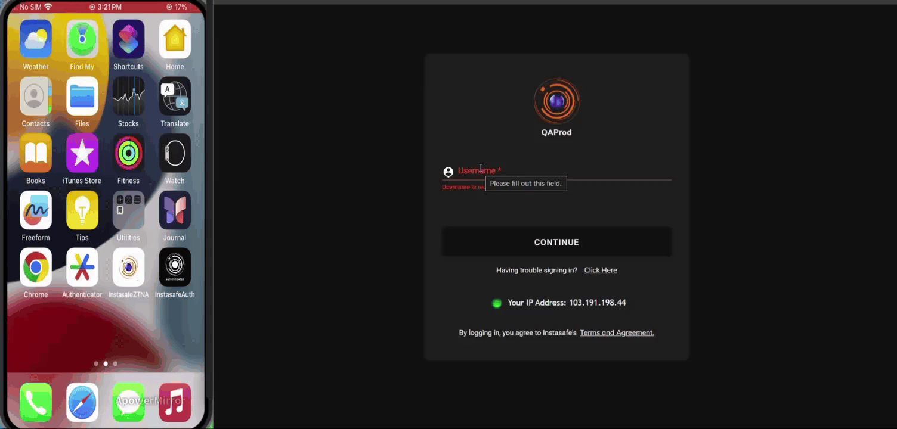
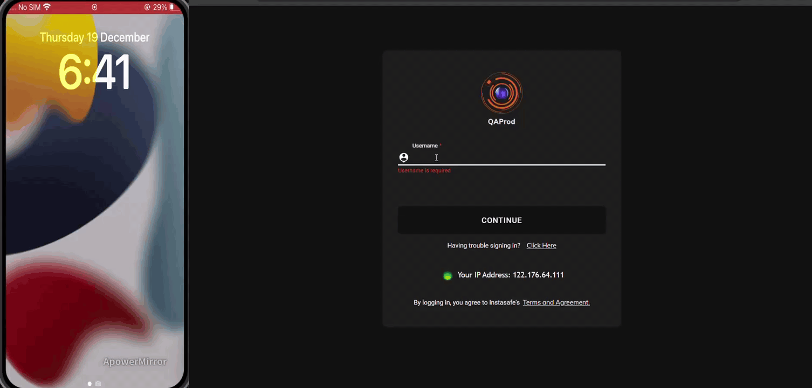
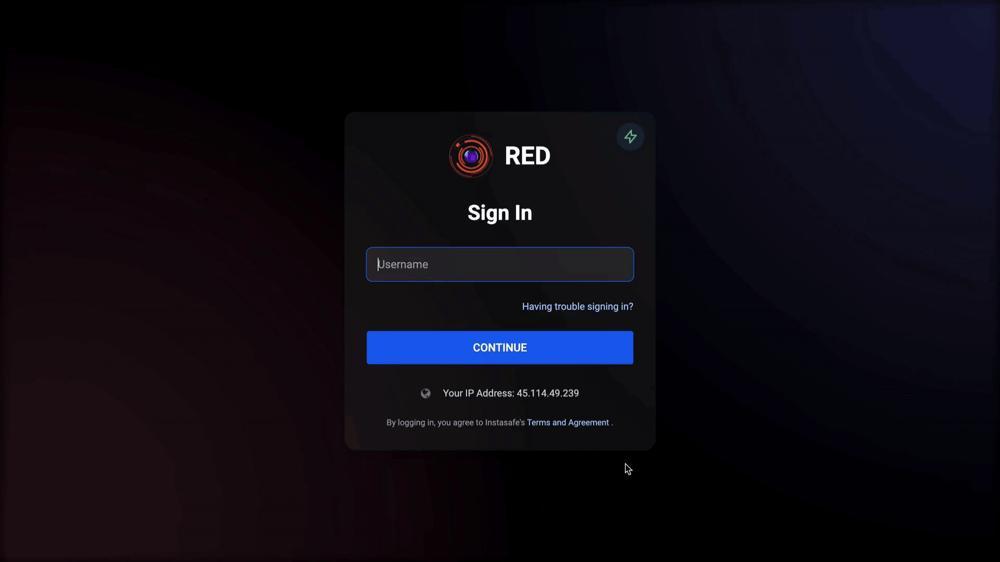

## MFA with Google Authenticator app ##

The below video illustrates on how users can scan a QR code in their profile to an Authenticator app (InstaSafe Authenticator/Google Authenticator/Microsoft Authenticator). Once the InstaSafe profile is configured in an Authenticator app, users can use the TOTP MFA option to login to the Agent, Desktop MFA and Web access.

## MFA with push notification in the InstaSafe Authenticator app ##

The Push Notification option of MFA login is available in the InstaSafe Authenticator app. The steps to download and configure the profile in the InstaSafe Authenticator app is available [here](https://docs.instasafe.com/Zero%20Trust%20Application%20Access/026authenticator/). The below video illustrates a login to the the platform by approving a push notification from the InstaSafe Authenticator app.

## MFA with Security Question & Answer ##

The below video illustrates on how users can submit the Answers for the Security Questions in their profile and use the Security Question MFA option to login to the Agent, Desktop MFA and Web access when they do not have a mobile device in their possession for TOTP/OTP MFA login and access to their emails to receive OTP.

