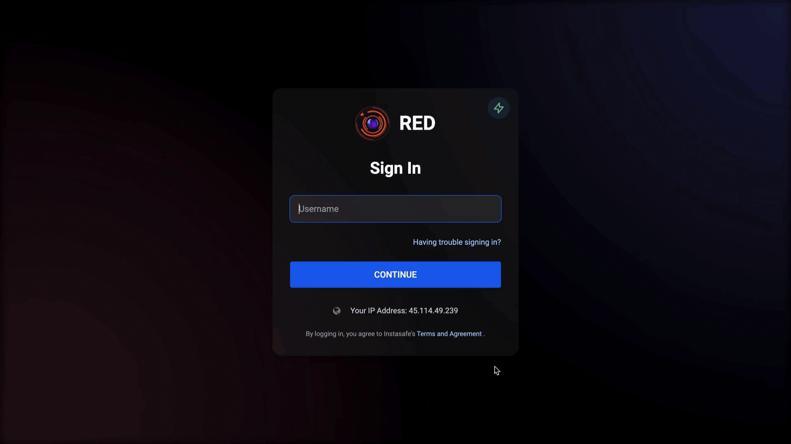

Security Question & Answer MFA is a secondary authentication mechanism used to enhance the security of user accounts by requiring users to provide correct responses to pre-configured security questions. This mechanism is typically employed alongside primary authentication methods, such as passwords or biometric systems. 

Security Question & Answer provides accessible MFA option for users when they do not have a mobile device in their possession for TOTP/OTP MFA login and access to their emails to receive OTP or access to hardware tokens.

The below video illustrates on how users can submit the Answers for the Security Questions in their profile and use the Security Question MFA option to login to the Agent, Desktop MFA and Web access when they do not have a mobile device in their possession for TOTP/OTP MFA login and access to their emails to receive OTP.

