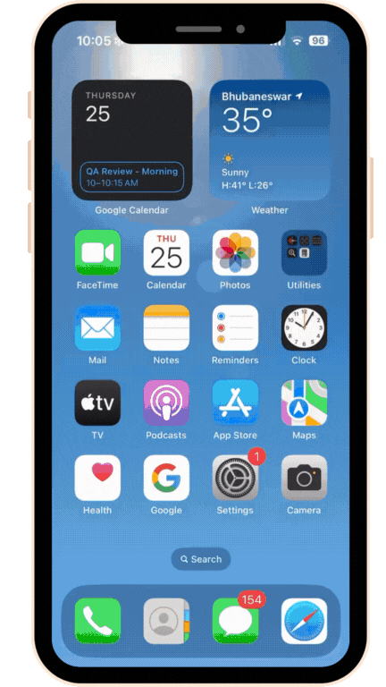

The Mobile Zero Trust Network Access Client (mZTNA) provides seamless access to network applications on mobile devices. It is available over both Android and iOS. Users can download the mZTNA client for Android and iOS from Google Play Store and Apple App Store respectively. 

Key highlights of the mZTNA client are as below:

- With a minimalistic user interface and compact size, the mobile application ensures a user-friendly experience and efficient use of device resources.

- Built natively for Android and iOS, mZTNA prioritizes performance, offering a smooth and responsive user interface.

#### Android Installation 

mZTNA client is available on android playstore as **InstaSafe mZTNA**. Please follow the below mentioned steps for installing the agent on an android device.

1. Open Google Play Store and search for  **InstaSafe mZTNA**.

2. Open the application page and click on Install.

3. Once installation is complete open the app and login with your InstaSafe ZTNA credentials.

4. InstaSafe ZTNA client setup on your android device is now complete.

The below video illustrates the installation of the mZTNA agent on an Android device.

#### IOS Installation 

InstaSafe ZTNA client is available on Apple appstore as **InstaSafe mZTNA**. Please follow the below mentioned steps for installing the agent on an iOS device.

1. Open Apple appstore and search for  **InstaSafe mZTNA**.

2. Open the application page and click on Install.

3. Once installation is complete, open the app and login with your credentials.

4. InstaSafe ZTNA client setup on your iOS device is now complete.

The below video illustrates the installation of the mZTNA agent on an iOS device.

