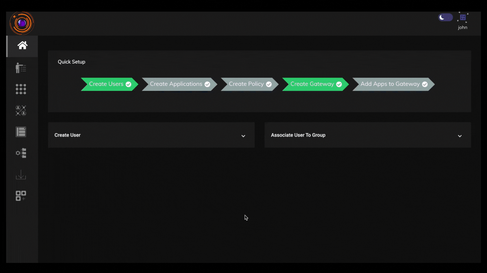
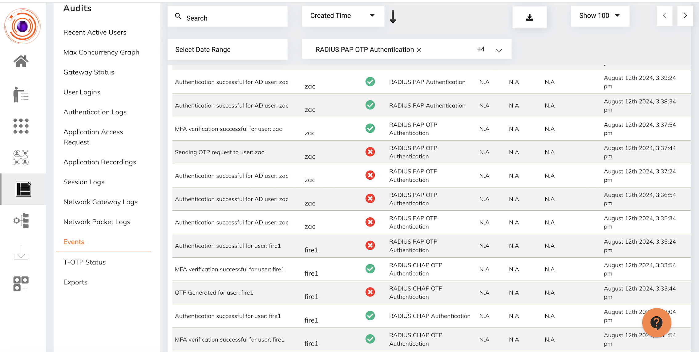
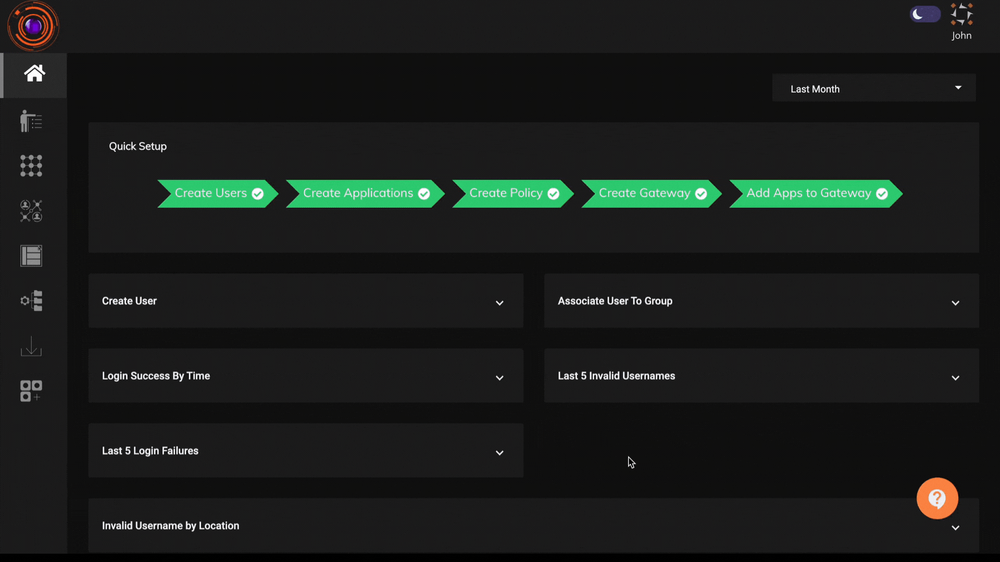

RADIUS (Remote Authentication Dial-In User Service) is a networking protocol that provides centralized Authentication, Authorization, and Accounting (AAA) management for users who connect and use a network service. RADIUS is commonly used for managing access to network resources, such as Wi-Fi networks, virtual private networks (VPNs), and other types of networked services.

RADIUS operates in a client-server architecture. Network devices (routers, switches, firewalls, VPNs, access points) act as RADIUS clients and forward authentication requests to the RADIUS server. The RADIUS server processes these requests, authenticates the user, and communicates the authorization and accounting information back to the client.

The InstaSafe Zero Trust platform (InstaSafe ZTNA) supports RADIUS authentication along with Multi-Factor Authentication (MFA) over PAP & CHAP authentication methods. The the platform acts as a RADIUS server and receives authentication requests from RADIUS clients, such as routers, firewalls or VPNs, verifies the credentials of the user, and returns an authorization decision to the client.

The below video displays the Multi-Factor Authentication (MFA) login from a OpenVPN client with the InstaSafe Zero Trust platform (InstaSafe ZTNA) configured as the RADIUS server. 

All RADIUS authentication requests are audited by the the platform. Below is the screenshot of the RADIUS PAP & CHAP authentication requests logged in the the platform.

The feature for configuring InstaSafe ZTNA as a RADIUS server is available in Identity Management -> Identity Provider

Please refer the below video to configure InstaSafe ZTNA as RADIUS server.

