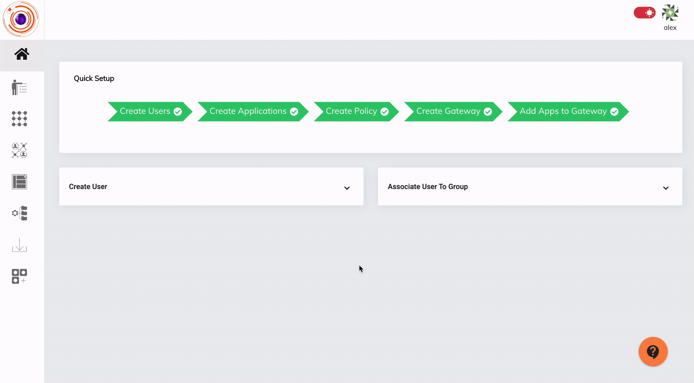
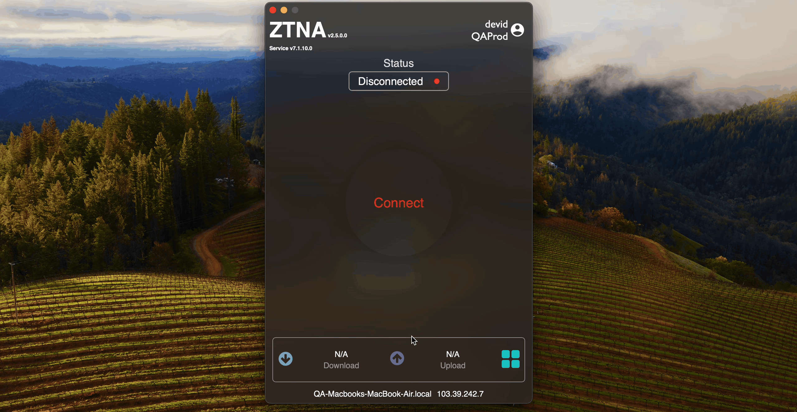

The Network Filter endpoint control feature allows Admins to block Domains or IP addresses in the end user devices. This feature can be applied over devices with either Windows, Linux or Darwin operating systems. Admins can choose whether to have this endpoint control applied when user connects to the ZTNA agent for VPN connectivity or have it applied when user boots his device.

To create and apply the Network Filter endpoint control feature, Admins will have to perform the below steps:

 - create a dataset of type 'FQDN' to define the Domains and IP addresses which needs to be blocked.

 - create a Network Filter endpoint control policy with the defined dataset and selecting the operating systems in which it needs to be applied.
 
 - select the Users/User Groups to which the policy needs to be applied.

 Please refer the below video on how to create a Network Filter endpoint control policy.

 Please refer the below video on how the Network Filter endpoint control policy gets applied in the end user systems.

 

