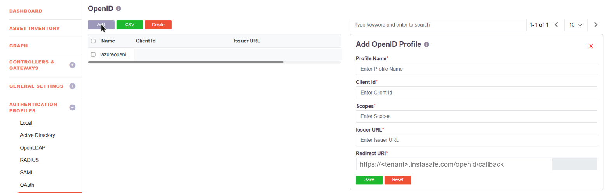
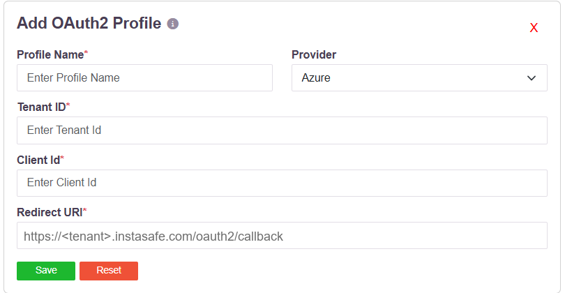
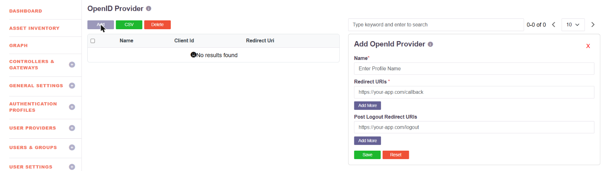

# OAuth 2.0 and OpenID Connect Single Sign-On

Single sign-on works in both directions, and the two are configured in different parts of
the console.

| Direction | What it means | Where |
|---|---|---|
| **Consuming an external identity provider** | Users sign in to the platform with credentials held by an existing IdP | Authentication Profiles → **OpenID** or **OAuth** |
| **Acting as the identity provider** | Other applications send their users to the platform to authenticate | IDAM → **OpenID Provider**, **OAuth2 Service**, **SAML IDP**, **RADIUS Service** |

SAML is supported alongside OpenID Connect in both directions - see
[Log into ZTAA via SSO](013b-ConfiguringZTAAasSPwithSAML.md) and
[ZTAA as IDP for SSO](013-ConfiguringZTAAasSSOwithSAML.md).

## Signing in with an external identity provider

### OpenID Connect

An OpenID profile registers the platform as a relying party at the provider.

| Field | What it takes |
|---|---|
| **Profile Name** | A name for the profile |
| **Client Id** | The client identifier issued by the provider |
| **Scopes** | The scopes requested at authentication |
| **Issuer URL** | The provider's issuer, from its discovery document |
| **Redirect URI** | Supplied by the platform; register it at the provider |

Because the profile is defined by issuer, client id and scopes, any provider that publishes
a standard OpenID Connect discovery document can be used.

### OAuth 2.0

An OAuth profile covers providers reached through their OAuth 2.0 endpoints.

**Provider** offers **Generic**, **Google** and **Azure**. Google and Azure fill in the
provider's own endpoints; **Generic** is for any other OAuth 2.0 provider. Azure also takes
a **Tenant ID**.

More than one profile can exist at a time, so different sets of users can authenticate
against different providers.

## Acting as the identity provider

Under **IDAM**, the platform publishes itself as an identity provider so that other
applications delegate authentication to it. **OpenID Provider** registers a relying party:

| Field | What it takes |
|---|---|
| **Name** | A name for the registered application |
| **Redirect URIs** | Where the application receives the response. **Add More** registers several |
| **Post Logout Redirect URIs** | Where the user lands after signing out. **Add More** registers several |

A client id is generated for the application and shown in the list once saved.

The same menu carries **OAuth2 Service** for OAuth 2.0 clients, **SAML IDP** for SAML
service providers, and **RADIUS Service**. For applications that are neither SAML nor
OIDC, authentication can also be driven through the platform's OAuth 2.0 APIs - see
[API based SSO](apibasedsso.md).
