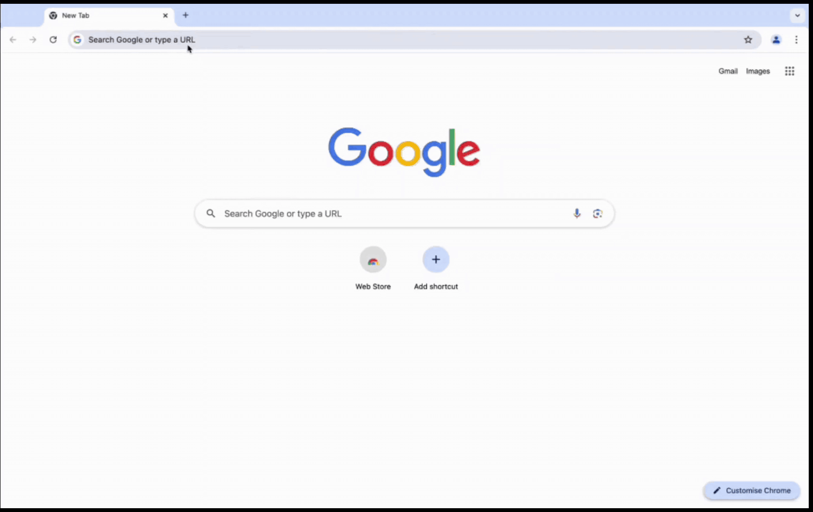

With all day-to-day business communication happening over email, inboxes have become a treasure trove of sensitive and confidential enterprise data. Emails are increasingly being targeted by malicious actors to get access to inboxes and carry out further phishing attacks. Microsoft Outlook Web Access (OWA) being widely used for emails by enterprises remains the target of malicious actors. 

Multi-factor authentication (MFA) is the logical answer for protecting OWA access. Below are some key reasons why MFA is important for email access:

**Increased Security**: MFA adds an extra layer of protection beyond just a username and password for email access. Even if a password is compromised, the second factor (like a OTP, TOTP, Passkey, Security Question/Answer) is needed to access the account.

**Protection Against Phishing**: With MFA, even if users fall for phishing attacks and provide their passwords, unauthorized access is still prevented without the second factor.

**Compliance Requirements**: Many organizations are required to implement MFA for Email access to comply with industry regulations and standards, protecting sensitive data.

**Reduced Risk of Account Takeover**: MFA significantly decreases the risk of email account takeovers, which can lead to data breaches and loss of confidential information.

**Safeguarding Remote Access**: With the rise of remote work, securing access to corporate email and resources via OWA is crucial. MFA helps ensure that only authorized users can access sensitive information from various locations and devices.

The below video illustrates how InstaSafe ZTNA solution secures Outlook Web Access with Two-Factor authentication.

Users while trying to access Outlook Web Access are redirected to the InstaSafe platform where they need to perform a multi-factor 
authentication. If the authentication is successful then users are granted access to Outlook Web Access.

