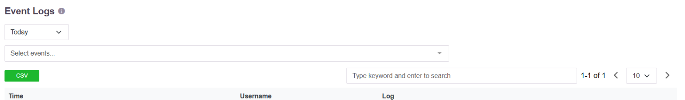
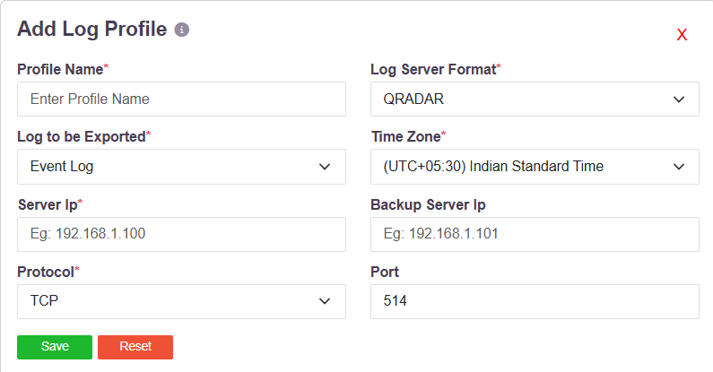

# Reporting, Dashboards and Export

Reporting works in three layers. The console carries a dashboard and a set of reports that
are ready to use. Any of those reports can be filtered, exported, or scheduled to arrive by
email. And the underlying logs can be streamed to an external analytics platform, which is
where an organisation builds dashboards and reports of its own design.

## The dashboard

The dashboard opens on the platform's operating state: online gateways, online users,
licensed user count against subscription, and the renewal date. Below it sit four panels -
**Top Data Usages**, **Top Time Usages**, **Anomalies by Type** and **Top Blocked
Services** - each with its own **Today / Week / Month** selector, so the same panel can be
read over three different periods without leaving the page.

## The reports

| Report | What it covers |
|---|---|
| Live Users · Live Gateways | Who and what is connected right now |
| Session Log | Connection sessions, with times |
| Access Log · Application Access Log · Portal Access Log | Which user reached which application, and when |
| Event Log | Configuration and system events |
| Login Failures | Failed authentication attempts |
| User Last Login Report | Last successful login per user |
| Data Usage · Time Usage | Consumption per user and per application |
| Risk Report | Users scored against their risk profiles |
| Network Test | Connectivity diagnostics |
| User · User Group · Devices · Gateways · Application Services · Access Policies · Application Groups | Inventory of what is configured |

Every report page carries the same controls: a period selector, a filter for the record
type, a free-text search, page-size control, and a **CSV** button that exports what is on
screen.

## Scheduled delivery

Any combination of these reports can be scheduled to arrive by email - daily, weekly or
monthly, at a chosen time and timezone, to a list of recipients. See
[Email Alerts and Scheduled Reports](email-alerts.md).

## Export to an external analytics platform

This is the layer that answers custom dashboards and custom reports. Logs are exported to
the organisation's own analytics or SIEM platform, where dashboards, correlations and
reports are built to whatever specification is wanted, alongside data from other systems.

An export profile names the destination and what to send:

| Field | What it takes |
|---|---|
| **Profile Name** | A name for the profile |
| **Log Server Format** | **QRADAR**, **ARCSIGHT**, **SPLUNK**, **SYSLOG**, **SCP**, **SFTP** or **EMAIL** |
| **Log to be Exported** | Event Log, Session Log, or App Access Log |
| **Time Zone** | The timezone stamps are written in |
| **Server Ip** and **Backup Server Ip** | The destination, and a fallback |
| **Protocol** and **Port** | TCP or UDP, and the port - 514 by default |

Because QRadar, ArcSight and Splunk are named formats rather than generic syslog, the
records arrive parsed and ready to query, not as unstructured text.

For streaming system events to a SIEM in Syslog or FTP/SFTP form, see
[Event Stream](018-eventstream.md).

## What this does and does not include

The console's dashboard and report set are fixed: they are configured and filtered, not
designed. There is no report designer inside the console. Reporting that an organisation
wants in its own shape is built on the exported data, in the platform it already uses for
that purpose.
