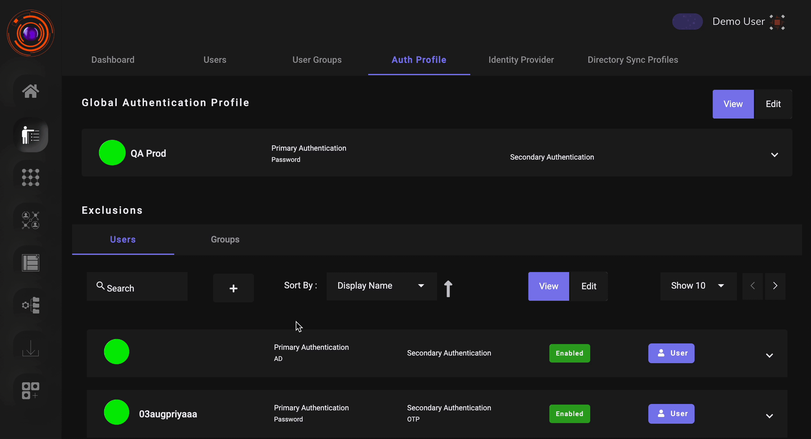

InstaSafe ZTNA besides enforcing strict access control can also restrict user access to the the agent and agentless web application from certain IP/IP range. The admin can blacklist or whitelist IP/IP range for individual user/user group/organization. Whitelisting will enable the user to login from the whitelisted IP and block access from all other IP's whereas blackisting will restrict access from a particular IP/IP range.

Use case for whitelisting IP can be when the organization wants that the users can access the the agent or agentless web application only when they are trying to access it from the office LAN.

Steps to enable IP Whitelisting or Blackisting:

1. Go to Auth Profile tab from Identity Mangement section.

2. Select the Authentication profile for the User/User Group for whom you want to enable IP based filtering.

3. Go to Filter Auth Chain tab under individual auth profile. Check the Filter Chain Auth option to enable IP based filtering.

4. Toggle the button for whitelisting or blackisting IP. Enter the IP/IP range and click on Update.

