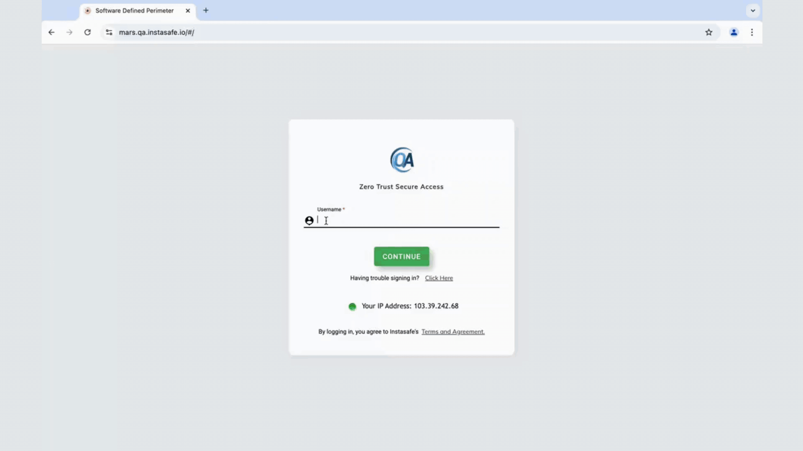
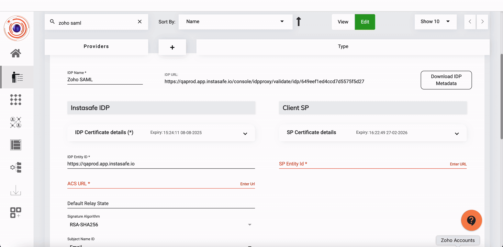

**Superseded.** This is the previous version of this page, kept for comparison. The current
page is [SAML Single Sign-On](saml-single-sign-on.md).

Security Assertion Markup Language (SAML) is an XML-based open security standard framework for authentication and authorization across two different systems (Service Provider and an Identity Provider).

InstaSafe ZTAA can act as an Single Sign On solution for applications that support login via SAML.

The below video illustrates how Single Sign On login can be done to mulitple SAML supported applications with InstaSafe ZTAA acting as the Identity Provider.


 


**Supported Configuration**

```
InstaSafe supports two kinds of SAML Configuration.

•Frontend SAML -> Backend Local 

In this Case the ZTAA is directly used as an IDP to log into the 
Application. 

Application (SP)---> ZTAA(IDP)

•Frontend SAML - Back End SAML

In this scenario an organization already uses an IDP and wants to use ZTAA for 
other features while still retaining a different primary IDP. In this case ZTAA 
functions as a proxy acting as both an Identity provider for the application as 
well as a service provider for the primary IDP. When any User tries logging in to 
the application, request will first come to InstaSafe. InstaSafe will forward the 
request to primary IDP.

The response received will be modified and forwarded to the application.


Application (SP) ---->ZTAA(IDP)  ||  ZTAA(SP)-----> APP(IDP)
```

### Setting up ZTAA as an IDP


**Terminologies**

•	Identity provider performs the authentication i.e., verifies the end user and establishes identity by confirming that the end users are who they say they are and sends that data to the service provider.

•	Service Provider is the application that needs the authentication from the identity provider and uses the established identity to grant authorization to the user.

| **Basic SAML Configuration setting** | **SP Initiated** | **IdP-Initiated** | **Description** | 
| ------ | ------ |------ | ------ |
| **Identifier (Entity ID)** | Required for some apps | Required for some apps | Entity ID An entity ID is a globally unique name for a SAML entity, either an Identity Provider (IdP) or a Service Provider (SP). The first step in configuring any SAML deployment is to choose a permanent name for the entityThis field will Uniquely identify the application. ZTAA sends the identifier to the application as the Audience parameter of the SAML token. The Service Provider application is expected to validate it. This value also appears as the **IDP Entity ID** in ZTAA  the application.| 
| **ACS URL (Reply URL/Redirection URL)** | Required | Required |Assertion consumer service (ACS) endpoint is a location to which the SSO tokens are sent, according to partner requirements. ACS is applicable to all SAML versions and both the IdP- and SP-initiated SSO profiles.| 
| **Sign-on URL** | Required | Need not be specified | When a user opens this URL, the service provider redirects to ZTAA to authenticate and sign on the user. Azure AD uses the URL to start the application from Microsoft 365 or Azure AD My Apps. When blank, Azure AD does an IdP-initiated sign-on when a user launches the application from Microsoft 365, Azure AD My Apps, or the Azure AD SSO URL.|
| **IDP URL/SSO URL** | Auto Generated | Required | The URL of the SAML IdP that handles sign-in requests and upon successful authentication issues the SAML token  along with user details to the service provider.|

### ZTAA(Identity Provider) Set up

1. Login as Admin 
2. Go To Identity Management >> Identity Provider
3. Click on Add and give name 
4. Select Generic SAML SP
5. Click on next 
6. Now Click on Generate Certificate.
7. Fill in the details as

 * ACS URL and SP Entity ID will be obtained from the SP configuration page.

 * IDP Entity ID can be chosen by admin. However, it is recommended to use Tenant Domain name as IDP Entity ID

 * SP Certificate is not Mandatory.

 * Remaining fields automatically containing default values and will be modified depending upon Service Provider.

 * Enable toggle to  Allow access from browser/desktop/mobile, as desired.

```
The documentation is to serve as a guide to be used while configuring ZTAA as an IDP. 
While the general steps remain same , nomenclature of fields and configuration flow may 
vary from application to application.
```

### Configuring ZTAA as an Identity Provider to access Freshdesk

**Settings IN ZTAA**

*  Signed Assertion to be changed to true.

*  IDP entity to be defined and the same value is to pasted in Service provider.

*  ACS URL and SP entity ID to be obtained from Freshdesk and pasted here. Upon saving the configuration IDP URL and Logout URL will be generated. 

**Settings in Freshdesk**

1.	Login into Freshdesk with admin credentials
2.	Go to SSO in security settings.
3.	Copy the ACS URL (SAML SSO URL) and paste it in respective field in ZTAA console.
4.  Copy IDP certificate from identity provider (generated in ZTAA) and paste it into respective field in Freshdesk.
5.  Change the Signing Option to "Signed Assertion only".
6.  The IDP URL generated in ZTAA is to be pasted in SSO URL. 
7.  Click on Configure SSO to finish setup.

The above steps and the process of configuring ZTAA as a SSO for Freshdesk can be seen in the video below.

 

### Configuring ZTAA as an Identity Provider to ZenDesk

1.	Login into Zendesk with admin credentials
2.	Go to security setting >SSO
3.	Copy the ACS URL (SAML SSO URL) and paste it in respective field in ZTAA console.
4. Copy IDP certificate from identity provider and paste into SAML one Login Tool>Calculate Fingerprint.
5. Paste the obtained certificate fingerprint in ZenDesk Portal
6. Click on save
7. Go to Staff members>Enable External authentication and select Single sign on>click on save. Go to End Users > Enable External authentication and Click on save.
8. The Service Provider URL will be generated. Copy the Same and Paste it in respective field in  ZTAA  console.
9. Enable all toggle Allow access from browser/Allow access from desktop/Allow access from mobile
10. Click on Next 
11. Select Backend Type Local
12. Click on Submit.


### Configuring ZTAA as an Identity Provider to access Zoho

The below video illustrates the steps to configure ZTAA as an Identity Provider to access Zoho.



**Broad Protocol Support for Interoperability**

InstaSafe’s Zero Trust Security Platform and Authenticator App are designed for seamless integration with diverse enterprise environments. To enable federated identity management and single sign-on (SSO) across hybrid IT ecosystems, InstaSafe supports multiple industry-standard authentication and federation protocols.

**Supported Protocols:**

OAuth 2.0 – Token-based authorization for secure API and application access.

OpenID Connect (OIDC) – Layered identity framework over OAuth 2.0 for user authentication.

WS-Federation (WS-Fed) – Standards-based identity federation for web applications.

WS-Trust – Security token exchange framework enabling interoperability in SOA environments.

Active Directory Federation Services (ADFS) – Integration with Microsoft environments for single sign-on.

Liberty Alliance Protocols – Federated identity and SSO capabilities for cross-domain interoperability.

**Benefits:**

Seamless Integration with legacy, cloud, and modern applications.

Future-Proof Compatibility with evolving identity standards.

Vendor Neutral design ensuring smooth deployment in heterogeneous IT environments.

**Single Logout (SLO) & Complete Session Revocation**

The InstaSafe Zero Trust Platform provides robust Single Logout (SLO) functionality, ensuring that when a user terminates a session, the logout action is propagated across all integrated applications and devices. This prevents residual active sessions, mitigating the risk of unauthorized access from unattended or compromised endpoints.

**Key Features:**

Centralized Session Termination – A single logout action ends sessions across all federated applications and services.

Protocol Support –

SAML: Supports both front-channel and back-channel logout flows.

OIDC / OAuth 2.0: Standards-based sign-out flows for modern applications.

Complete Session Revocation – Ensures tokens, cookies, and active sessions are invalidated to prevent session hijacking.

Cross-Device Enforcement – Logout is synchronized across web, mobile, and desktop environments.
