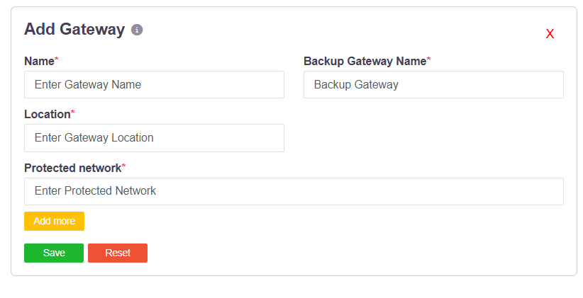

# Split Tunnel and Full Tunnel

Which of a user's traffic enters the tunnel is not a setting on the endpoint and is not a
mode the agent is built in. It follows from two things an administrator configures
centrally:

- the **protected networks** a gateway declares, and
- the **access policy** that entitles a user or user group to reach them.

Change what the policy grants and the scope of the tunnel changes with it. That is what
makes split tunnel and full tunnel a property of the policy rather than of the client.

| | What the user's device tunnels |
|---|---|
| **Split tunnel** | Only the addresses the policy grants. Everything else leaves the device directly. |
| **Full tunnel** | Everything, by granting the policy `0.0.0.0/0`. |

## The gateway declares what sits behind it

A gateway profile names the addresses and subnets it fronts:

**Protected network** takes an address or a subnet in CIDR notation - `192.168.1.1/32` for
a single host, `192.168.1.0/24` for a subnet - and **Add more** declares as many as the
gateway serves. See [Create Gateways](006-creatinggateways.md).

## The access policy decides who reaches them

An access rule binds a user or user group to an application or application group. When a
rule allows access, the controller does two things:

1. sends the route for that destination to the user's agent, which installs it on the
   device, and
2. sends the matching route and ports to the gateway agent, so the gateway will carry that
   traffic.

See [Role-Based Application Access Control](007-accesscontrol.md).

## Split tunnel

This is the behaviour that follows when the policy grants named destinations.

Only traffic destined for addresses the user is entitled to reach is routed into the
tunnel. Everything else - the public internet, the user's local network, anything the policy
does not cover - leaves the device directly and never touches the platform. Nothing is
carried that the policy has not allowed, and an address that is neither a protected network
behind a gateway nor in an allow rule is not reachable at all.

## Full tunnel

Full tunnel is configured by granting the policy **`0.0.0.0/0`**. With the default route in
the policy, the whole of the user's traffic is carried through the tunnel rather than only
the named destinations.

Two things are required, and both are central:

1. The gateway that is to serve the full-tunnel traffic must carry **`0.0.0.0/0` as a
   protected network**. A gateway only carries what it declares, so the gateway intended to
   handle this traffic has to be the one that declares the default route.
2. The access policy granting `0.0.0.0/0` is **assigned to one or more users or user
   groups**, like any other policy.

Because the grant lives in the policy, full tunnel applies to the users and groups that
policy covers and to no one else.

## Both, in one deployment

Nothing forces a single choice across the estate. The agent is the same build in both cases;
only the policy differs. So a deployment can run:

| | |
|---|---|
| **Full tunnel for one group** | A policy granting `0.0.0.0/0`, served by a gateway that declares it |
| **Split tunnel for another** | A policy granting only the named applications, from the same or another gateway |

and move a group from one to the other by editing a policy, with no change on any endpoint.

| | |
|---|---|
| **Scope is per policy** | Two groups with different entitlements carry different traffic through the tunnel, from the same agent. |
| **It changes centrally** | Widening or narrowing what a group tunnels is an edit to an access rule or a gateway's protected networks. |
| **Revocation is immediate** | Removing an entitlement removes the route. |

## Related controls

**Allow Direct Access from Public IPs** on the User Settings page forces traffic to bypass
the tunnel for users at named public addresses, which is useful when a user is on the
corporate LAN with the agent connected - see
[Restricting Access by Public IP](wan-ip-restriction.md).

The **Network Filter** endpoint control blocks domains and addresses on the device itself,
independently of the tunnel - see [Network Filter](networkfilter.md).
