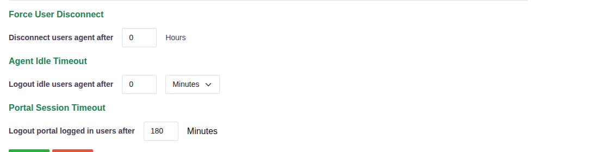
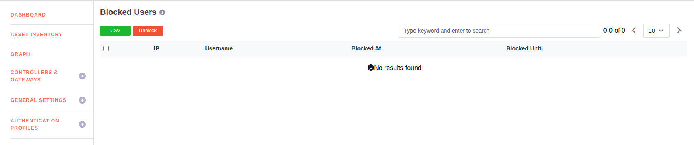

# Account Lockout, Idle Timeout and Forced Logout

Three separate controls govern how long a session lasts and what happens when access is
abused. They are configured in different places, so they are set out here together.

## Idle timeout and session timeout

Both are set on the **User Settings** page, under the User Settings menu.

| Setting | What it does |
|---|---|
| **Agent Idle Timeout** - *Logout idle users agent after* | Logs out a user whose agent has been idle for the set period. Takes a number plus **Minutes** or **Hours**. |
| **Portal Session Timeout** - *Logout portal logged in users after* | Ends a signed-in portal session after the set number of minutes, idle or not. |
| **Force User Disconnect** - *Disconnect users agent after* | Disconnects the agent after the set number of hours, regardless of activity. This is the forced logout. |

A value of `0` leaves that control off. In the deployment shown, the portal session ends
after 180 minutes.

The portal also shows the user a countdown to their own session expiry in the header, so a
session never ends without warning.

## Forced logout by an administrator

Besides the timed disconnect above, an administrator can end a session on demand. On
**Recent Active Users** under Audit, every user connected through the agent is listed, and
the administrator can log a user out remotely from the console - the control intended for
use when something looks wrong. See [Audit Logs](017-auditlog.md).

## Account lockout

Repeated failed access attempts cause the account and the source address to be blocked.
Blocks are listed on the **Blocked Users** page under Users & Groups:

| Column | What it holds |
|---|---|
| **IP** | The address the attempts came from |
| **Username** | The account that was being attempted |
| **Blocked At** | When the block started |
| **Blocked Until** | When it lifts by itself |

A block therefore expires on its own, and an administrator can release one early by
selecting it and clicking **Unblock**. The list exports to CSV.

### Policy response to failed attempts

Lockout is not the only answer available to failed authentication. A **risk profile** can
act on **Login Failure** and **MFA Failure** directly, and the action is chosen by the
administrator:

| Action | Effect on a user tripping the profile |
|---|---|
| **Deny Access** | The attempt is refused |
| **Suspend User** | The account is suspended |
| **Disconnect User** | The session is ended |
| **Email Admin** | An alert is sent |

So the response to repeated failures is configurable, per group of users, through the
profile that applies to them. See
[Email Alerts and Scheduled Reports](email-alerts.md) for how risk profiles are built.

Lockout, suspension and disconnection all appear in the audit record - see
[Audit Logs](017-auditlog.md) for the Authentication Logs and Events reports.
