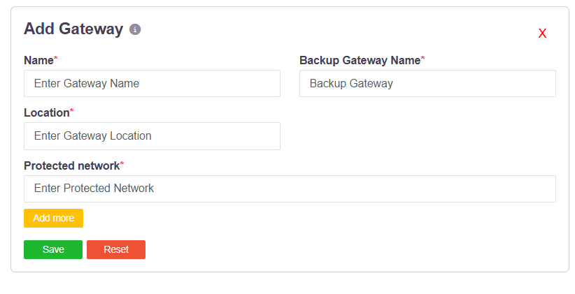

# What Traffic Goes Through the Tunnel

Which of a user's traffic enters the tunnel is not a setting on the endpoint. It follows
from two things an administrator configures centrally: the networks a gateway protects, and
the access policies that entitle users to reach them.

## The gateway declares what sits behind it

A gateway profile names the internal addresses and subnets it fronts:

**Protected network** takes an address or a subnet in CIDR notation - `192.168.1.1/32` for a
single host, `192.168.1.0/24` for a subnet - and **Add more** declares as many as the
gateway serves. See [Create Gateways](006-creatinggateways.md).

## The access policy decides who reaches them

An access rule binds a user or user group to an application or application group. When a
rule allows access, the controller does two things:

1. sends the route for that destination to the user's agent, which installs it on the
   device, and
2. sends the matching route and ports to the gateway agent, so the gateway will carry that
   traffic.

See [Role-Based Application Access Control](007-accesscontrol.md).

## What follows from that

Only traffic destined for addresses the user is entitled to reach is routed into the tunnel.
Everything else - the public internet, the user's local network, anything the policy does not
cover - leaves the device directly and never touches the platform. Nothing is carried that
the policy has not allowed.

The consequences worth knowing:

| | |
|---|---|
| **Scope is per policy** | Two user groups with different entitlements carry different traffic through the tunnel, from the same build of the agent. |
| **It changes centrally** | Widening or narrowing what a group tunnels is an edit to an access rule or a gateway's protected networks, not a change on the endpoint. |
| **Revocation is immediate** | Removing an entitlement removes the route. |
| **Nothing is exposed by default** | An address that is not a protected network behind a gateway, and not in an allow rule, is not reachable at all. |

Related controls: **Allow Direct Access from Public IPs** on the User Settings page forces
traffic to bypass the tunnel for users at named public addresses, which is useful when a
user is on the corporate LAN with the agent connected - see
[Restricting Access by Public IP](wan-ip-restriction.md). The **Network Filter** endpoint
control blocks domains and addresses on the device itself, independently of the tunnel - see
[Network Filter](networkfilter.md).
