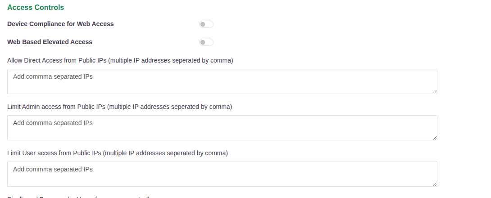
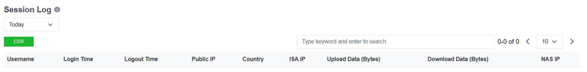

# Restricting Access by Public IP

Access can be restricted by the public (WAN) IP address a user connects from, and every
session is recorded with the address it came from. The restriction is applied at two levels.

## Organisation-wide, on the User Settings page

Two fields under **Access Controls** take a comma-separated list of public IP addresses:

| Field | Effect |
|---|---|
| **Limit Admin access from Public IPs** | Administrators can reach the console only from the listed addresses |
| **Limit User access from Public IPs** | Users can connect only from the listed addresses |

Listing addresses here restricts everyone in the tenant. Leaving a field empty applies no
restriction at that level. The same section also carries **Allow Direct Access from Public
IPs**, which is a routing exception rather than a restriction.

## Per user, group or organisation, on the authentication profile

Finer control is applied on the authentication profile itself, through **Filter Auth
Chain**, where an address or range can be either allowed or blocked:

| Mode | Effect |
|---|---|
| **Whitelist** | The user can sign in from the listed addresses and from nowhere else |
| **Blacklist** | The user is refused from the listed addresses and allowed from anywhere else |

This is set per individual user, per user group, or for the whole organisation, so a
restriction can be as narrow as one account. The typical use is to allow a group to connect
only from the office network. The steps are in [Restrict Access](restrict_access.md) and
[Filter Auth Chain](012-Filterauthchain.md).

Because the filter sits on the authentication profile, an unauthorised address is refused at
sign-in, before any application is reached.

## The audit record

Every session carries the address it came from. The **Session Log** records, per session:

| Column | |
|---|---|
| **Username** | Who connected |
| **Login Time**, **Logout Time** | When the session began and ended |
| **Public IP** | The WAN address the user connected from |
| **Country** | Where that address is registered |
| **ISA IP** | The address assigned inside the tunnel |
| **Upload / Download Data (Bytes)** | Volume moved in the session |
| **NAS IP** | The gateway that served the session |

The log is filtered by Hour, Today, Last 24 Hours, Week, Month or a date range, searched by
keyword, and exported with the **CSV** button.

Attempts that are refused are recorded too. An account and address that exceed the allowed
number of failed attempts appear on the **Blocked Users** page with the address, the account,
the time the block was applied and the time it lifts - see
[Account Lockout, Idle Timeout and Forced Logout](session-controls.md). Administrator actions
in the console, including changes to these restrictions, are recorded in the **Access Logs**
and **Event Log**.

All of these logs can be streamed to an external SIEM for longer retention and correlation -
see [Reporting, Dashboards and Export](reporting-and-export.md).
