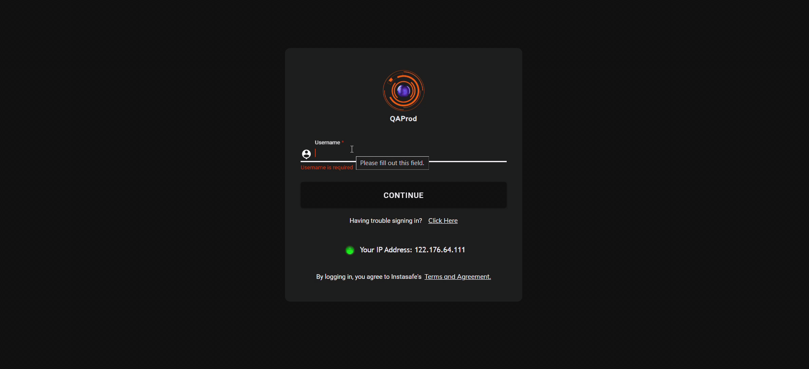
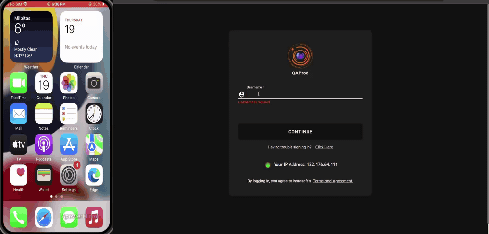
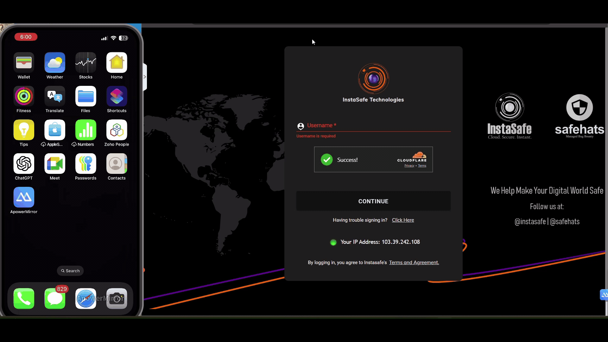
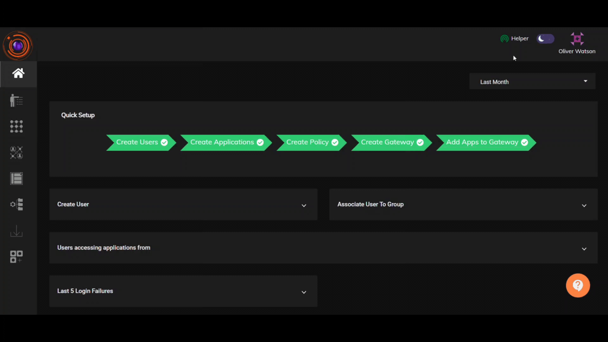
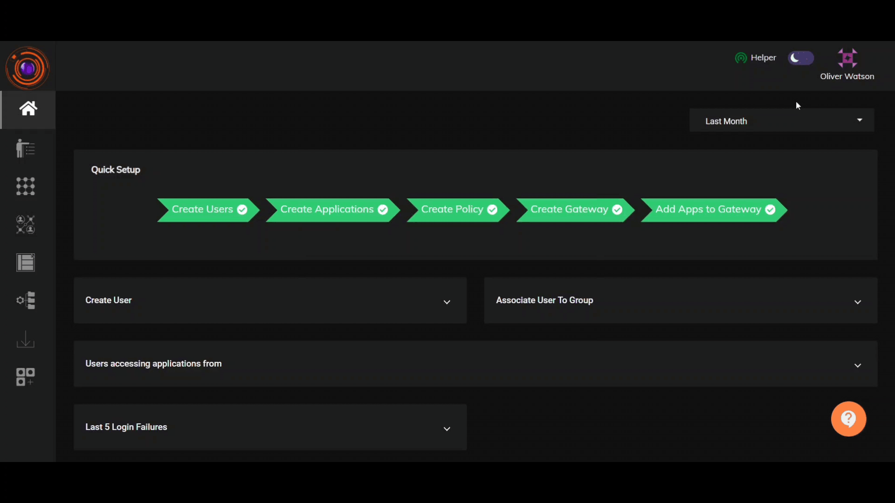

WebAuthn (Web Authentication) is a modern authentication standard that facilitates secure and phishing-resistant login experiences. It can be used as a Multi-Factor Authentication (MFA) method by combining something you have (a hardware security key, a device with biometric sensors, or a smartphone) with another authentication factor (such as a password or PIN).

InstaSafe ZTNA supports three types of WebAuthn/FIDO2 authentication:

1. Windows Hello

2. Security Key

3. Pass Key

Preconditions:

- For configuring Windows Hello, users must have set up a PIN or fingerprint on their device.

- For Security Key authentication, users need a YubiKey. When you insert the YubiKey into your device, you will be prompted to set a one-time PIN for the YubiKey. This PIN will be required when configuring the WebAuthn device as a Security Key (YubiKey).

- For Pass Key authentication, ensure that your Bluetooth device and Internet Connection is enabled on your mobile device and Desktop.

The below video demonstrates a WebAuthn MFA login to the InstaSafe platform with Windows Hello.

The below video demonstrates WebAuthn login to the InstaSafe platform with a FIDO2 compliant Yubikey.

The below video demonstrates a WebAuthn MFA login to the InstaSafe platform with Passkey from a mobile device.

##How to Configure WebAuth from Users Profile:

Preconditions: 

From Organization >>  Advance Settings, 'Enable WebAuthn' option should be Enabled.

**Steps to Register WebAuthn Device**

1. Navigate to Identity Management.
2. Click on "Add Users."
3. Fill in the mandatory fields and click "Add."
4. Access the user profile and go to the Configure section.
5. Click on the "WebAuthn" button.
6. Enter the display name of your registering device.
7. Choose the desired authentication method, such as Windows Hello PIN, from the Windows Security Prompt.

**Registering the device for Windows PIN:**

1. Enter your PIN in the PIN field.

Setting Up Authentication Mode to WebAuthn:

- In the Authentication Profile, keep the Primary Auth as "password," and set the Secondary Auth to "WebAuthn."

The below video illustrates how to register Windows PIN in the the platform for WebAuthn Secondary Authentication.

**WebAuthn login to the the platform with Windows PIN:**

1. Log in to the the console with the username and password associated with the WebAuthn registration.
2. Enter your password when prompted.
3. Select your registered device as Windows PIN.
4. Enter your Windows PIN.
5. Once completed, you'll successfully log in.

**Registering the device as Security Key:**

1. Select "USB Security Key" while creating a passkey.
2. Follow the prompts to insert and touch the YubiKey for registration.

Setting Up Authentication Mode to WebAuthn:

- In the Authentication Profile, keep the Primary Auth as "password," and set the Secondary Auth to "WebAuthn."

The below video illustrates how to register YubiKey in the the platform for WebAuthn Secondary Authentication.

**WebAuthn login to the the platform with Security Key:**

1. Log in to InstaSafe using the credentials of the user registered with WebAuthn.
2. Enter your password when prompted.
3. Plug in the token (YubiKey) when asked.
4. Enter the passcode set during registration.
5. Once completed, the login will be successful.

**Registering the device with PassKey:**

1. Select "iPhone, iPad, and Android Device."
2. Follow the instructions to scan the QR code through your mobile device.

The below video illustrates how to register a mobile device for passkey in the the platform for WebAuthn Secondary Authentication.

Setting Up Authentication Mode to WebAuthn:

- In the Authentication Profile, keep the Primary Auth as "password," and set the Secondary Auth to "WebAuthn."

**WebAuthn login to the the platform using PassKey:**

1. Log in to InstaSafe using the credentials of the user registered with WebAuthn.
2. Enter your password when prompted.
3. Select your registered device (PassKey Device).
4. Scan the QR Code from your mobile device.
5. Once the passcode is entered, the login will be successful.

## Certificate-based authentication, including DSC

Separately from FIDO2, a **digital certificate** can be required as an authentication factor.
This covers a Class-3 Digital Signature Certificate held on a hardware USB token and a soft
certificate installed in the certificate store, and it is configured on the authentication
profile. See [Certificate-Based Authentication](certificate-authentication.md).
