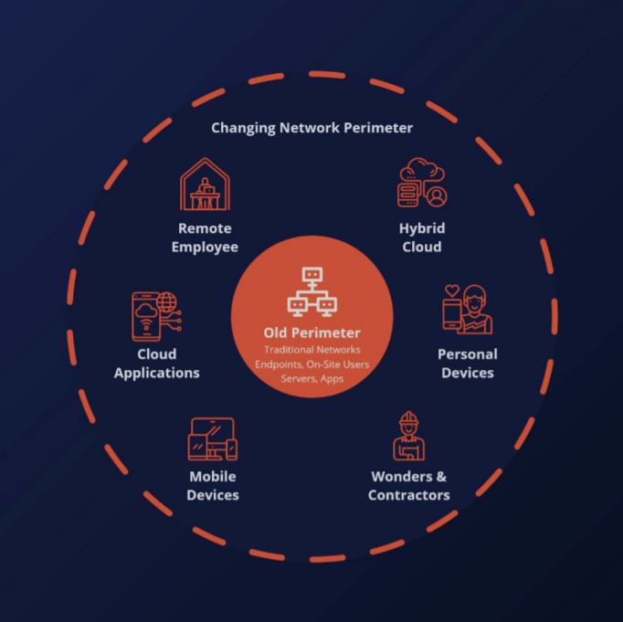
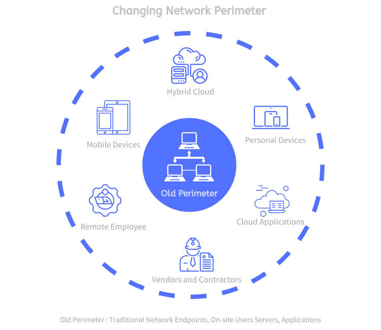
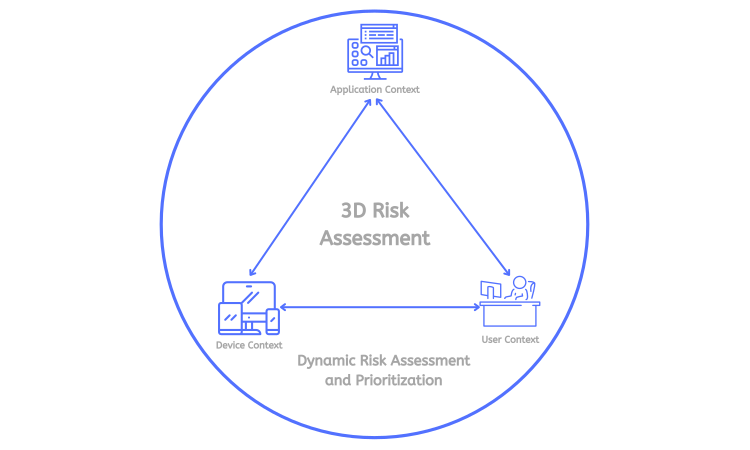

Popular legacy based security systems, such as the VPN, by default, trust  users and assets that are inside the network. However with the rapid emergence of cloud technologies & quick adaption of remote working norms, the existing security infrastructure has proved unequipped to handle the evolving challenges. The end user authentication modes can easily be compromised, exposing the organisation's digital resources to  external threats. Therefore, there was a need for a system that reimagined network security as we knew it. Hence, the idea of Zero Trust came into existence.

<!--  -->

## What is Zero Trust?

Traditional network centric security systems grant more trust than required, which can be exploited.

Zero Trust is a security model that doesn't trust any entity, whether inside or outside the network. Unlike traditional security systems which follow the 'Trust but Verify' approach, Zero Trust Models follow a 'Never Trust, Always Verify' approach, using strict access control policies and constant monitoring to secure enterprise networks from malware and other security threats. Zero trust ensures that each and every user and their devices are validated and given the least required access on a “need to know” basis. It also involves continuous monitoring of current users to identify malicious behaviour and revoke access accordingly.

## InstaSafe Approach

It is important to know how the InstaSafe Zero Trust architecture helps in ensuring better control and visibility over all network traffic, and in effect, helps in better threat detection and response. At InstaSafe, we help businesses by delivering comprehensive and uncompromising protection to mobile and remote workers, enabling them to safely and securely access enterprise apps, email, and web from anywhere on any network.

Zero Trust is an iterative process that starts with what you know, and as you tend to go deep through the process you gather information at a granular level which leads to having a clear understanding of the design.

**1.DEFINE PROTECT SURFACE**

This means protecting data and applications that are inside and outside the network and also it includes protecting all service such as connectivity protocols i.e. LDAP, DNS, etc.

**2.ARCHITECT ZERO TRUST NETWORK**

Networks are designed based on the business initiative at InstaSafe zero Trust secure access which provides comprehensive and uncompromising protection to mobile and remote workers enabling them to safely and securely access enterprise apps, email, and web from anywhere on any network.

**3.MAP TRANSACTION FLOWS**

In order to design a network it is always important to understand how the system should work. Without
having a proper understanding, it is not possible to design anything. This understanding of the system can be achieved by mapping and scanning the traffic flows inside the network to protect the surface of the network.
Once the system is understood this map will explain where to insert controls in order to protect data, applications, services, and networks. Zero Trust has an iterative workflow, which starts with what you know, and as we move forward we start understanding data and traffic flow at a granular level.

**4.CREATE A ZERO TRUST POLICY**

Once the architecture is completed it is very important to create supporting policies to the created
architecture around it because, for one resource to communicate with another resource, a specific rule must explicitly allow that traffic. Hence creating policy enables granular enforcement, so that only known allowed traffic or legitimate application communication is allowed in the network. This process significantly reduces the attack surface. 

Read more how Instasafe ZTAA secures enterprises  resources by minimizing insider threat [here](https://instasafe.com/zero-trust-application-access/). 

Further information on Zero trust can be found [here.](https://instasafe.com/zero-trust-software-defined-perimeter/)

## Glossary

This section contains description of the terminologies that are frequently used through out the document. Further information on the same  can be found in relevant sections of the documentation.

| Terminology | Reference |
| ------ | ------ |
|**User Group** | User Group refers to  functionality for clubbing of similar  users who share the roles, so that the same access control rules can be configured for them. |
| **Application** | Application here is a generalized term used for  any service running on  the organization's data centre or cloud. It may be a web based application, File server or virtual instances. |
|**Access Rules**| Access rules are a set of policies that govern user access to a particular application. The admin can configure access rules to define what resources are accessible to the user and what kind of access to the  particular resource is the user allowed. For example an HR employee may not have access to companies CRM applications while a sales user will have http/https access to the same. But an IT user may need SSH connection access to the same server.|
|**Perimeter**|Perimeter is the virtual boundary between the private and public side of a network. While the public resources are universally accessible, whereas the private Resources are accessible only to authorized individuals. An important characteristic of virtual perimeter is that it varies from person to person depending upon access rules configured for the person.|
|**Agent**|Agent is a lightweight software module that can be installed on the user device. “Agent”  resides on the client’s machines and connects the client to  the required resource after performing necessary security checks and validations defined by the company operating the Zero Trust Network|
|**Gateway**|Gateway is a lightweight software module that can be installed on a physical server/VM (which runs in the data centre) or an instance ( in the cloud-hosted data centre). The gateway is the relay point between the user and the application and point of access to all the applications secured by the ZTAA. An Gateway needs to be provisioned at every datacentre/cloud network environment where enterprise application are hosted. |
|**Auth Profile**| Auth profiles specifies the mode of authentication set for individual users. ZTAA supports authentication via multiple methods such as password, AD, SAML etc. Auth profile settings allows admin to set these for user on organisational, group as well as personal level.| 

