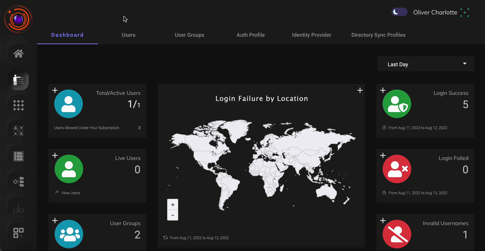

ZTAA supports user creation locally i.e directly from within the console or be imported from directory services such as AD or Azure. 

The following article highlights how a single user can be added directly.User addition via importing from directory services has been dealt with in later articles.Users can be created from the User Tab under Identity Management Section or directly from  Create User option in the  Quick setup section of the homescreen.

## Adding an User

The article describes the steps, how a individual can be added to ZTAA platform.Users can only be added by members with **Admin** or **Ownership** priviledge. 

| Role | |
| ------ | ----- |
| Owner| The principal admin account associated with a company,it is generally  the first account created for a company.  Ownership can be transfered to  another admin user within the company.An Owner account cannot be deleted. |
|  Admin| Admin are responsble for managing activities on the ZTAA platform  and have the right to add/delete/edit configurations in the console.|
| Read Only Admin| Readonly Admin or subadmins have limited priviledge access i.e  they can view but cannot modify configurations in the console.|
| Regular User| Regular users using the product for access to enterprise  application and cannot veiw or modify any configurations.|
| Security Admin| Security Admin User is an individual with privileged access and responsibilities for managing and enforcing security measures in the console.|
| Identity Admin | Identity Admin is responsible for managing and overseeing user identities within a system, including user authentication, authorization, and maintaining accurate user information, to ensure secure access and compliance with organizational policies.|
| Network Admin| Network Admin is tasked with configuring, maintaining, and securing an organization's computer networks, ensuring optimal functionality, performance, and safeguarding against potential cyber threats through the console.|
| Log Admin | Log Admin monitors and analyzes logs, identifying and addressing security incidents while maintaining the integrity and confidentiality of log data in the company's console.|


1.  In the User Section, Click on **Create New User** button.

2.  Enter Relevant Details and Click on Add User. 

```
1- Email addresses will be confirmed by sending an invitation email 
with a unique registration link to each new Member.

2- The member's user name is used as a unique identifier of Members 
in your workspace.

3- Phone Number will be used for two factor authentication of user 
via SMS.

4- The Owner Type toggle will enable/disable admin privileges.
```

3. The new User account will be created and the user will be notified by Mail.

```
An admin can add multiple team  members until the total license subscribed 
is met.
```
The above steps and the process of creating an user can be seen in the video below.


