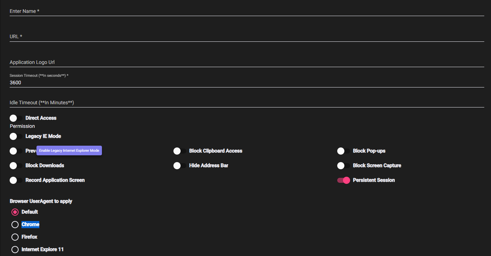
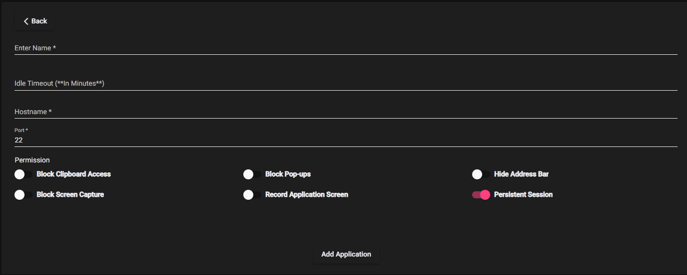
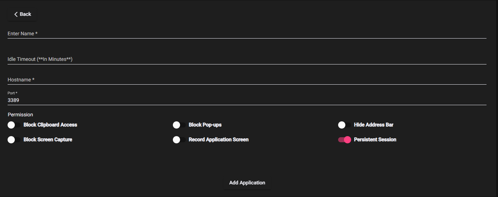
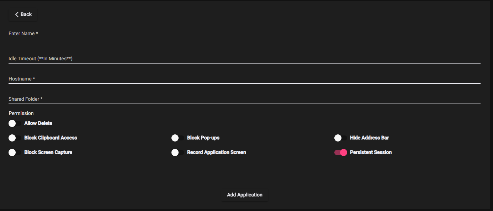
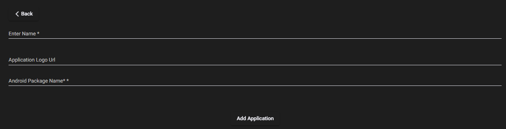
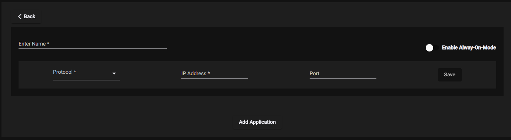

ZTAA supports granular level access control to application i.e in addition to administrators  controlling which user has access to which resource, they can also configure the type of access. Application is  defined as any service running on  the organization's data center or cloud, for which secure access is to be provided through ZTAA. It may be a web application, private application, File server or virtual instances.

## Steps to Add an Application

Applications can be created from the **‘Application’** tab in the **Perimeter Management Section** or by directly clicking on **‘Create Application Tab’** in the  Quick setup section of the dashboard .

1.  In the User Section, Click on **Create New Application** button.

2. Select  Application Type/Access type.

| Application Type |  |
| ------ | ------ |
|**Web Application** | Any simple internet application(SAAS application) to be accessed via URL/Public Ip. Example https://deemoadmin-trials72.orangehrmlive.com/ |
|**SSH Application** | Any linux server/virtual machine to which SSH access is required through ZTAA secure browser.|
|**RDP Application** | Any windows server/virtual machine to which RDP access is required through ZTAA. |
|**Fileserver** | Any server or drive responsible for storage and managing access to documents to other users of the organization |
|**Network Application** |Any private application running on internal server or cloud and is to be accessed through  private IP and dedicated port over secured VPN connectivity|
|**IOS and Android Application** |For controlling access to application running on IOS or Android environment |

3.  Enter relevant details and click on Add Application. 


### For Web Application

```
Application Name - Unique Identifier for the application.

URL- WEB url of the application or link over which the application is to 
be accessed.

Logo URL - Location of the image that is to be displayed as the logo of 
the application.

Session Timeout-  Duration after which the user will be locked out.

Idle Timeout- Duration after which the user will be logged out, if 
application is left idle.

Direct Access- To allow access using system's default traffic. To be ON 
incase access via browser is to be allowed. Also enable Open Externally tab which 
appears only if Direct access is enabled.

The below permissions can be enabled or disabled using the adjacent toggle button 
provided.

    Legacy IE Mode - To enable access from older versions of Internet Explorer

    Prevent Client Checks- To Disable strict network check for user client.

    Block Clipboard Access- To apply restrictions on Copy/Paste functions

    Block Pop-ups- To block pop ups within application.

    Block Downloads- To prevent user from downloading any file from the application

    Hide Address Bar- Prevent the URL of the application from being displayed in client.

    Block Screen Capture- Prevent user from taking screenshot or record any thing being 
    displayed 

    Record Application Screen- Switch on recording of user activities for a perticlar application
    in client and can be accessed in appliation recording logs under Audit logs.

The Admin can enable access from certain browsers. 
```


### For SSH Application

```
Application Name - Unique Identifier for the application.

Idle Timeout- Duration after which the user will be logged out, if application is left idle.

Host Name- Combination of Username and Ip address of the linux machine, to identify and connect to the machine.

Port- Port over which SSH connection will happen. Default value is 22.

The below permissions can be enabled or disabled using the adjacent toggle button provided.

    Block Clipboard Access- To apply restrictions on copy/Paste functions

    Block Pop-ups- To block pop ups within application.

    Block Downloads- To prevent user from downloading any file from the application

    Hide Address Bar- Prevent the URL of the application from being displayed in client.

    Block Screen Capture- Prevent user from taking screenshot or record any thing being 
    displayed 

    Record Application Screen- Switch on recording of user activities for a particular application
    in client and can be accessed in application recording logs under Audit logs.

    Persistent Session- Prevent user from being timed out 
    ```


### For RDP Application

```
Application Name - Unique Identifier for the application.

Idle Timeout- Duration after which the user will be logged out, if application is left idle.

Host Name- Combination of Username and Ip address of the windows machine, to identify and connect to the machine.

Port- Port over which ssh connection will happen. Default value is 22.

The below permissions can be enabled or disabled using the adjacent toggle button provided.

    Block Clipboard Access- To apply restrictions on copy/Paste functions

    Block Pop-ups- To block pop ups within application.

    Block Downloads- To prevent user from downloading any file from the application

    Hide Address Bar- Prevent the URL of the application from being displayed in client.

    Block Screen Capture- Prevent user from taking screenshot or record anything being 
    displayed 

    Record Application Screen- Switch on recording of user activities for a particular application
    in client and can be accessed in application recording logs under Audit logs.

    Persistent Session- Prevent user from being timed out
```


### For Fileserver Application

```
Application Name - Unique Identifier for the application.

Idle Timeout- Duration after which the user will be logged out, if application is left idle.

Host Name- Combination of Username and IP address of the machine,to identify and connect to the machine.

Shared Folder- Path of the folder within the server.

The below permissions can be enabled or disabled using the adjacent toggle button provided.

    Allow Delete- Give the user permission to delete files from the fileserver. 

    Block Clipboard Access- To apply restrictions on copy/Paste functions.

    Block Pop-ups- To block pop ups within application.

    Block Downloads- To prevent user from downloading any file from the application.

    Hide Address Bar- Prevent the URL of the application from being displayed in client.

    Block Screen Capture- Prevent user from taking screenshot or record anything being 
    displayed.

    Record Application Screen- Switch on recording of user activities for a particular application
    in client and can be accessed in application recording logs under Audit logs.

    Persistent Session- Prevent user from being timed out.
    ```



### For IOS and Android Application

```
Application Name - Unique Identifier for the application.

Logo URL - Location of the image that is to be displayed as the logo of the application.

HostName(IOS)- The name of the host device on which the process is executing.

Package Name (IOS/Android)- Used to uniquely identify the app on the device.

```


### For Network Application

```
Application Name - Unique Identifier for the application.

Protocol- Internet Protocol over which connection is to be established.

IP addresses- Private IP of the application server.

Port (Range)- Port over which communication is to happen.

```


4. Click on add application and the application will be created.


