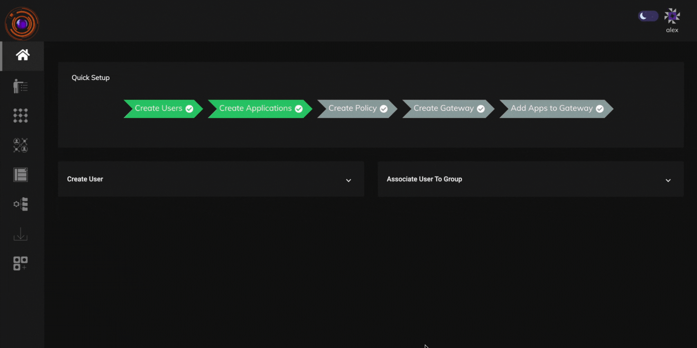

### Prerequisite

The  company admin must ensure that the following prerequisites are met prior to installation of InstaSafe ZTAA gateways. It is recommended to set up a backup InstaSafe Gateway, with the same configuration for the purpose of redundancy.


| Virtual Machine Parameter | Requirement  |
|-----------------------|--------------------------|
| **Operating System** |Ubuntu 22.04.2 LTS(server edition)  |
| **OS Type**|64-bit |
| **RAM** | Minimum 8 GB|
|**Hard Disk**|Minimum 30GB of free space  |
| **CPU**|2 x Dual Core processor (x64 based) |

#### Network Parameter 

**For TCP Gateways**

|Source | Destination  | Port | Direction |
|----------------------- |-------------------------- |---------------------- | -------------------------- |
| ANY | TCP Gateway  | TCP 443| Inbound |
| InstaSafe Gateways | ANY (Private NetworkTCP80, TCP443-public internet) | ANY | Outbound |


**For RDP Gateways**

|Source | Destination  | Port | Direction |
|----------------------- |-------------------------- |---------------------- | -------------------------- |
| ANY | RDP Gateway  | TCP 8080 | Inbound |
| Instasafe Gateways | ANY (Private NetworkTCP80, TCP443-public internet) | ANY | Outbound |

**For Network Gateways**

|Source | Destination  | Port | Direction |
|----------------------- |-------------------------- |---------------------- | -------------------------- |
| ANY | Network Gateway | UDP 443 | Inbound |
| InstaSafe Gateways | ANY (Private NetworkTCP80, TCP443-public internet) | ANY | Outbound |


**Please Note**

```
1. InstaSafe ZTAA Gateways has inbuilt firewall features and hence is equipped to handle  network traffic coming from unknown sources, 
even when network firewall allows traffic from any source.

2. If any proxy configuration is present, it must be ensured that direct connection from the firewall is allowed.

```


### Installing the Gateway  

1. Login as Admin
2. Go to the Download Section and copy the Gateway installation script. 
3. Paste the same in the gateway server.
4. Choose the type of gateway you want to install. Please refer the [gateway](https://docs.instasafe.io/Zero%20Trust%20Application%20Access/006agateway/) section of the documentation to know more about the different types of gateways available on ZTAA. 
5. Enter 1 to begin installation.

```
**P.S ZTAA VPN component only works on NAT and hence the gateway needs to be installed in DMZ.**
```
6. Once installation is completed, an access code will be generated. Copy the same.

   
### Setting in Console

1. In the console go to Gateways under perimeter management . Select a new Private Gateway and click next.

2. Paste the access code and click next.
  
3. Click on Authorize and wait for the gateway to be online.

The above steps as well as detailed guide on how to install the gateway can be viewed in the video below. 


