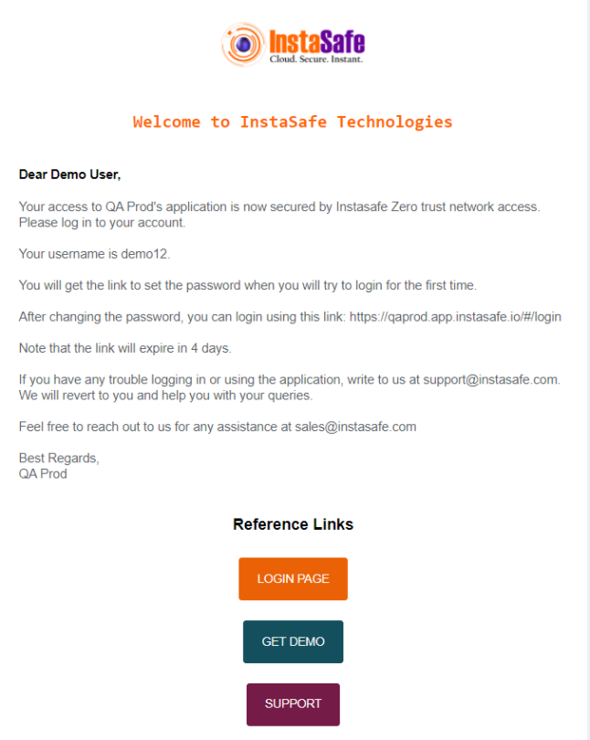
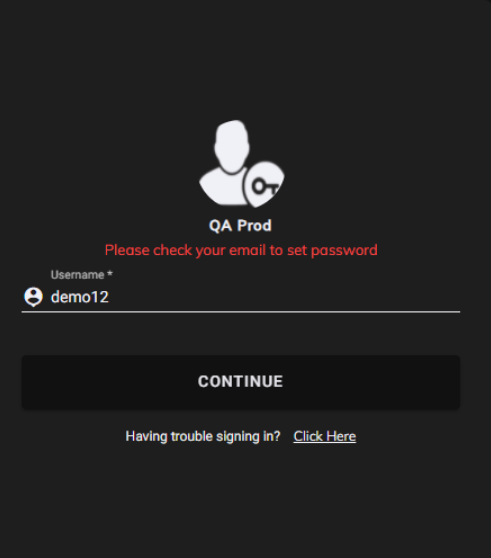
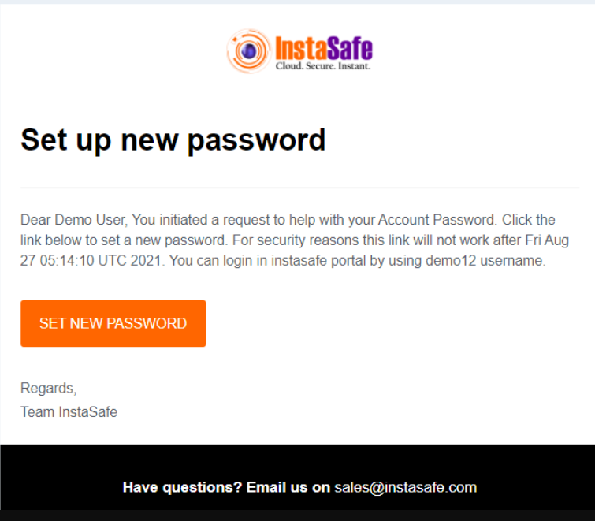
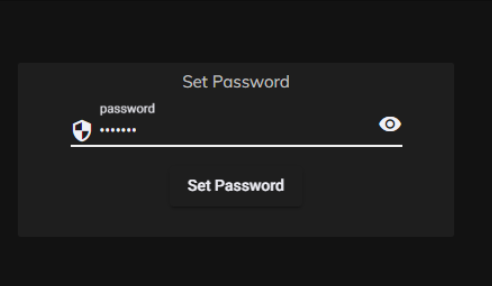

Once the profile for an user is created by the admin, the user has to set the password himself. The folowing steps will help the user set up a profile password.

1. On Provisioning an user will receive a mail providing him with details of user name and URl for login. 

2. The User can visit the **login page** and enter the ** user-name** mentioned in the mail.

3. When the user is logging for the first time  password a mail for setting the password will be sent to his mail.

 

4. The user can set a new password using the link.

5. For subsequent login the user can directly login using the User Name and password set.
